# AI-Enabled Secure C2 Platform for Counter-UAS Operations
## Enterprise Architecture & Implementation Plan

| Field | Value |
|---|---|
| Document ID | CUAS-ARCH-001 |
| Revision | 1.0 |
| Date | 18 July 2026 |
| Classification | UNCLASSIFIED / Academic — Institutional Use |
| Programme | NUST CEME — Department of Computer & Software Engineering |
| Team | Kaleem Ullah, Muhammad Ahmad Ameen, Syed Rehan Ejaz Shah |
| Supervisor | Dr. Muhammad Shafiq |
| Basis Document | *AI-Enabled UAS Detection, Reporting, and Engagement Platform for Pakistan Army Mobile Communication System* (Research Proposal, 6 July 2026) |
| Execution Window | 16 weeks — W1 commencing 20 July 2026, W16 concluding 8 November 2026 |

---

# 1. Executive Summary

## 1.1 The System in One Page

This platform is the **software integration layer** between counter-UAS detection hardware that already exists and engagement assets that remain under human authority. It ingests heterogeneous sensor streams (RF, radar, EO/IR, acoustic, GNSS), normalises them into a single canonical detection record, correlates them into tracks, invokes specialised AI services per modality, fuses their evidence, scores each track for threat, and presents an operator with a decision rather than a puzzle.

The prototype delivers a Dockerised, twelve-service backend, an operator-grade React dashboard, four AI inference services, a Kafka-backed real-time pipeline, and a measured evaluation of the project's headline claim: **multi-sensor fusion reduces false positives relative to any single modality**.

Engagement — RF jamming, GNSS spoofing, cyber takeover — is explicitly outside the software boundary. The platform emits *recommendations* with confidence and rationale; every recommendation terminates at an operator authorisation gate that is RBAC-controlled and written to a tamper-evident audit log. This is an architectural constraint, not a disclaimer: there is no code path in the system that emits an RF-active command.

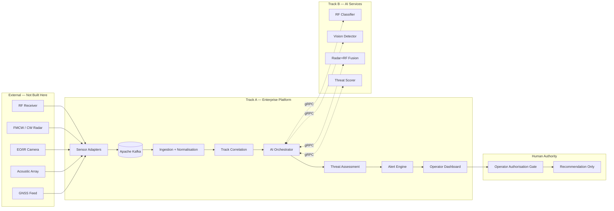

## 1.2 Why This Architecture Is Enterprise-Grade

| Property | Mechanism | Consequence |
|---|---|---|
| **Service independence** | Twelve backend services, each owning its schema; no shared tables | A team of three can work three services concurrently without merge contention |
| **Sensor agnosticism** | Canonical `DetectionRecord` at the adapter boundary | New modality = one adapter, zero pipeline changes (proposal §4) |
| **AI decoupling** | AI Orchestrator speaks one gRPC contract; every model is a swappable provider behind it | Track B ships models on its own timeline; Track A never blocks |
| **Backpressure safety** | Kafka between every stage; consumers are independently lagged | A slow GPU inference service degrades latency, never drops ingestion (proposal §6) |
| **Evidential integrity** | Hash-chained audit log + Elasticsearch event store | Every alert traces to the detections and model versions that produced it |
| **Reproducibility** | Model registry, semantic model versions carried on every inference response | An evaluation result from Week 14 can be regenerated in Week 30 |
| **Zero-trust posture** | mTLS between services, JWT at the edge, no implicit trust from network position | Survives cybersecurity review as a defence-adjacent system |

## 1.3 Why UI/UX and Backend Are Built First

This is the central sequencing decision of the programme, and it is deliberate.

**1. The operator experience is the deliverable that gets evaluated.** A faculty panel, a military communications engineer, and an enterprise architect all assess the same artefact: what appears on screen when a drone enters the airspace. A 94% F1 RF classifier presented through an unusable interface demonstrates nothing. The dashboard is the product; the models are components inside it.

**2. The contract must precede the implementation.** Track B cannot develop against an undefined interface. By specifying `InferenceRequest`/`InferenceResponse` in Week 2 and implementing **mock inference providers** that return schema-valid synthetic results with realistic latency distributions, the entire platform runs end-to-end from Week 6 — with zero trained models. Every subsequent model is a drop-in replacement validated against a contract that already has a working reference implementation.

**3. Integration risk is the dominant schedule risk, and it must be retired early.** The proposal's risk register (§15) rates integration complexity Medium and model latency High. Both are discovered late in model-first projects, when there is no schedule left to absorb them. Building the pipeline first converts these from end-of-project surprises into Week 6 measurements.

**4. Platform work is parallelisable; model work is not.** Frontend, backend, and infrastructure decompose cleanly across three engineers. Model training is serialised behind dataset preparation and GPU availability. Starting the parallelisable work first maximises schedule utilisation.

**Consequence:** by end of Week 8 the system detects, tracks, scores, alerts, and displays — driven entirely by replayed dataset traffic and mocked inference. Weeks 9–12 swap mocks for real models one at a time, each swap being a configuration change and a container image tag.

## 1.4 Two-Track Execution Model

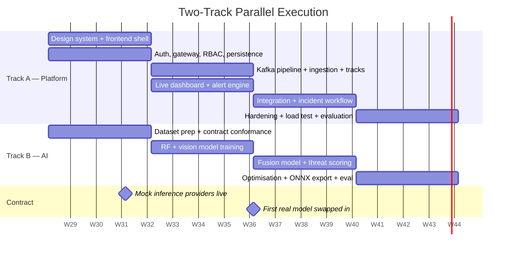

The two tracks meet at exactly one place: the **AI Service Contract** (§6.2). It is frozen at end of Week 2 and versioned thereafter. Neither track reads the other's code.

---

# 2. Enterprise UI/UX Strategy

The operator experience is designed before any AI integration. This section is the specification the frontend implements against.

## 2.1 Design Language

### 2.1.1 Design Principles

| Principle | Application |
|---|---|
| **Data density over whitespace** | Command centres are not marketing sites. Target 3–5× the information density of a consumer SaaS dashboard. |
| **Colour carries meaning only** | Colour is reserved for threat state, sensor health, and confidence. Decorative colour is prohibited. |
| **No illustration, no iconography for its own sake** | Icons are functional glyphs from a single geometric set (Lucide, 1.5px stroke, 16/20/24px). No stickers, no mascots, no gradients-as-decoration. |
| **Dark-first** | Operators work in low-light rooms for long shifts. The dark theme is the primary design target; light theme is a supported secondary. |
| **Motion signals change, never delight** | Animation exists to draw the eye to a state transition. Duration ≤ 200ms. Nothing loops except a live-data heartbeat. |
| **Never hide state behind a hover** | Anything an operator must know is visible without interaction. Hover reveals detail, never existence. |

### 2.1.2 Colour System

Neutral scale (dark theme primary surfaces):

| Token | Hex | Use |
|---|---|---|
| `--bg-canvas` | `#0A0E14` | Application background |
| `--bg-surface` | `#111721` | Panel background |
| `--bg-surface-raised` | `#161D29` | Cards, popovers, modals |
| `--bg-surface-overlay` | `#1C2534` | Dropdowns, tooltips |
| `--border-subtle` | `#212B3A` | Panel dividers |
| `--border-default` | `#2C384B` | Input borders, table rules |
| `--border-strong` | `#3D4C63` | Focus-adjacent, active dividers |
| `--text-primary` | `#E6EDF7` | Body, values |
| `--text-secondary` | `#9AA9BF` | Labels, metadata |
| `--text-tertiary` | `#6B7A91` | Disabled, timestamps |
| `--text-inverse` | `#0A0E14` | Text on solid accent fills |

Semantic scale — **threat states**. These four colours are the only saturated hues permitted on the operations surfaces:

| Token | Hex | Meaning | Contrast on `--bg-surface` |
|---|---|---|---|
| `--threat-critical` | `#FF4D4F` | Confirmed hostile, immediate action | 5.9:1 |
| `--threat-high` | `#FF8A3D` | High threat score, operator decision required | 8.1:1 |
| `--threat-medium` | `#FFC53D` | Elevated, monitor | 11.4:1 |
| `--threat-low` | `#3DD68C` | Benign / cleared | 8.7:1 |
| `--threat-unknown` | `#8B98AC` | Insufficient evidence, awaiting fusion | 6.2:1 |

Functional scale:

| Token | Hex | Use |
|---|---|---|
| `--accent-primary` | `#3B82F6` | Interactive: buttons, links, selected row |
| `--accent-primary-hover` | `#60A5FA` | Hover state |
| `--status-online` | `#3DD68C` | Sensor healthy |
| `--status-degraded` | `#FFC53D` | Sensor degraded / high latency |
| `--status-offline` | `#FF4D4F` | Sensor offline |
| `--status-standby` | `#6B7A91` | Sensor disabled by operator |
| `--focus-ring` | `#7DD3FC` | 2px outline, 2px offset, all interactive elements |

**Colour-blind safety.** Threat state is never encoded by colour alone. Every threat indicator carries a redundant channel:

| Threat | Colour | Shape token | Text label |
|---|---|---|---|
| Critical | Red | Filled triangle ▲ | `CRIT` |
| High | Orange | Filled diamond ◆ | `HIGH` |
| Medium | Amber | Filled square ■ | `MED` |
| Low | Green | Filled circle ● | `LOW` |
| Unknown | Grey | Hollow circle ○ | `UNK` |

**Confidence encoding.** Model confidence is encoded as opacity (40%→100%) plus a numeric percentage, never as a separate hue — hue is reserved for threat.

### 2.1.3 Typography Scale

Two families. `Inter` (variable) for UI; `JetBrains Mono` for all numerics, identifiers, coordinates, and timestamps — tabular figures are mandatory so that streaming values do not cause horizontal jitter.

| Token | Size / Line | Weight | Tracking | Use |
|---|---|---|---|---|
| `display` | 32 / 40 | 600 | -0.02em | Login title, empty-state headline |
| `h1` | 24 / 32 | 600 | -0.015em | Screen title |
| `h2` | 20 / 28 | 600 | -0.01em | Panel title |
| `h3` | 16 / 24 | 600 | 0 | Card title, section header |
| `body-lg` | 15 / 22 | 400 | 0 | Report prose, incident narrative |
| `body` | 14 / 20 | 400 | 0 | Default UI text |
| `body-sm` | 13 / 18 | 400 | 0 | Table cells, dense lists |
| `label` | 12 / 16 | 500 | 0.02em | Field labels, column headers |
| `caption` | 11 / 14 | 500 | 0.04em, uppercase | Metadata, status chips |
| `mono-lg` | 20 / 28 | 500 | 0 | KPI values, primary telemetry |
| `mono` | 13 / 18 | 400 | 0 | Track IDs, coordinates, timestamps |
| `mono-sm` | 11 / 16 | 400 | 0 | Log lines, hash digests |

Minimum rendered size anywhere in the product: **11px**, and only for non-essential metadata. Operational values never fall below 13px.

### 2.1.4 Spacing — 8-Point System

Base unit 8px, with a 4px half-step for intra-component spacing only.

| Token | px | Use |
|---|---|---|
| `space-0.5` | 4 | Icon-to-label, chip padding |
| `space-1` | 8 | Dense table cell padding, tight stacks |
| `space-2` | 16 | Default component padding, form field gap |
| `space-3` | 24 | Card padding, panel inset |
| `space-4` | 32 | Section separation |
| `space-6` | 48 | Major layout region gap |
| `space-8` | 64 | Page-level margins (desktop) |

Layout grid: 12-column, 24px gutter, fluid with `min-width: 1280px` on operations screens. Below 1280px the operations dashboard enters a documented degraded layout (§2.3).

### 2.1.5 Border Radius

Restrained. Sharp geometry reads as instrumentation; heavy rounding reads as consumer software.

| Token | px | Use |
|---|---|---|
| `radius-none` | 0 | Table cells, map overlay edges, data grid |
| `radius-sm` | 4 | Inputs, chips, badges, buttons |
| `radius-md` | 6 | Cards, panels |
| `radius-lg` | 8 | Modals, popovers, drawers |
| `radius-full` | 9999 | Status dots, avatar, count pills only |

### 2.1.6 Elevation

Dark-theme elevation is expressed primarily through **surface luminance**, with shadow as a secondary cue. Pure-shadow elevation is invisible on `#0A0E14`.

| Level | Surface | Shadow | Use |
|---|---|---|---|
| `e0` | `--bg-canvas` | none | Page background |
| `e1` | `--bg-surface` | `0 1px 2px rgba(0,0,0,.4)` | Panels, static cards |
| `e2` | `--bg-surface-raised` | `0 2px 8px rgba(0,0,0,.5)` | Interactive cards, dropdown triggers |
| `e3` | `--bg-surface-overlay` | `0 8px 24px rgba(0,0,0,.6)` | Popovers, menus, tooltips |
| `e4` | `--bg-surface-overlay` | `0 16px 48px rgba(0,0,0,.7)` + backdrop blur 8px | Modals, command palette |
| `e-alert` | `--bg-surface-raised` | `0 0 0 1px var(--threat-critical), 0 4px 16px rgba(255,77,79,.25)` | Critical alert toast |

### 2.1.7 Accessibility — WCAG 2.1 AA

| Requirement | Criterion | Implementation |
|---|---|---|
| Text contrast ≥ 4.5:1 | 1.4.3 | All token pairs pre-validated; CI runs `axe-core` contrast audit on Storybook build |
| Non-text contrast ≥ 3:1 | 1.4.11 | Borders, focus rings, map track glyphs, chart series all validated |
| Colour not sole channel | 1.4.1 | Shape + text label redundancy on every threat state (§2.1.2) |
| Keyboard operable, no traps | 2.1.1 / 2.1.2 | Every action reachable by keyboard; map has full keyboard track cycling (§2.3) |
| Visible focus | 2.4.7 | 2px `--focus-ring`, 2px offset, never suppressed |
| Motion sensitivity | 2.3.3 | `prefers-reduced-motion` disables pulse/flash; alerts fall back to a static border + audio |
| Flash threshold | 2.3.1 | No element flashes above 3Hz. Critical alert pulse is 0.8Hz. |
| Status announcement | 4.1.3 | New critical alerts announced via `aria-live="assertive"`; track updates via `aria-live="polite"` on a throttled summary region, never per-update |
| Target size | 2.5.5 (AAA, adopted) | Interactive targets ≥ 44×44px on primary action paths |
| Timeouts | 2.2.1 | Session expiry warned at 2 minutes remaining with extend action |
| Zoom | 1.4.4 | 200% zoom supported without horizontal scroll on all non-map screens |

**Audio alerting.** Critical alerts carry a distinct 2-tone chime; high alerts a single tone; medium and below are silent. Audio is a supplement to, never a replacement for, visual state. Per-operator mute is persisted and surfaced as a permanent header indicator so a muted console is never mistaken for a quiet airspace.

## 2.2 Dashboard Information Architecture

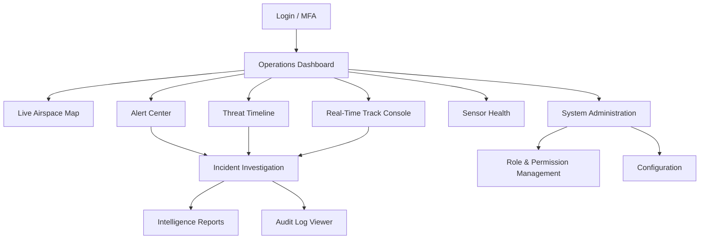

| # | Screen | Route | Min Role | Refresh Model |
|---|---|---|---|---|
| 1 | Login / MFA | `/auth/login` | — | Static |
| 2 | Operations Dashboard | `/ops` | `VIEWER` | WebSocket, 4 Hz coalesced |
| 3 | Live Airspace Map | `/ops/map` | `VIEWER` | WebSocket, 10 Hz render |
| 4 | Real-Time Track Console | `/ops/tracks` | `VIEWER` | WebSocket, 4 Hz |
| 5 | Threat Timeline | `/ops/timeline` | `VIEWER` | WebSocket + historical query |
| 6 | Sensor Health | `/ops/sensors` | `VIEWER` | WebSocket, 1 Hz |
| 7 | Alert Center | `/alerts` | `OPERATOR` | WebSocket, immediate |
| 8 | Incident Investigation | `/incidents/:id` | `OPERATOR` | Query + replay |
| 9 | Audit Log Viewer | `/audit` | `AUDITOR` | Query, paginated |
| 10 | Intelligence Reports | `/reports` | `ANALYST` | Query + async generation |
| 11 | System Administration | `/admin` | `ADMIN` | Query |
| 12 | Role & Permission Mgmt | `/admin/rbac` | `ADMIN` | Query |

## 2.3 Operator-Centric UX Specification

### Screen 1 — Login / MFA

- **Primary goal:** authenticate an operator into a shift in under 15 seconds.
- **Critical actions:** credential submit; TOTP entry; certificate-based login (future); session-role selection where an account holds multiple roles.
- **Keyboard:** `Enter` submits; TOTP field auto-advances per digit and auto-submits on the 6th; `Esc` clears.
- **Alert logic:** N/A. Failed attempts show remaining-attempt count; lockout at 5 shows a duration countdown, never a bare rejection.
- **Mobile vs desktop:** fully responsive; the only screen designed mobile-first, because a duty officer may authenticate from a phone to acknowledge an alert.
- **Notes:** classification banner (`UNCLASSIFIED // ACADEMIC`) is pinned top of viewport on every screen including login. Last-successful-login and last-failed-login are displayed post-authentication.

### Screen 2 — Operations Dashboard

- **Primary goal:** answer "what is in my airspace right now, and what needs me?" in under 3 seconds of glance time.
- **Critical actions:** acknowledge a critical alert; drill into the highest-threat track; declare an incident; toggle sector filter.
- **Keyboard:** `1–6` jump to workspace panels; `A` acknowledge top alert; `D` declare incident from selected track; `/` command palette; `?` shortcut overlay; `Space` pause the live feed (with a permanent, unmissable PAUSED banner).
- **Alert prioritisation:** ordered by `(threat_level DESC, threat_score DESC, time_to_closest_approach ASC, first_seen ASC)`. Critical alerts break out of the list into a persistent top-of-viewport strip that cannot be dismissed, only acknowledged. Unacknowledged critical alerts escalate after 30 seconds (audio repeat + supervisor notification).
- **Mobile vs desktop:** desktop-only for operational use (≥1280px). Below that, serve a **read-only situational summary** — alert count by severity, active track count, sensor health rollup — with an explicit "Full console requires a wider display" notice. Never degrade silently into an unusable grid.

### Screen 3 — Live Airspace Map

- **Primary goal:** maintain spatial situational awareness of all active tracks and sensor coverage.
- **Critical actions:** select track; measure range/bearing; toggle sensor coverage overlays; toggle trajectory prediction; set a geofence; centre on a track and lock follow.
- **Keyboard:** `Tab` cycles tracks in threat order (announcing each via `aria-live`); `Enter` selects; `F` follow-lock; `M` measure mode; `G` geofence draw; `C` toggle coverage rings; `T` toggle predicted trajectories; `+`/`-` zoom; `0` reset view; `Esc` deselect.
- **Alert logic:** a new critical track triggers a single 600ms camera ease to bring it into view **only if the operator has not manually panned in the last 10 seconds** — never yank the viewport from someone actively working.
- **Mobile vs desktop:** desktop-only.

### Screen 4 — Real-Time Track Console

- **Primary goal:** work the track list as a triage queue — assess, classify, escalate, or clear.
- **Critical actions:** select; classify (hostile / benign / unknown); escalate to incident; mark for follow-up; add operator note; view per-sensor evidence contributions.
- **Keyboard:** `J`/`K` next/previous track (vim-style, muscle-memory for sustained triage); `Enter` open detail; `H` mark hostile; `B` mark benign; `U` mark unknown; `E` escalate; `N` note; `Shift+J/K` extend multi-select; `Cmd/Ctrl+A` select all visible.
- **Alert logic:** rows sort by threat descending by default; a row whose threat level *increases* flashes its left border for 1.2s and pins to top for 5s before re-sorting, so a rising threat is never lost mid-scroll.
- **Mobile vs desktop:** desktop-only.

### Screen 5 — Threat Timeline

- **Primary goal:** understand how the airspace picture evolved over a window, and reconstruct sequence for after-action review.
- **Critical actions:** scrub time; set window; filter by sensor/threat/track; export window to incident; play back at 1×/2×/8×.
- **Keyboard:** `←`/`→` step one event; `Shift+←/→` step 1 minute; `Space` play/pause replay; `[`/`]` set window start/end; `L` toggle live-follow.
- **Alert logic:** in replay mode a permanent amber "HISTORICAL — NOT LIVE" banner occupies the top strip. Live alerts continue to arrive in a separate collapsed rail with an unread count.
- **Mobile vs desktop:** tablet-supported read-only; desktop for full interaction.

### Screen 6 — Sensor Health Monitoring

- **Primary goal:** know instantly whether the operational picture can be trusted.
- **Critical actions:** view per-sensor status/latency/message rate; acknowledge a sensor fault; place a sensor in maintenance standby; view ingestion lag; view calibration/sync drift.
- **Keyboard:** `J`/`K` navigate sensors; `Enter` detail; `A` acknowledge fault; `S` toggle standby (requires `ENGINEER` role + confirmation).
- **Alert logic:** a sensor transitioning to offline raises a **system alert**, visually distinct from threat alerts (blue-grey chrome, not red) so infrastructure faults are never confused with airspace threats. Coverage loss is computed and reported as an affected-sector polygon, not just a device name.
- **Mobile vs desktop:** responsive down to tablet; this is the one operations screen a duty engineer legitimately checks from a phone.

### Screen 7 — Alert Center

- **Primary goal:** ensure no alert is missed, and every alert has an owner and an outcome.
- **Critical actions:** acknowledge; assign; resolve with disposition; bulk-acknowledge below a severity threshold; open the originating track.
- **Keyboard:** `J`/`K` navigate; `A` acknowledge; `R` resolve; `Shift+A` bulk-acknowledge selection; `O` open source track; `F` filter.
- **Alert logic:** three buckets — Unacknowledged / In Progress / Resolved. Unacknowledged criticals cannot be bulk-actioned; each requires an individual, deliberate acknowledgement with the operator identity recorded.
- **Mobile vs desktop:** responsive; acknowledge and assign are mobile-supported for on-call duty officers. Resolve-with-disposition is desktop-only.

### Screen 8 — Incident Investigation

- **Primary goal:** reconstruct a complete, defensible account of what happened and what was decided.
- **Critical actions:** replay incident timeline; inspect per-modality evidence with model version and confidence; review the decision chain; attach analyst notes; generate report; export evidence bundle.
- **Keyboard:** `Space` play/pause; `←`/`→` frame step; `1–5` jump to evidence tab by modality; `N` note at current timestamp; `G` generate report; `X` export bundle.
- **Alert logic:** none — this is a post-hoc surface. Live alerts appear only as a collapsed unread badge.
- **Mobile vs desktop:** desktop-only.

### Screen 9 — Audit Log Viewer

- **Primary goal:** let an auditor answer "who did what, when, and can I prove the record is intact?"
- **Critical actions:** query by actor/action/resource/time; verify hash chain; export signed audit extract.
- **Keyboard:** `/` focus query; `Enter` execute; `J`/`K` navigate; `V` verify chain segment; `E` export.
- **Alert logic:** a hash-chain verification failure renders a full-width, non-dismissible critical banner identifying the first broken link. This is the single highest-severity condition the UI can display.
- **Mobile vs desktop:** desktop-only.

### Screen 10 — Intelligence Reports

- **Primary goal:** produce a defensible written artefact from system data.
- **Critical actions:** select template (incident / daily summary / sensor performance / fusion efficacy); set parameters; generate; review; export PDF/JSON; share within role scope.
- **Keyboard:** `G` generate; `P` preview; `E` export; `Cmd/Ctrl+S` save draft.
- **Alert logic:** none. Long-running generation reports progress and notifies on completion; the operator is never blocked.
- **Mobile vs desktop:** tablet read-only; desktop for authoring.

### Screen 11 — System Administration

- **Primary goal:** configure the platform without touching a config file or restarting a service.
- **Critical actions:** register sensor; set threat-scoring policy thresholds; configure AI service endpoints and model versions; set retention policy; manage notification channels; feature flags.
- **Keyboard:** standard form navigation; `Cmd/Ctrl+S` save; `Esc` discard with confirm.
- **Alert logic:** every change shows a **before → after diff** and requires explicit confirmation. Threat-policy changes additionally require a justification string, which is written to the audit log.
- **Mobile vs desktop:** desktop-only.

### Screen 12 — Role & Permission Management

- **Primary goal:** manage who can do what, with the blast radius visible before commit.
- **Critical actions:** create/edit role; assign permissions; assign users; simulate effective permissions for a user; revoke session.
- **Keyboard:** `N` new role; `E` edit; `S` simulate; `Cmd/Ctrl+S` save.
- **Alert logic:** privilege escalation edits render an amber warning stating exactly which new capabilities the change grants, enumerated. Self-escalation is blocked outright at both UI and API.
- **Mobile vs desktop:** desktop-only.

## 2.4 Enterprise Wireframes

### 2.4.1 Main Operations Dashboard

```
┌────────────────────────────────────────────────────────────────────────────────────────────────┐
│ UNCLASSIFIED // ACADEMIC                                                    18 JUL 2026 14:32:07Z│
├────────────────────────────────────────────────────────────────────────────────────────────────┤
│ ◆ C-UAS C2   [Ops] Map  Tracks  Timeline  Alerts  Sensors │ ⌕ Search…  🔊 ON  ● LIVE  K.Ullah ▾│
├────────────────────────────────────────────────────────────────────────────────────────────────┤
│ ▲ CRITICAL  TRK-0473  DJI Mavic 3 · 87% · 1.2 km NE · closing 14 m/s      [ACK (A)] [OPEN (O)] │
├──────────────────────────────────────────┬─────────────────────────────────────────────────────┤
│  ACTIVE TRACKS                        12 │  LIVE AIRSPACE                        [MAP ▸]       │
│ ┌──────────────────────────────────────┐ │ ┌─────────────────────────────────────────────────┐ │
│ │▲CRIT TRK-0473  1.2km  NE   87% ●●●●○│ │ │           ·  ·   ╱ sector-N coverage             │ │
│ │◆HIGH TRK-0468  3.4km  E    74% ●●●○○│ │ │        ·      ▲473                               │ │
│ │◆HIGH TRK-0471  2.8km  SE   71% ●●●○○│ │ │    ·        ╱     ◆468                           │ │
│ │■MED  TRK-0462  5.1km  N    58% ●●○○○│ │ │  ○   ⊕SITE        ◆471                           │ │
│ │■MED  TRK-0455  6.7km  NW   52% ●●○○○│ │ │        ╲      ■462      ·                        │ │
│ │●LOW  TRK-0449  8.2km  W    31% ●○○○○│ │ │           ·  ╲   ■455                            │ │
│ │○UNK  TRK-0474  4.4km  S    ——  ○○○○○│ │ │              ·         ●449   ○474               │ │
│ │…6 more                               │ │ │  ▬▬▬ predicted   ○ sensor   ⊕ protected asset   │ │
│ └──────────────────────────────────────┘ │ └─────────────────────────────────────────────────┘ │
│  J/K navigate · Enter detail · E escalate│  Tab cycle · F follow · C coverage · M measure      │
├──────────────────────────────────────────┼─────────────────────────────────────────────────────┤
│  THREAT TIMELINE            last 15 min  │  SENSOR HEALTH                      7 of 8 nominal  │
│ ┌──────────────────────────────────────┐ │ ┌─────────────────────────────────────────────────┐ │
│ │CRIT│      ▲                          │ │ │ ● RF-01   ONLINE     42 ms   1.2k msg/s        │ │
│ │HIGH│   ◆     ◆  ◆                    │ │ │ ● RAD-01  ONLINE     31 ms   840 msg/s         │ │
│ │MED │ ■   ■ ■   ■    ■                │ │ │ ● RAD-02  ONLINE     35 ms   836 msg/s         │ │
│ │LOW │●  ● ●  ●   ● ●   ●              │ │ │ ● EO-01   ONLINE    118 ms    30 msg/s         │ │
│ │    └──┴──┴──┴──┴──┴──┴──┴──┴──┴──┴──│ │ │ ◐ EO-02   DEGRADED  412 ms    11 msg/s   ⚠      │ │
│ │   14:17      14:24      14:32       │ │ │ ● ACO-01  ONLINE     58 ms   440 msg/s         │ │
│ └──────────────────────────────────────┘ │ │ ● GNSS-01 ONLINE     22 ms     4 msg/s         │ │
│  ← → step · Space replay · L live       │ │ │ ○ ACO-02  STANDBY      —          —            │ │
│                                          │ │ Coverage loss: sector SE 2.1–4.0 km (EO-02)     │ │
│                                          │ └─────────────────────────────────────────────────┘ │
├──────────────────────────────────────────┴─────────────────────────────────────────────────────┤
│ Pipeline p95 412 ms │ Kafka lag 118 │ AI RF 31ms VIS 84ms FUS 47ms │ 12 tracks │ 3 unack alerts│
└────────────────────────────────────────────────────────────────────────────────────────────────┘
```

### 2.4.2 Live Track Console

```
┌────────────────────────────────────────────────────────────────────────────────────────────────┐
│ UNCLASSIFIED // ACADEMIC                                    ● LIVE   4 Hz   12 active tracks    │
├────────────────────────────────────────────────────────────────────────────────────────────────┤
│ Filter: [All sectors ▾] [Threat ≥ LOW ▾] [All sensors ▾] [Confidence ≥ 0% ▾]   ⌕ ______  (F)   │
├──────┬─────────┬────────┬───────┬──────┬───────┬──────┬────────────────┬──────┬────────────────┤
│ THR  │ TRACK   │ CLASS  │ CONF  │ RNG  │ BRG   │ ALT  │ SENSORS        │ AGE  │ ACTION         │
├──────┼─────────┼────────┼───────┼──────┼───────┼──────┼────────────────┼──────┼────────────────┤
│▲CRIT │ TRK-0473│ Mavic3 │  87%  │ 1.2km│ 048°  │ 120m │ RF RAD EO      │ 3m12s│ [ESC] [H] [B] │◀ selected
│◆HIGH │ TRK-0468│ Phantom│  74%  │ 3.4km│ 091°  │  85m │ RF RAD         │ 8m44s│ [ESC] [H] [B] │
│◆HIGH │ TRK-0471│ Unknown│  71%  │ 2.8km│ 134°  │ 210m │ RAD EO         │ 1m58s│ [ESC] [H] [B] │
│■MED  │ TRK-0462│ Mavic2 │  58%  │ 5.1km│ 002°  │  60m │ RF             │12m03s│ [ESC] [H] [B] │
│■MED  │ TRK-0455│ Unknown│  52%  │ 6.7km│ 318°  │ 145m │ RAD            │ 6m21s│ [ESC] [H] [B] │
│●LOW  │ TRK-0449│ Bird   │  31%  │ 8.2km│ 271°  │  40m │ RAD ACO        │15m40s│ [ESC] [H] [B] │
│○UNK  │ TRK-0474│   ——   │  ——   │ 4.4km│ 187°  │  ——  │ ACO            │ 0m18s│ [ESC] [H] [B] │
├──────┴─────────┴────────┴───────┴──────┴───────┴──────┴────────────────┴──────┴────────────────┤
│ TRACK DETAIL — TRK-0473                                              [Escalate to Incident (E)]│
├────────────────────────────────────────────────────────────────────────────────────────────────┤
│ ┌─ EVIDENCE BY MODALITY ───────────────────┐ ┌─ THREAT SCORE BREAKDOWN ────────────────────┐  │
│ │ RF-01    DJI OcuSync 2.4GHz              │ │ Model confidence      0.87  × 0.40 = 0.348  │  │
│ │          rf-classifier v1.3.0            │ │ Proximity to asset    0.92  × 0.25 = 0.230  │  │
│ │          conf 0.91  ████████████░ 91%    │ │ Closing velocity      0.78  × 0.20 = 0.156  │  │
│ │ RAD-01   RCS 0.021 m² · vel 14.2 m/s     │ │ Trajectory intent     0.71  × 0.10 = 0.071  │  │
│ │          fusion-radar-rf v0.9.2          │ │ Sensor agreement      0.95  × 0.05 = 0.048  │  │
│ │          conf 0.84  ███████████░░ 84%    │ │ ──────────────────────────────────────────  │  │
│ │ EO-01    bbox 0.83 · 6 consec. frames    │ │ COMPOSITE             0.853  → ▲ CRITICAL   │  │
│ │          yolo-visiodect v2.1.0           │ │ Policy: CRIT ≥ 0.80 (policy-v3, 12 Jul)     │  │
│ │          conf 0.83  ██████████░░░ 83%    │ │                                              │  │
│ │ Fusion agreement: 3 of 3 modalities      │ │ RECOMMENDATION                               │  │
│ │ Contradiction: none                      │ │ TRACK & MONITOR — request visual ID          │  │
│ └──────────────────────────────────────────┘ │ ⚠ Engagement actions require operator        │  │
│ ┌─ TRAJECTORY ─────────────────────────────┐ │   authorisation and are outside this system  │  │
│ │  past ──────●  predicted ▬▬▬▬▶ ⊕ASSET    │ └──────────────────────────────────────────────┘  │
│ │  CPA 640 m in 00:47 · confidence 0.74    │                                                    │
│ └──────────────────────────────────────────┘  [Mark Hostile (H)] [Mark Benign (B)] [Note (N)]  │
└────────────────────────────────────────────────────────────────────────────────────────────────┘
```

### 2.4.3 Incident Investigation

```
┌────────────────────────────────────────────────────────────────────────────────────────────────┐
│ ◀ Back   INC-2026-0087 · Unauthorised UAS — Sector NE      Status: UNDER REVIEW   Sev: CRITICAL│
│ Opened 18 JUL 14:21:03Z by K.Ullah · Assigned S.R.E.Shah · Source TRK-0473 · Duration 00:11:04 │
├────────────────────────────────────────────────────────────────────────────────────────────────┤
│ [Overview] [Timeline] [Evidence] [Decision Chain] [Notes] [Report]                              │
├────────────────────────────────────────────────────────────────────────────────────────────────┤
│ ┌─ REPLAY ───────────────────────────────────────────────────────────────────────────────────┐ │
│ │ ⏮ ⏯ ⏭   ├──────────●───────────────────────────────────┤   14:26:41Z   1× 2× 8×          │ │
│ │         14:21:03                                14:32:07                                   │ │
│ │  ▲ HISTORICAL — NOT LIVE                                                                    │ │
│ └────────────────────────────────────────────────────────────────────────────────────────────┘ │
│ ┌─ MAP AT T ────────────────────────────┐ ┌─ EVENT SEQUENCE ─────────────────────────────────┐ │
│ │                                        │ │ 14:21:03  RF-01   first detection      conf 0.62│ │
│ │        ╱ sector-N                      │ │ 14:21:07  RAD-01  radar correlation    conf 0.71│ │
│ │   ·      ▲473 ▬▬▬▶                    │ │ 14:21:09  SYS     track TRK-0473 created         │ │
│ │  ⊕SITE        ╲                        │ │ 14:22:14  AI     rf-classifier v1.3.0  conf 0.91│ │
│ │      ╲    · CPA 640m                   │ │ 14:23:02  EO-01  visual acquired       conf 0.83│ │
│ │         ·                              │ │ 14:23:05  AI     fusion 3-modality     conf 0.88│ │
│ │                                        │ │ 14:23:06  SYS    threat MED → CRITICAL  0.853   │ │
│ │  ▬▬ actual  ┈┈ predicted-at-T          │ │ 14:23:06  ALERT  ALT-9912 raised                │ │
│ └────────────────────────────────────────┘ │ 14:23:41  USER   K.Ullah acknowledged           │ │
│ ┌─ EVIDENCE AT T ───────────────────────┐ │ 14:24:10  USER   K.Ullah declared INC-2026-0087 │ │
│ │ [RF] [Radar] [EO/IR] [Acoustic] [GNSS]│ │ 14:26:41  USER   S.R.E.Shah assigned            │ │
│ │ ┌───────────────────────────────────┐ │ │ 14:29:55  USER   note added: "visual confirms…" │ │
│ │ │  EO-01 frame 14:26:41.220Z        │ │ └──────────────────────────────────────────────────┘ │
│ │ │  ┌─────────────┐  bbox 0.83       │ │ ┌─ DECISION CHAIN ─────────────────────────────────┐ │
│ │ │  │   ┌────┐    │  cls Mavic 3     │ │ │ SYSTEM RECOMMENDED  Track & monitor · visual ID  │ │
│ │ │  │   │ ▪▪ │    │  model v2.1.0    │ │ │ OPERATOR DECIDED    Escalate to incident         │ │
│ │ │  │   └────┘    │  sha 4a7f…c21e   │ │ │ AUTHORISED BY       K.Ullah (OPERATOR)  14:24:10 │ │
│ │ │  └─────────────┘                  │ │ │ ENGAGEMENT ACTION   NONE — outside system scope  │ │
│ │ └───────────────────────────────────┘ │ │ AUDIT REF           audit:0x8f3a…  ✓ chain valid │ │
│ └────────────────────────────────────────┘ └──────────────────────────────────────────────────┘ │
│                              [Add Note (N)]  [Generate Report (G)]  [Export Evidence Bundle (X)]│
└────────────────────────────────────────────────────────────────────────────────────────────────┘
```

### 2.4.4 Sensor Health

```
┌────────────────────────────────────────────────────────────────────────────────────────────────┐
│ SENSOR HEALTH                                  7 ONLINE · 1 DEGRADED · 0 OFFLINE · 1 STANDBY   │
├────────────────────────────────────────────────────────────────────────────────────────────────┤
│ ┌─ FLEET SUMMARY ────────────────────────────────────────────────────────────────────────────┐ │
│ │  INGEST RATE        PIPELINE p95        KAFKA LAG        SYNC DRIFT max      COVERAGE       │ │
│ │  3,382 msg/s        412 ms              118 msgs         ±14 ms              94.2 %         │ │
│ │  ▁▂▃▅▆▅▃▂▃▅▆▇▆▅▃    ▁▁▂▂▃▂▂▁▁▂▃▄▃▂▁     ▁▁▁▂▁▁▁▂▃▂▁▁     ▁▂▁▁▂▁▁▁▂▁▁▂▁      ▇▇▇▇▇▆▇▇▇▇     │ │
│ └────────────────────────────────────────────────────────────────────────────────────────────┘ │
├───────┬────────┬──────────┬────────┬─────────┬────────┬──────────┬────────┬────────────────────┤
│ STATE │ ID     │ TYPE     │ LAT p95│ RATE    │ DRIFT  │ UPTIME   │ ERR/hr │ ACTION             │
├───────┼────────┼──────────┼────────┼─────────┼────────┼──────────┼────────┼────────────────────┤
│ ●     │ RF-01  │ RF Rx    │  42 ms │1,204 /s │  +3 ms │  99.98 % │      0 │ [Detail] [Standby] │
│ ●     │ RAD-01 │ FMCW     │  31 ms │  840 /s │  -2 ms │  99.99 % │      0 │ [Detail] [Standby] │
│ ●     │ RAD-02 │ CW       │  35 ms │  836 /s │  +1 ms │  99.97 % │      1 │ [Detail] [Standby] │
│ ●     │ EO-01  │ EO/IR    │ 118 ms │   30 /s │  +8 ms │  99.91 % │      2 │ [Detail] [Standby] │
│ ◐  ⚠  │ EO-02  │ EO/IR    │ 412 ms │   11 /s │ +14 ms │  97.20 % │     47 │ [Detail] [Ack] ◀── │
│ ●     │ ACO-01 │ Acoustic │  58 ms │  440 /s │  +4 ms │  99.95 % │      0 │ [Detail] [Standby] │
│ ●     │ GNSS-01│ GNSS     │  22 ms │    4 /s │  +1 ms │ 100.00 % │      0 │ [Detail] [Standby] │
│ ○     │ ACO-02 │ Acoustic │    —   │     —   │    —   │      —   │      — │ [Detail] [Enable]  │
├───────┴────────┴──────────┴────────┴─────────┴────────┴──────────┴────────┴────────────────────┤
│ ⚠ SYSTEM ALERT — EO-02 DEGRADED since 14:09:22Z (23m)                                          │
│   Frame rate 11/s below 25/s threshold · latency 412 ms above 200 ms threshold                 │
│   COVERAGE IMPACT: sector SE, 2.1–4.0 km, elevation 0–400 m — visual verification unavailable  │
│   Affected tracks: TRK-0471 (radar-only confirmation)                                          │
│                                       [Acknowledge (A)]  [Open Runbook]  [Place in Standby (S)]│
└────────────────────────────────────────────────────────────────────────────────────────────────┘
```

## 2.5 Real-Time UX Patterns

### 2.5.1 Streaming Data Coalescing

Raw track updates arrive at up to 20 Hz per track. Rendering at that rate across 200 tracks is neither necessary nor readable.

| Surface | Render rate | Strategy |
|---|---|---|
| Map track positions | 10 Hz | `requestAnimationFrame` batch; interpolate between updates for smooth motion |
| Track console table | 4 Hz | Coalesce into a single reducer flush per 250ms window |
| Threat timeline | 1 Hz | Append-only, windowed to visible range |
| Sensor health | 1 Hz | Server-side aggregated snapshot, not per-message |
| KPI status bar | 1 Hz | Server-computed rollup |
| Alerts | Immediate | Never coalesced — every alert renders on arrival |

Implementation: a single WebSocket connection feeds a `TrackBuffer` (a `Map<trackId, TrackState>` outside React). A `useSyncExternalStore` subscription flushes to React on a `rAF`-throttled schedule. **Track updates never pass through React state per-message** — that is the single most important frontend performance decision in the system.

### 2.5.2 WebSocket Update Protocol

- One multiplexed connection per session; topic subscription by channel (`tracks`, `alerts`, `sensors`, `system`).
- Server sends a **full snapshot** on subscribe, then **deltas** thereafter, each carrying a monotonic `seq`.
- Client detects a `seq` gap → requests resnapshot; if two gaps occur within 30s the client displays a degraded-connection indicator.
- Heartbeat every 5s; missed heartbeat at 15s → connection presumed dead → exponential-backoff reconnect (1s, 2s, 4s, 8s, capped 30s, ±20% jitter).
- **During disconnect the UI does not show stale data as live.** A full-width amber banner reads `CONNECTION LOST — DATA AS OF 14:32:07Z (00:14 AGO)` with a live-updating age counter, and all track glyphs desaturate to 50%.

### 2.5.3 Alert Animation

| Severity | Entry | Persistent state | Sound |
|---|---|---|---|
| Critical | Slide from top 180ms + 3× border pulse @0.8Hz | Fixed strip, undismissable until ACK | 2-tone chime, repeats every 30s until ACK |
| High | Slide 180ms | Toast, auto-collapses to Alert Center after 15s | Single tone |
| Medium | Fade 120ms | Toast, auto-collapse after 8s | Silent |
| Low / Info | None | Alert Center only, badge increment | Silent |

Under `prefers-reduced-motion`: all slides/pulses replaced by an instant static 2px threat-coloured border. Audio and text behaviour are unchanged.

### 2.5.4 Map Clustering

| Zoom | Behaviour |
|---|---|
| ≥ 14 | All tracks individual, full label (ID, class, confidence) |
| 11–13 | Individual glyphs, label on hover/select only |
| 8–10 | Cluster within 40px radius; cluster inherits **highest** contained threat colour and shape |
| ≤ 7 | Cluster within 60px; numeric count badge |

**Critical and High tracks never cluster at any zoom.** A cluster's colour always reflects its worst member — a cluster containing one critical track renders as critical. Clustering hides count, never hides danger.

### 2.5.5 Track Highlighting

| State | Treatment |
|---|---|
| Default | Threat-coloured glyph, 12px |
| Hover | +2px scale, tooltip with ID/class/confidence/range |
| Selected | 2px `--accent-primary` ring, glyph 16px, trajectory drawn, synced highlight in the console table |
| Follow-locked | Selected treatment + viewport eases to keep centred, `FOLLOW` chip in map header |
| Threat increased | Left-border flash 1.2s in the table; on the map, a single 600ms expanding ring |
| Stale (no update > 5s) | 50% opacity + `⧗` glyph; at > 15s moves to a "Lost Contact" list, not silently deleted |

### 2.5.6 Confidence Visualisation

One consistent representation everywhere confidence appears:

```
conf 0.87   ████████████░░  87%      ← bar + numeric, always paired
```

- Bar fill uses `--text-secondary`, **never** a threat colour — confidence and threat are orthogonal and must never be visually conflated.
- Below 0.50 the numeric renders in `--threat-unknown` with an `LOW CONFIDENCE` caption.
- Absent confidence renders `——`, never `0%`. A missing measurement and a zero measurement are different facts.
- Fused multi-modality confidence additionally shows contributing modality count: `conf 0.88 (3/3 agree)`.

### 2.5.7 Multi-Monitor Command Center Layout

Three supported configurations, selected in user preferences and persisted:

| Config | Layout |
|---|---|
| **Single (1×1080p+)** | Full operations dashboard, quadrant layout (§2.4.1) |
| **Dual (2×1080p+)** | Monitor 1: full-bleed map + alert strip. Monitor 2: track console (top) + timeline (bottom). |
| **Triple (3×1080p+)** | Monitor 1: map. Monitor 2: track console + track detail. Monitor 3: alerts + sensor health + timeline. |

Implemented via `window.open` detached panels sharing state through a `BroadcastChannel`, with a single shared WebSocket in the primary window that fans out to detached panels. Panel layout persists per user; a `Restore Layout` action rebuilds the arrangement at shift start. Critical alerts render on **all** monitors simultaneously — an operator looking at any screen sees the alert.

---

# 3. Frontend Architecture

## 3.1 Stack Decision

| Concern | Choice | Rationale |
|---|---|---|
| Framework | **React 19** | `useSyncExternalStore` for high-frequency external stores; Actions/`useOptimistic` for acknowledge flows |
| Language | **TypeScript 5.6** strict | Contract types generated from Protobuf — a schema change breaks the build, not production |
| Build | **Vite 6** (SPA, not Next.js) | The console is an authenticated, real-time, single-tenant SPA. SSR delivers nothing here and complicates WebSocket lifecycle, CSP, and air-gapped deployment. **Recommendation: Vite.** |
| Styling | **Tailwind CSS 4** + CSS custom properties | Design tokens (§2.1) live as CSS variables; Tailwind consumes them. Theme switching is a variable swap. |
| Server state | **TanStack Query v5** | Query/mutation/cache for REST. Not used for the WebSocket stream. |
| Client state | **Zustand** | UI state: selection, filters, panel layout, preferences. Small, no Provider tree, no re-render cascade. |
| Streaming state | **Custom external store** | Track/alert stream lives outside React entirely (§2.5.1). |
| Map | **MapLibre GL JS 4** | Vector rendering, self-hostable tiles (mandatory for air-gapped), no licence cost. Cesium deferred to a post-prototype 3D milestone. |
| Charts | **ECharts 5** | Canvas renderer handles high-cardinality time series; Recharts (SVG) degrades badly above ~2k points. |
| Tables | **TanStack Table v8** + **TanStack Virtual** | Headless; virtualised rows mandatory at 200+ tracks. |
| Forms | **React Hook Form** + **Zod** | Zod schemas shared with API boundary validation. |
| Testing | **Vitest**, **Testing Library**, **Playwright**, **Storybook 8** | Storybook is the design-system deliverable, not an afterthought. |

## 3.2 Folder Structure

```
apps/web/
├── public/
│   ├── tiles/                          # self-hosted vector basemap (air-gap requirement)
│   └── sounds/{critical.mp3,high.mp3}
├── src/
│   ├── main.tsx
│   ├── App.tsx
│   ├── router.tsx                      # route tree + lazy boundaries
│   │
│   ├── design-system/                  # ── DELIVERABLE: built Weeks 1–2, before features
│   │   ├── tokens/
│   │   │   ├── colors.css              # §2.1.2 as CSS custom properties
│   │   │   ├── typography.css
│   │   │   ├── spacing.css
│   │   │   ├── elevation.css
│   │   │   └── index.css
│   │   ├── primitives/
│   │   │   ├── Button/{Button.tsx,Button.stories.tsx,Button.test.tsx}
│   │   │   ├── Input/  Select/  Checkbox/  Radio/  Switch/
│   │   │   ├── Badge/  Chip/  Tooltip/  Popover/  Modal/  Drawer/
│   │   │   ├── Table/  Tabs/  Menu/  Toast/  Spinner/  Skeleton/
│   │   │   └── index.ts
│   │   ├── patterns/
│   │   │   ├── ThreatIndicator/        # colour + shape + label triad (§2.1.2)
│   │   │   ├── ConfidenceBar/          # §2.5.6
│   │   │   ├── StatusDot/              # sensor state
│   │   │   ├── KpiTile/
│   │   │   ├── EmptyState/  ErrorState/
│   │   │   ├── DataGrid/               # virtualised operational table
│   │   │   └── ClassificationBanner/
│   │   └── hooks/{useKeyboardShortcut,useFocusTrap,useReducedMotion,useAnnounce}.ts
│   │
│   ├── features/                       # vertical slices — one folder per domain
│   │   ├── auth/
│   │   │   ├── api/{login,refresh,mfa}.ts
│   │   │   ├── components/{LoginForm,MfaChallenge,SessionExpiryWarning}.tsx
│   │   │   ├── hooks/{useAuth,useSession,usePermission}.ts
│   │   │   ├── store/authStore.ts
│   │   │   └── routes/LoginPage.tsx
│   │   ├── operations/
│   │   │   ├── components/{OpsGrid,ActiveTrackPanel,MapPanel,TimelinePanel,SensorPanel,CriticalAlertStrip}.tsx
│   │   │   ├── hooks/useOperationsLayout.ts
│   │   │   └── routes/OperationsPage.tsx
│   │   ├── map/
│   │   │   ├── layers/{TrackLayer,TrajectoryLayer,CoverageLayer,GeofenceLayer,AssetLayer}.ts
│   │   │   ├── components/{AirspaceMap,MapControls,MeasureTool,TrackPopup,MapLegend}.tsx
│   │   │   ├── hooks/{useMapInstance,useTrackClustering,useMapKeyboardNav}.ts
│   │   │   └── routes/MapPage.tsx
│   │   ├── tracks/
│   │   │   ├── api/trackApi.ts
│   │   │   ├── components/{TrackTable,TrackDetail,EvidencePanel,ThreatBreakdown,TrajectoryChart}.tsx
│   │   │   ├── hooks/{useTrackStream,useTrackSelection,useTrackActions}.ts
│   │   │   └── routes/TrackConsolePage.tsx
│   │   ├── alerts/
│   │   ├── incidents/
│   │   ├── sensors/
│   │   ├── timeline/
│   │   ├── audit/
│   │   ├── reports/
│   │   └── admin/{users,roles,sensors,policy,ai-services}/
│   │
│   ├── realtime/                       # ── streaming subsystem, framework-agnostic core
│   │   ├── WebSocketClient.ts          # connect, auth, backoff, heartbeat, seq-gap detect
│   │   ├── ChannelManager.ts           # multiplexed topic subscription
│   │   ├── stores/
│   │   │   ├── TrackStore.ts           # Map<id,TrackState>, OUTSIDE React
│   │   │   ├── AlertStore.ts
│   │   │   └── SensorStore.ts
│   │   ├── hooks/{useTrackStore,useAlertStore,useConnectionStatus}.ts
│   │   ├── coalescing/RafScheduler.ts  # §2.5.1
│   │   └── multiwindow/BroadcastBridge.ts   # §2.5.7 detached-panel fan-out
│   │
│   ├── api/
│   │   ├── client.ts                   # fetch wrapper: auth header, refresh-on-401, trace-id
│   │   ├── queryClient.ts
│   │   ├── generated/                  # ← protoc-gen-ts output, DO NOT EDIT
│   │   │   ├── detection.ts  track.ts  alert.ts  incident.ts  inference.ts
│   │   └── schemas/                    # Zod runtime validation at the boundary
│   │
│   ├── lib/
│   │   ├── geo/{bearing,haversine,cpa,projection}.ts
│   │   ├── format/{time,coordinate,duration,number}.ts
│   │   ├── threat/{levels,ordering,policy}.ts
│   │   └── audio/AlertAudio.ts
│   │
│   ├── store/                          # cross-feature Zustand slices
│   │   ├── uiStore.ts  preferencesStore.ts  layoutStore.ts  filterStore.ts
│   │
│   ├── mocks/                          # ── enables full frontend dev with zero backend
│   │   ├── handlers/                   # MSW REST handlers
│   │   ├── ws/MockWebSocketServer.ts   # replays recorded scenarios
│   │   └── scenarios/{single-intrusion,swarm,false-positive-bird,sensor-failure}.json
│   │
│   └── types/
├── e2e/                                # Playwright
├── .storybook/
├── tailwind.config.ts   vite.config.ts   tsconfig.json
```

**Design rule:** `design-system/` never imports from `features/`. `features/` never import from each other — cross-feature communication goes through `store/` or the router. Enforced by an ESLint `import/no-restricted-paths` rule in CI, not by convention.

## 3.3 Component Hierarchy

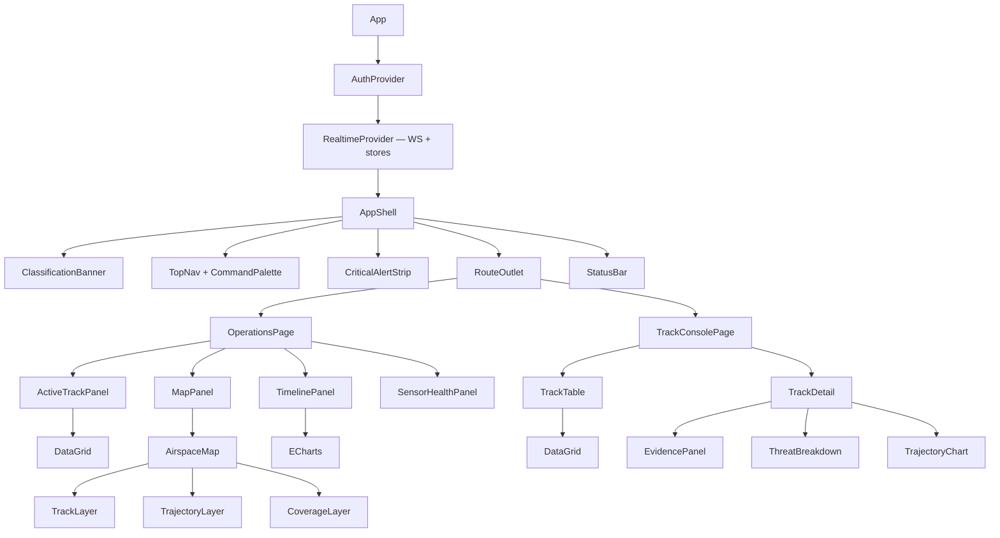

## 3.4 State Management Strategy

Four distinct state domains, four distinct tools. Conflating them is the usual cause of real-time dashboard performance collapse.

| Domain | Tool | Examples | Update rate |
|---|---|---|---|
| **Server state** | TanStack Query | Incidents, audit pages, users, roles, reports, sensor registry | On demand |
| **Streaming state** | Custom external store + `useSyncExternalStore` | Track positions, live alerts, sensor telemetry | 4–20 Hz |
| **UI state** | Zustand | Selection, filters, panel layout, modal stack, map viewport | User-driven |
| **Form state** | React Hook Form | Admin forms, incident notes, report parameters | Keystroke, local |

```ts
// realtime/stores/TrackStore.ts — the performance-critical path
class TrackStore {
  private tracks = new Map<string, TrackState>();
  private listeners = new Set<() => void>();
  private dirty = false;
  private snapshot: readonly TrackState[] = [];

  applyDelta(d: TrackDelta): void {
    const prev = this.tracks.get(d.trackId);
    this.tracks.set(d.trackId, mergeTrack(prev, d));
    this.dirty = true;                       // no React notification here
    RafScheduler.request(this.flush);        // coalesce to next animation frame
  }

  private flush = (): void => {
    if (!this.dirty) return;
    this.snapshot = Array.from(this.tracks.values());  // new identity => one React render
    this.dirty = false;
    this.listeners.forEach(l => l());
  };

  subscribe = (l: () => void) => { this.listeners.add(l); return () => this.listeners.delete(l); };
  getSnapshot = () => this.snapshot;
}

export const useTracks = () =>
  useSyncExternalStore(trackStore.subscribe, trackStore.getSnapshot);
```

A 20 Hz stream across 200 tracks produces 4,000 updates/second and **at most 60 React renders/second**, each rendering only virtualised visible rows.

## 3.5 WebSocket Architecture

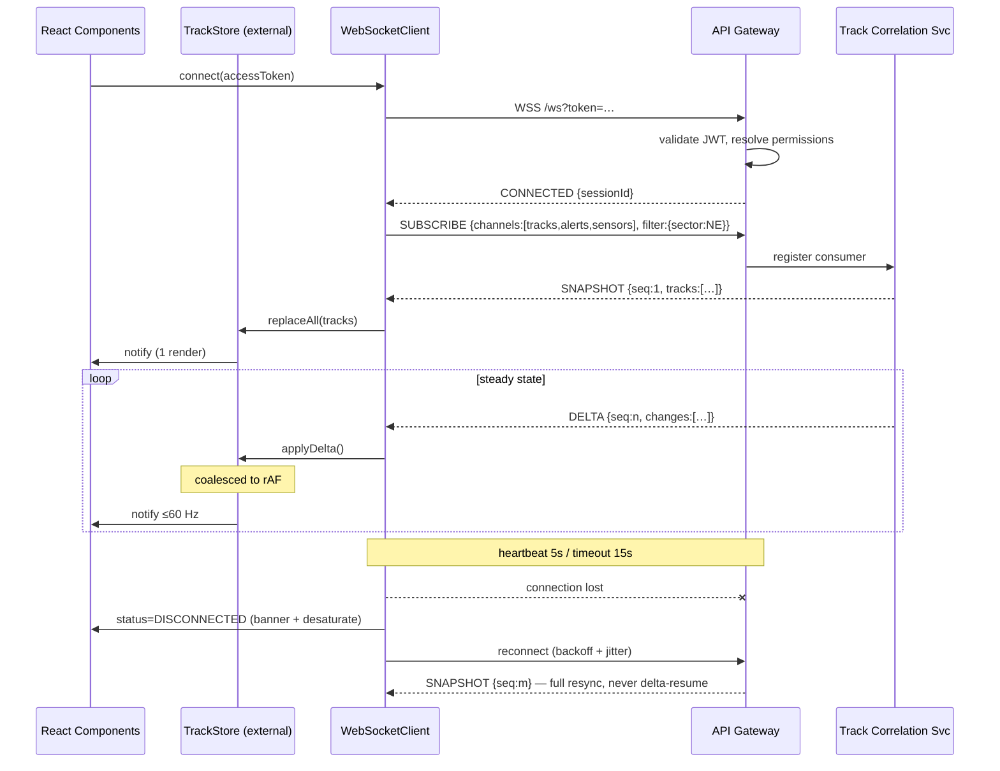

Message envelope:

```typescript
type ServerMessage =
  | { type: 'CONNECTED';    sessionId: string; serverTime: string }
  | { type: 'SNAPSHOT';     channel: Channel; seq: number; payload: unknown }
  | { type: 'DELTA';        channel: Channel; seq: number; payload: unknown }
  | { type: 'ALERT';        alert: ThreatAlert }              // never coalesced
  | { type: 'SYSTEM_EVENT'; event: SystemEvent }
  | { type: 'HEARTBEAT';    serverTime: string }
  | { type: 'ERROR';        code: string; message: string; retryable: boolean };
```

## 3.6 Route Structure & Lazy Loading

```typescript
const router = createBrowserRouter([
  { path: '/auth/login', element: <LoginPage /> },              // eager — first paint
  {
    path: '/', element: <ProtectedShell />, errorElement: <RouteError />,
    children: [
      { index: true, loader: () => redirect('/ops') },
      // Eager bundle — operations core is always needed
      { path: 'ops',            element: <OperationsPage /> },
      { path: 'ops/map',        element: <MapPage /> },
      { path: 'ops/tracks',     element: <TrackConsolePage /> },
      // Lazy chunks
      { path: 'ops/timeline',   lazy: () => import('@/features/timeline/routes') },
      { path: 'ops/sensors',    lazy: () => import('@/features/sensors/routes') },
      { path: 'alerts',         lazy: () => import('@/features/alerts/routes') },
      { path: 'incidents/:id',  lazy: () => import('@/features/incidents/routes') },
      { path: 'audit',          lazy: () => import('@/features/audit/routes'),
        loader: requirePermission('audit:read') },
      { path: 'reports',        lazy: () => import('@/features/reports/routes'),
        loader: requirePermission('report:read') },
      { path: 'admin',          lazy: () => import('@/features/admin/routes'),
        loader: requirePermission('admin:access') },
    ],
  },
]);
```

| Chunk | Contents | Target gzip |
|---|---|---|
| `main` | Shell, design system, auth, realtime | ≤ 180 KB |
| `operations` | Ops dashboard, MapLibre, track console | ≤ 320 KB |
| `charts` | ECharts (shared, prefetched on idle) | ≤ 190 KB |
| `admin` / `audit` / `reports` | Per-feature | ≤ 90 KB each |

MapLibre and ECharts are **prefetched during idle time immediately after the operations route mounts** — an operator must never wait for a chunk during an incident.

## 3.7 Performance Optimisation Plan

| Risk | Mitigation | Verification |
|---|---|---|
| Re-render storm from stream | External store + `rAF` coalescing (§3.4) | React Profiler: ≤60 commits/s at 200 tracks |
| Long track lists | TanStack Virtual, ~20 DOM rows regardless of count | DOM node count assertion in Playwright |
| Map layer thrash | MapLibre GeoJSON source `setData` diff; never re-add layers | Chrome perf trace, no layout thrash |
| Chart redraw | ECharts canvas + `setOption({notMerge:false})`; downsample >2k points | Frame budget < 16 ms |
| Memory growth over an 8 h shift | Ring buffer: tracks capped at 500, timeline at 10k events; explicit eviction | 8 h soak test, heap delta < 15% |
| Bundle bloat | `rollup-plugin-visualizer`; CI budget gate fails the build on regression | CI budget check |
| Slow initial paint | Route-level code split, critical CSS inline, font `display=swap` | Lighthouse FCP < 1.2 s |

**Frontend performance budget (enforced in CI):**

| Metric | Target |
|---|---|
| First Contentful Paint | < 1.2 s |
| Time to Interactive | < 2.5 s |
| Sustained frame rate, 200 live tracks | ≥ 55 fps |
| Track update → pixel | < 150 ms p95 |
| Alert receipt → visible | < 100 ms p95 |
| Memory after 8 h | < 600 MB |

---

# 4. Backend Microservice Architecture

## 4.1 Service Inventory

Twelve services. Each owns its data, publishes its events, and is independently deployable. **Database-per-service is absolute** — no service reads another's tables; all cross-service data flows via API or event.

| # | Service | Port | Datastore | Scale unit |
|---|---|---|---|---|
| 1 | API Gateway | 8080 | Redis (rate limits, sessions) | Horizontal, stateless |
| 2 | Authentication | 8081 | PostgreSQL `authdb` + Redis | Horizontal, stateless |
| 3 | User & RBAC | 8082 | PostgreSQL `userdb` | Horizontal, read-heavy, cached |
| 4 | Sensor Ingestion | 8083 | PostgreSQL `sensordb` + Kafka | Horizontal by partition |
| 5 | Track Correlation | 8084 | PostgreSQL `trackdb` + Redis | **Partitioned by sector — stateful** |
| 6 | AI Orchestrator | 8085 | Redis (inference cache) | Horizontal, IO-bound |
| 7 | Threat Assessment | 8086 | PostgreSQL `threatdb` | Horizontal |
| 8 | Alert | 8087 | PostgreSQL `alertdb` | Horizontal |
| 9 | Notification | 8088 | PostgreSQL `notifydb` | Horizontal |
| 10 | Reporting | 8089 | PostgreSQL `reportdb` + Elasticsearch | Horizontal, async workers |
| 11 | Audit | 8090 | PostgreSQL `auditdb` + Elasticsearch | **Append-only, single writer** |
| 12 | Configuration | 8091 | PostgreSQL `configdb` | Horizontal, heavily cached |

### 4.1.1 API Gateway

| | |
|---|---|
| **Responsibilities** | Single ingress; TLS termination; JWT validation; permission pre-check; rate limiting; request routing; WebSocket upgrade and fan-out; correlation-ID injection; access logging |
| **Database** | None (owns no domain data). Redis for token buckets and WS session registry. |
| **APIs** | `/*` reverse-proxied; `GET /ws` WebSocket upgrade; `GET /health`, `/health/ready` |
| **Publishes** | `platform.gateway.access.v1` (sampled), `platform.gateway.ratelimit.v1` |
| **Consumes** | `track.updated.v1`, `alert.raised.v1`, `sensor.health.v1` → WebSocket fan-out |
| **Scaling** | Stateless; WS sessions tracked in Redis; ~5k concurrent WS per instance |

### 4.1.2 Authentication Service

| | |
|---|---|
| **Responsibilities** | Credential verification (Argon2id); TOTP MFA; JWT issue/refresh/revoke; refresh-token rotation with reuse detection; session lifecycle; account lockout; future mTLS client-certificate auth |
| **Database** | `authdb`: `credentials`, `refresh_tokens`, `mfa_secrets`, `login_attempts`, `sessions` |
| **APIs** | `POST /auth/login`, `/auth/mfa/verify`, `/auth/refresh`, `/auth/logout`, `/auth/logout-all`; `GET /auth/jwks`; gRPC `ValidateToken` |
| **Publishes** | `platform.auth.login.success.v1`, `.login.failed.v1`, `.logout.v1`, `.token.revoked.v1`, `.lockout.v1` |
| **Consumes** | `platform.user.deactivated.v1` → revoke all sessions |
| **Scaling** | Stateless; JWKS cached at the gateway so token validation needs no per-request call |

### 4.1.3 User & RBAC Service

| | |
|---|---|
| **Responsibilities** | User CRUD; role and permission definition; role assignment; effective-permission resolution; permission simulation; self-escalation prevention |
| **Database** | `userdb`: `users`, `roles`, `permissions`, `role_permissions`, `user_roles`, `role_change_log` |
| **APIs** | `GET/POST/PATCH /users`, `/roles`, `/permissions`; `POST /rbac/simulate`; gRPC `ResolvePermissions(userId)` |
| **Publishes** | `platform.user.created.v1`, `.updated.v1`, `.deactivated.v1`, `platform.role.assigned.v1`, `.permissions.changed.v1` |
| **Consumes** | — |
| **Scaling** | Read-dominant; permission sets cached in Redis, TTL 60 s, invalidated on `.permissions.changed.v1` |

### 4.1.4 Sensor Ingestion Service

| | |
|---|---|
| **Responsibilities** | Accept sensor payloads (REST, gRPC stream, MQTT bridge); schema validation; **normalise every modality to the canonical `DetectionRecord`**; UTC timestamp normalisation and clock-drift correction; deduplication by `(sensorId, sensorSeq)`; per-sensor health telemetry; dataset replay for development |
| **Database** | `sensordb`: `sensors`, `sensor_health`, `ingestion_stats`; Redis-backed dedup window |
| **APIs** | `POST /ingest/detections` (batch); gRPC `StreamDetections` (bidirectional); `POST /ingest/replay` (dev only, feature-flagged) |
| **Publishes** | `sensor.detection.raw.v1`, `sensor.detection.normalized.v1`, `sensor.health.v1`, `sensor.ingestion.error.v1` |
| **Consumes** | `sensor.detection.raw.v1`, `platform.config.sensor.updated.v1` |
| **Scaling** | Horizontal by Kafka partition; partition key `sensorId`, preserving per-sensor ordering |

The raw topic appears on both lines by design. The intake adapters (REST `POST /ingest/detections`, gRPC `StreamDetections`) accept a sensor payload and publish it verbatim to `sensor.detection.raw.v1`; a separate consumer within the service reads that topic, normalises to the canonical `DetectionRecord`, and publishes `sensor.detection.normalized.v1`. Decoupling intake from normalisation through the raw topic is what lets ingestion absorb a burst without blocking a sensor (§5.6) and gives replay and audit a faithful record of what each sensor actually sent. A sensor adapter — including the development simulator — reaches the raw topic only through these intake APIs; it never writes to Kafka directly.

### 4.1.5 Track Correlation Service

| | |
|---|---|
| **Responsibilities** | Spatio-temporal association of normalised detections into tracks; Kalman-filter state estimation (position, velocity, acceleration); track lifecycle (tentative → confirmed → coasting → lost); cross-sensor duplicate elimination; trajectory prediction and CPA computation against protected assets |
| **Database** | `trackdb`: `tracks`, `track_states` (time-partitioned), `track_detections`, `track_lifecycle_events`; Redis holds hot in-flight state |
| **APIs** | `GET /tracks`, `/tracks/{id}`, `/tracks/{id}/history`; gRPC `SubscribeTracks` (server stream) |
| **Publishes** | `track.created.v1`, `track.updated.v1`, `track.merged.v1`, `track.lost.v1`, `track.classified.v1` |
| **Consumes** | `sensor.detection.normalized.v1`, `ai.inference.completed.v1` |
| **Scaling** | **Stateful.** Partitioned by geographic sector; each instance owns a sector exclusively. Vertical first, then sector sharding. This is the hardest service to scale and the correct place to spend design effort. |

**Cross-sensor duplicate elimination — the merge rule.** Two tracks merge when *all* of the following hold: both are `CONFIRMED`; both are in the same sector; their contributing sensor sets are **disjoint** (the same sensor reporting twice is a duplicate detection, which association already handles — a merge is specifically the case of two sensors having independently opened a track on one object); and their Kalman-estimated positions stay within the merge gate for **N consecutive sweeps**. The survivor is the **older** track, which UUIDv7's time ordering makes unambiguous; the younger becomes `MERGED` with `merged_into_track_id` set, and `track.merged.v1` carries it so a consumer holding the younger id can re-key onto the survivor. The N-sweep requirement is what keeps two drones in close formation from being collapsed into one — a single-sweep coincidence is not evidence of identity, and a false merge is the more damaging error, since it makes one of two real threats disappear.

**Protected assets.** §4.1.12 assigns protected-asset geometry to the Configuration Service. Until that service exists (M8), the asset registry is a domain **port** (`ProtectedAssetRegistry`) whose adapter reads a static list from this service's own configuration. Swapping in the config-service-backed adapter is an infrastructure change only — no domain, CPA, or contract change — which is the point of declaring it as a port. No service reads another's tables at any stage.

### 4.1.6 AI Orchestrator Service

| | |
|---|---|
| **Responsibilities** | **The Track A / Track B boundary.** Routes inference requests to the correct AI service by modality; selects model version from configuration; enforces per-service timeouts and circuit breakers; retries with backoff; caches identical inferences; falls back to the mock provider when a real service is unavailable; records latency and confidence telemetry; performs canary traffic splitting between model versions |
| **Database** | None. Redis for inference cache (key = content hash of input, TTL 60 s). |
| **APIs** | `POST /inference` (sync); gRPC `Infer` / `InferStream`; `GET /ai/services` (registry + health); `POST /ai/services/{id}/model-version` (admin) |
| **Publishes** | `ai.inference.requested.v1`, `ai.inference.completed.v1`, `ai.inference.failed.v1`, `ai.service.degraded.v1` |
| **Consumes** | `track.created.v1`, `track.updated.v1`, `platform.config.ai.updated.v1` |
| **Scaling** | IO-bound; horizontal. Bounded concurrency per downstream AI service so a burst never overwhelms a GPU. |

### 4.1.7 Threat Assessment Service

| | |
|---|---|
| **Responsibilities** | Composite threat scoring from model confidence, proximity, closing velocity, trajectory intent, and cross-sensor agreement; rules-engine policy evaluation; Low/Medium/High/Critical classification; recommendation generation (**advisory only — never an engagement command**); uncertainty handling; explainability breakdown per §2.4.2 |
| **Database** | `threatdb`: `threat_scores`, `threat_policies`, `policy_versions`, `rule_definitions`, `assessments` |
| **APIs** | `GET /threats/{trackId}`, `GET /threats/{trackId}/breakdown`; `GET/PUT /threats/policies`; `POST /threats/evaluate` (what-if) |
| **Publishes** | `threat.assessed.v1`, `threat.level.changed.v1`, `threat.recommendation.generated.v1` |
| **Consumes** | `track.updated.v1`, `ai.inference.completed.v1`, `platform.config.policy.updated.v1` |
| **Scaling** | Stateless, CPU-bound; horizontal |

### 4.1.8 Alert Service

| | |
|---|---|
| **Responsibilities** | Alert generation from threat transitions; deduplication and suppression windows; escalation timers; acknowledgement and assignment; resolution with disposition; incident creation and lifecycle; evidence-bundle assembly |
| **Database** | `alertdb`: `alerts`, `alert_acknowledgements`, `alert_escalations`, `incidents`, `incident_events`, `incident_notes`, `incident_evidence` |
| **APIs** | `GET /alerts`, `POST /alerts/{id}/acknowledge`, `/assign`, `/resolve`; `GET/POST /incidents`, `GET /incidents/{id}/timeline`, `POST /incidents/{id}/notes`, `GET /incidents/{id}/evidence` |
| **Publishes** | `alert.raised.v1`, `alert.acknowledged.v1`, `alert.escalated.v1`, `alert.resolved.v1`, `incident.created.v1`, `incident.updated.v1`, `incident.closed.v1` |
| **Consumes** | `threat.level.changed.v1`, `track.lost.v1`, `sensor.health.degraded.v1` |
| **Scaling** | Horizontal; escalation timers via a Redis sorted-set scheduler with leader election |

### 4.1.9 Notification Service

| | |
|---|---|
| **Responsibilities** | Multi-channel delivery (WebSocket push, email, SMS/webhook); per-user channel preference and quiet hours; retry with backoff; cross-channel deduplication; delivery receipt tracking |
| **Database** | `notifydb`: `notification_channels`, `user_preferences`, `notification_log`, `delivery_receipts` |
| **APIs** | `GET/PUT /notifications/preferences`, `GET /notifications/history`, `POST /notifications/test` |
| **Publishes** | `notification.sent.v1`, `notification.failed.v1` |
| **Consumes** | `alert.raised.v1`, `alert.escalated.v1`, `incident.created.v1`, `sensor.health.offline.v1` |
| **Scaling** | Horizontal; per-channel outbound rate limiting |

### 4.1.10 Reporting Service

| | |
|---|---|
| **Responsibilities** | Templated report generation (incident, daily summary, sensor performance, fusion efficacy); async generation with progress; PDF/JSON/CSV export; Elasticsearch aggregation queries; scheduled recurring reports |
| **Database** | `reportdb`: `report_templates`, `report_jobs`, `report_artifacts`; Elasticsearch for source aggregation |
| **APIs** | `GET /reports/templates`, `POST /reports/generate` (202 + job id), `GET /reports/jobs/{id}`, `GET /reports/{id}/download` |
| **Publishes** | `report.generation.started.v1`, `report.generated.v1`, `report.generation.failed.v1` |
| **Consumes** | All domain events → Elasticsearch indexing pipeline |
| **Scaling** | Horizontal async workers; generation never blocks a request thread |

### 4.1.11 Audit Service

| | |
|---|---|
| **Responsibilities** | Immutable, append-only capture of every security-relevant and operator action; **hash-chained tamper-evident log** (each record carries SHA-256 of its predecessor); chain verification API; signed audit extracts; retention enforcement; SIEM forwarding (CEF/Syslog) |
| **Database** | `auditdb`: `audit_log` (append-only; `REVOKE UPDATE, DELETE` on the application role), `chain_checkpoints`; Elasticsearch mirror for search |
| **APIs** | `GET /audit` (query), `POST /audit/verify` (chain segment), `POST /audit/export` (signed), `GET /audit/checkpoints` |
| **Publishes** | `audit.chain.verified.v1`, `audit.chain.broken.v1` (**highest-severity platform event**) |
| **Consumes** | **Every** `platform.*`, `alert.*`, `incident.*`, `threat.*` event, plus all authenticated mutations via gateway interception |
| **Scaling** | Single writer per chain to guarantee ordering; reads scale via the Elasticsearch mirror. The throughput ceiling is deliberate — integrity outranks speed here. |

### 4.1.12 Configuration Service

| | |
|---|---|
| **Responsibilities** | Runtime configuration without redeploy: sensor registry, threat-policy thresholds, AI service endpoints and model versions, feature flags, retention policy, protected-asset geometry; change history with before/after diff; validated config schemas |
| **Database** | `configdb`: `configurations`, `config_versions`, `config_change_log`, `feature_flags` |
| **APIs** | `GET /config/{namespace}`, `PUT /config/{namespace}` (requires justification), `GET /config/{namespace}/history`, `POST /config/{namespace}/rollback`; gRPC `WatchConfig` (server stream) |
| **Publishes** | `platform.config.updated.v1`, `platform.config.sensor.updated.v1`, `platform.config.policy.updated.v1`, `platform.config.ai.updated.v1` |
| **Consumes** | — |
| **Scaling** | Read-dominant; clients hold a local cache refreshed by the `WatchConfig` stream |

## 4.2 Microservice Dependency Diagram

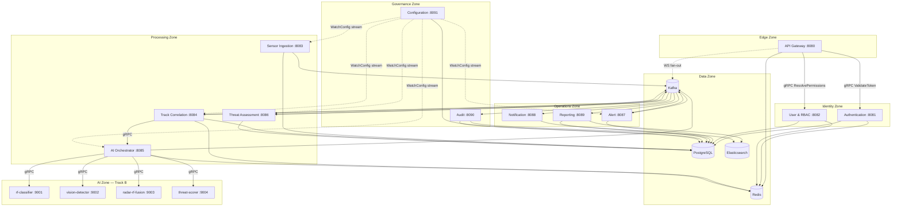

**Dependency rules enforced in review:**
1. No synchronous call between pipeline services except `TRK → ORC` (latency-critical, circuit-broken).
2. No service calls the Audit service — it consumes events. Audit can never become an availability dependency.
3. Configuration is pushed, never polled in the hot path.
4. Every synchronous cross-service call carries a timeout, a circuit breaker, and a documented degraded-mode fallback.

## 4.3 Standard Service Skeleton

```
services/track-correlation/
├── src/main/java/pk/nust/cuas/track/
│   ├── TrackCorrelationApplication.java
│   ├── api/{rest,grpc,dto}/
│   ├── domain/
│   │   ├── model/{Track,TrackState,Detection,TrackLifecycle}.java
│   │   ├── service/{CorrelationService,KalmanFilterService,TrajectoryPredictor,CpaCalculator}.java
│   │   └── policy/{AssociationPolicy,TrackLifecyclePolicy}.java
│   ├── infrastructure/
│   │   ├── persistence/{entity,repository,mapper}/
│   │   ├── messaging/{consumer,producer,serde}/
│   │   ├── cache/RedisTrackStateStore.java
│   │   └── client/AiOrchestratorGrpcClient.java
│   ├── config/{KafkaConfig,SecurityConfig,ObservabilityConfig,ResilienceConfig}.java
│   └── common/{CorrelationIdFilter,GlobalExceptionHandler}.java
├── src/main/resources/{application.yml,application-{dev,test,prod}.yml,db/migration/}
├── src/test/java/…            # unit + Testcontainers integration
├── Dockerfile
└── pom.xml
```

Cross-cutting concerns (correlation-ID propagation, structured JSON logging, Micrometer metrics, OpenTelemetry tracing, exception mapping, mTLS configuration) live in a shared `platform-commons` library so all twelve services behave identically under observation.

---

# 5. Real-Time Data Pipeline

## 5.1 End-to-End Flow

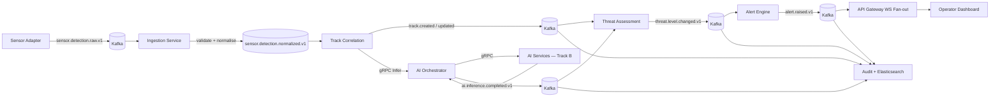

## 5.2 Kafka Topic Catalogue

| Topic | Key | Partitions | Retention | Cleanup | Producer | Consumers |
|---|---|---|---|---|---|---|
| `sensor.detection.raw.v1` | `sensorId` | 12 | 24 h | delete | Adapters | Ingestion |
| `sensor.detection.normalized.v1` | `sensorId` | 12 | 7 d | delete | Ingestion | Track Correlation, Audit, Reporting |
| `sensor.health.v1` | `sensorId` | 3 | 7 d | delete | Ingestion | Gateway, Alert, Reporting |
| `sensor.ingestion.error.v1` | `sensorId` | 3 | 30 d | delete | Ingestion | Alert, Reporting |
| `track.created.v1` | `trackId` | 6 | 30 d | delete | Track Correlation | Orchestrator, Threat, Audit, Gateway |
| `track.updated.v1` | `trackId` | 6 | 7 d | delete | Track Correlation | Orchestrator, Threat, Gateway, Reporting |
| `track.lost.v1` | `trackId` | 6 | 30 d | delete | Track Correlation | Threat, Alert, Audit |
| `track.merged.v1` | `trackId` | 6 | 30 d | delete | Track Correlation | Threat, Alert, Gateway, Audit |
| `track.classified.v1` | `trackId` | 6 | 30 d | delete | Track Correlation | Threat, Gateway, Audit |
| `track.state.snapshot.v1` | `trackId` | 6 | ∞ | **compact** | Track Correlation | Gateway (resnapshot) |
| `ai.inference.requested.v1` | `trackId` | 6 | 24 h | delete | Orchestrator | Reporting |
| `ai.inference.completed.v1` | `trackId` | 6 | 7 d | delete | Orchestrator | Threat, Track Correlation, Audit |
| `ai.inference.failed.v1` | `trackId` | 3 | 30 d | delete | Orchestrator | Alert, Reporting |
| `ai.service.degraded.v1` | `serviceId` | 3 | 30 d | delete | Orchestrator | Alert, Gateway, Reporting, Audit |
| `threat.assessed.v1` | `trackId` | 6 | 30 d | delete | Threat | Alert, Reporting, Audit |
| `threat.level.changed.v1` | `trackId` | 6 | 90 d | delete | Threat | Alert, Notification, Gateway, Audit |
| `alert.raised.v1` | `alertId` | 3 | 90 d | delete | Alert | Notification, Gateway, Audit, Reporting |
| `alert.acknowledged.v1` | `alertId` | 3 | 90 d | delete | Alert | Audit, Reporting |
| `incident.created.v1` | `incidentId` | 3 | ∞ | delete | Alert | Notification, Reporting, Audit |
| `platform.config.updated.v1` | `namespace` | 1 | ∞ | compact | Configuration | All services |
| `platform.config.sensor.updated.v1` | `namespace` | 1 | ∞ | compact | Configuration | Sensor Ingestion |
| `platform.audit.v1` | `actorId` | 3 | ∞ | delete | All | Audit |
| `platform.user.deactivated.v1` | `userId` | 3 | ∞ | delete | User & RBAC | Authentication |
| `platform.gateway.access.v1` | `userId` | 3 | 7 d | delete | API Gateway | Reporting |
| `platform.gateway.ratelimit.v1` | `identity` | 3 | 30 d | delete | API Gateway | Alert, Reporting |
| `*.DLQ` | original key | 3 | 30 d | delete | Any consumer | Ops tooling |

**Topic naming:** `<domain>.<entity>.<event>.v<major>`. The major version lives in the topic name — a breaking schema change creates a new topic and both run in parallel during migration. This is the only versioning strategy that survives a heterogeneous, independently-deployed consumer set.

## 5.3 Canonical Schema — `DetectionRecord`

The single most important contract in the system. Every modality normalises into this shape (proposal §4).

```protobuf
syntax = "proto3";
package pk.nust.cuas.detection.v1;

import "google/protobuf/timestamp.proto";

message DetectionRecord {
  string              detection_id   = 1;  // UUIDv7 — time-sortable
  string              sensor_id      = 2;
  SensorModality      modality       = 3;
  google.protobuf.Timestamp sensor_time = 4;  // sensor clock, as reported
  google.protobuf.Timestamp ingest_time = 5;  // platform clock, authoritative ordering
  int64               clock_drift_ms = 6;     // measured correction applied
  uint64              sensor_seq     = 7;     // per-sensor monotonic, for dedup

  GeoPosition         position       = 10;
  Kinematics          kinematics     = 11;
  Measurements        measurements   = 12;

  float               quality        = 20;  // [0,1] sensor-reported confidence
  map<string,string>  metadata       = 21;
  string              schema_version = 22;  // e.g. "1.0.0"
  string              correlation_id = 23;  // end-to-end trace
}

enum SensorModality {
  MODALITY_UNSPECIFIED = 0;
  MODALITY_RF          = 1;
  MODALITY_RADAR       = 2;
  MODALITY_EO_IR       = 3;
  MODALITY_ACOUSTIC    = 4;
  MODALITY_GNSS        = 5;
  MODALITY_EXTERNAL    = 6;
}

message GeoPosition {
  double latitude = 1; double longitude = 2;
  double altitude_m = 3;                 // AMSL
  double horizontal_accuracy_m = 4;
  double vertical_accuracy_m   = 5;
  bool   is_estimated = 6;               // true when derived, not measured
}

message Kinematics {
  double range_m = 1; double azimuth_deg = 2; double elevation_deg = 3;
  double radial_velocity_ms = 4; double speed_ms = 5; double heading_deg = 6;
}

message Measurements {
  oneof payload {
    RfMeasurement       rf       = 1;
    RadarMeasurement    radar    = 2;
    OpticalMeasurement  optical  = 3;
    AcousticMeasurement acoustic = 4;
    GnssMeasurement     gnss     = 5;
  }
}

message RfMeasurement {
  double center_frequency_hz = 1;
  double bandwidth_hz        = 2;
  double signal_strength_dbm = 3;
  double snr_db              = 4;
  string protocol_hint       = 5;         // "OcuSync" | "Lightbridge" | "WiFi" | "unknown"
  bytes  psd_features        = 6;         // float32[] power spectral density
  string iq_reference        = 7;         // object-store URI, NOT inline payload
}

message RadarMeasurement {
  double rcs_m2 = 1;
  double doppler_hz = 2;
  string range_doppler_map_ref = 3;       // object-store URI
  string radar_type = 4;                  // "FMCW" | "CW"
  uint32 track_quality = 5;
}

message OpticalMeasurement {
  BoundingBox bbox = 1;
  string frame_ref = 2;                   // object-store URI
  string spectrum  = 3;                   // "VISIBLE" | "IR"
  double illuminance_lux = 4;
  uint32 consecutive_frames = 5;
}
message BoundingBox { float x=1; float y=2; float width=3; float height=4; float confidence=5; }

message AcousticMeasurement {
  double bearing_deg = 1; double spl_db = 2;
  string spectrogram_ref = 3; double dominant_frequency_hz = 4;
}
message GnssMeasurement {
  uint32 satellites_visible = 1; double hdop = 2;
  bool   spoofing_suspected = 3; double signal_anomaly_score = 4;
}
```

**Design decisions worth defending in review:**
- **Two timestamps plus measured drift.** `sensor_time` preserves what the sensor claimed; `ingest_time` gives deterministic platform ordering; `clock_drift_ms` records the correction applied. Time synchronisation across heterogeneous sensors is the failure mode that silently destroys fusion quality — it must be auditable, not implicit.
- **Large payloads are references, never inline.** I/Q recordings, range-Doppler maps, and camera frames go to object storage (MinIO); Kafka carries the URI. A 4 MB radar frame on a Kafka topic destroys throughput for every consumer on that topic.
- **UUIDv7 identifiers.** Time-sortable, so they index well in PostgreSQL B-trees and sort naturally in Elasticsearch.
- **`is_estimated` on position.** A derived position and a measured position must never be indistinguishable downstream.

### 5.3.1 Ingestion service & health contract

`DetectionRecord` is the payload; the ingestion service adds two service-specific messages and one RPC, defined in `contracts/proto/ingestion.proto` (package `pk.nust.cuas.ingestion.v1`). Section 4.1.4 names the `StreamDetections` RPC, `IngestAck`, and `SensorHealth` but does not define their bodies; they are completed here at the minimal shape each use dictates.

```protobuf
syntax = "proto3";
package pk.nust.cuas.ingestion.v1;

import "google/protobuf/timestamp.proto";
import "detection.proto";

// Bidirectional intake (§4.1.4). One IngestAck per streamed record, so back-pressure and
// per-record rejection are visible to the adapter without tearing down the stream.
service DetectionIngestService {
  rpc StreamDetections(stream pk.nust.cuas.detection.v1.DetectionRecord)
      returns (stream IngestAck);
}

// Minimal per-record acknowledgement. Correlates by the sensor's own sequence number; the
// reason for a rejection travels out of band on sensor.ingestion.error.v1, not here.
message IngestAck {
  uint64 sensor_seq = 1;   // echoes DetectionRecord.sensor_seq
  bool   accepted   = 2;   // false: validation, duplicate, or back-pressure drop
}

// Per-sensor health, published on sensor.health.v1 (§4.1.4). Minimal: identity, serving
// status, and the platform clock at the last accepted detection. Richer counters live in the
// sensordb ingestion_stats table and can be added here compatibly if a consumer needs them.
message SensorHealth {
  string sensor_id = 1;
  Status status    = 2;
  google.protobuf.Timestamp last_seen = 3;
  enum Status { STATUS_UNSPECIFIED = 0; ONLINE = 1; DEGRADED = 2; OFFLINE = 3; }
}
```

**Design decisions worth defending in review:**
- **`IngestAck` carries no reject reason.** The bidirectional ack answers only *which* record and *whether* it was accepted; the *why* is an ingestion error, and `sensor.ingestion.error.v1` already carries it with full context. Duplicating it in the ack would be two sources for one fact.
- **`SensorHealth` is deliberately thin.** Health is a liveness signal, not a metrics feed. Throughput and drop counters are operational telemetry and belong in `ingestion_stats`; the event stays small because `sensor.health.v1` fans out to the gateway, alerting, and reporting.

### 5.3.2 Track schema

Section 4.1.5 names the track events but does not define their fields. The track schema is defined in `contracts/proto/track.proto` (package `pk.nust.cuas.track.v1`) and documented here. `track.created.v1`, `track.updated.v1`, `track.lost.v1`, `track.merged.v1` and `track.classified.v1` all carry the `Track` message directly; the topic name distinguishes birth from update, loss, merge, and classification.

```protobuf
syntax = "proto3";
package pk.nust.cuas.track.v1;

import "google/protobuf/timestamp.proto";
import "detection.proto";

// Lifecycle of §4.1.5: tentative → confirmed → coasting → lost, plus merged.
enum TrackStatus {
  TRACK_STATUS_UNSPECIFIED = 0;
  TRACK_STATUS_TENTATIVE   = 1;
  TRACK_STATUS_CONFIRMED   = 2;
  TRACK_STATUS_COASTING    = 3;
  TRACK_STATUS_LOST        = 4;
  TRACK_STATUS_MERGED      = 5;
}

// The Kalman-estimated state's uncertainty — how well the filter believes its own estimate.
message KinematicEstimate {
  double vertical_speed_ms       = 1;
  double acceleration_ms2        = 2;
  double position_uncertainty_m  = 3;   // 1σ
  double velocity_uncertainty_ms = 4;   // 1σ
}

// One point on the predicted trajectory; uncertainty grows with the horizon.
message PredictedPoint {
  pk.nust.cuas.detection.v1.GeoPosition position = 1;
  google.protobuf.Timestamp at            = 2;
  double                    uncertainty_m = 3;
}

// CPA against one protected asset — rendered as "CPA 640 m in 00:47" (§2.4.2).
message ClosestPointOfApproach {
  string asset_id      = 1;
  string asset_name    = 2;
  double distance_m    = 3;
  double time_to_cpa_s = 4;
  google.protobuf.Timestamp at = 5;
  bool   closing       = 6;   // false when already receding
}

message Track {
  string      track_id     = 1;   // UUIDv7
  string      sector_id    = 2;   // geographic sector (§4.1.5)
  TrackStatus status       = 3;
  string      merged_into_track_id = 4;   // set only when status is MERGED

  pk.nust.cuas.detection.v1.GeoPosition position = 10;  // Kalman estimate
  double      speed_ms     = 11;
  double      heading_deg  = 12;
  google.protobuf.Timestamp observed_at = 13;   // the time this estimate is valid for
  KinematicEstimate estimate = 14;

  google.protobuf.Timestamp first_seen = 20;
  google.protobuf.Timestamp last_seen  = 21;   // ingest time of the latest associated detection
  uint32      detection_count   = 22;
  string      last_detection_id = 23;

  string      schema_version = 30;
  string      correlation_id = 31;

  repeated PredictedPoint predicted_trajectory = 40;
  ClosestPointOfApproach  nearest_asset_cpa    = 41;
}
```

**Design decisions worth defending in review:**
- **`observed_at` and `last_seen` are different clocks, and they diverge while coasting.** `last_seen` is the ingest time of the latest associated detection and is what the miss timeouts count from; `observed_at` is the time the current estimate is valid for, which a coasting prediction advances past `last_seen`. Any code that advances the filter must measure elapsed time from `observed_at` — measuring from `last_seen` re-advances a coasting track's filter over an interval it has already covered. This is a real defect that was found and fixed during M5.2.
- **Uncertainty is published, not just the estimate.** `position_uncertainty_m` is what lets the dashboard draw an honest confidence ellipse (§2.5.6) and lets threat-assessment (§6.3.4) report a missing or weak factor rather than substituting a default.
- **`closing` is a boolean, not a sign convention.** A receding track reports `closing = false` with the present separation, rather than a negative `time_to_cpa_s`. A consumer that ignored a sign would read a receding track as an imminent one; a consumer that ignores an unset boolean reads `false`, which is the safe direction.
- **Prediction is extrapolation, and the contract does not promise otherwise.** `predicted_trajectory` is dead reckoning under the filter's constant-acceleration model. §6.3.5 anticipates a learned `trajectory-predictor` replacing it; that service would populate the same field, so no consumer changes.
- **Position reuses `detection.v1.GeoPosition`.** A track's position is the same canonical geodetic type a detection carries; a parallel track-specific position type would be a second source of truth for the same concept.
- **Every addition since M5.1 is additive**, and therefore a minor version under §5.5: new fields on `Track`, new messages, and new enum values. No topic version bumps and no consumer breaks. The one non-additive change is documentary — `observed_at` was described in M5.1 as the latest detection's ingest time, which is what `last_seen` now carries; no consumer existed at the time.

## 5.4 Serialization & Schema Registry

**Protobuf over Avro.** Rationale: gRPC is already required for inter-service and AI-service calls, so Protobuf gives one IDL for both messaging and RPC; `protoc` generates Java, Python, and TypeScript from one source of truth; and compatibility rules are simpler to reason about under field-number discipline.

Confluent Schema Registry runs in `BACKWARD` compatibility mode with CI enforcement:

| Change | Allowed | Mechanism |
|---|---|---|
| Add optional field | ✅ | New field number, never reuse |
| Remove field | ⚠️ | Mark `reserved`, deprecate for one release, then remove |
| Rename field | ✅ | Wire format is field-number based |
| Change field type | ❌ | New field + new topic major version |
| Add enum value | ✅ | Consumers must handle `UNSPECIFIED`/unknown defensively |

CI gate: `buf breaking --against .git#branch=main` fails any PR introducing an incompatible change without a topic version bump.

## 5.5 Event Versioning Strategy

| Level | Mechanism |
|---|---|
| **Major** (breaking) | New topic `*.v2`. Producer dual-writes v1 and v2 during migration. Consumers migrate independently. v1 retired only when consumer-group lag on v1 is zero across all groups. |
| **Minor** (additive) | Same topic, new optional field. Old consumers ignore it. |
| **Patch** (semantic) | Same topic and schema; documented in the registry description. No code change required. |

Every message also carries `schema_version` in-band, so a consumer can log and branch on it during incident triage without a registry lookup.

## 5.6 Back-Pressure Handling

Back-pressure is managed at four independent points; failure at any one degrades gracefully rather than cascading.

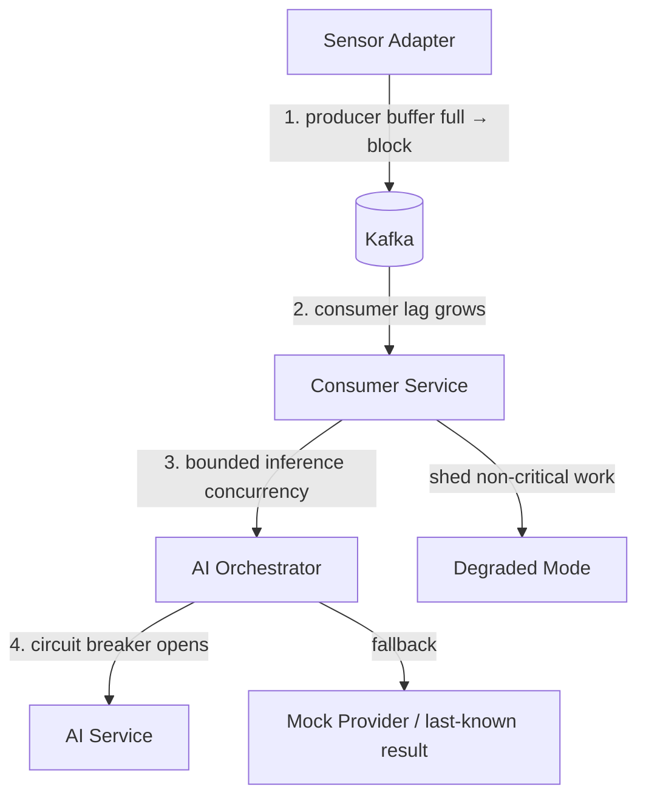

| Point | Mechanism | Configuration | Degraded behaviour |
|---|---|---|---|
| Adapter → Kafka | Producer `max.block.ms` + bounded buffer | `buffer.memory=64MB`, `max.block.ms=5000`, `acks=1` raw / `acks=all` audit | Adapter drops **lowest-quality** detections first, records drop count to health telemetry, never blocks the sensor |
| Kafka → Consumer | `max.poll.records` + pause/resume | `max.poll.records=200`, `max.poll.interval.ms=300000` | Consumer pauses partitions when its internal queue exceeds the high-water mark |
| Orchestrator → AI | Bulkhead, bounded semaphore per service | 32 concurrent per AI service | Overflow goes to a bounded queue; on queue-full the track is scored on kinematics alone and flagged `inference_unavailable` |
| AI service failure | Resilience4j circuit breaker | 50% failure over 20 calls → open 30 s | Falls back to mock provider or last-known inference; **the track is never dropped**, only degraded, and the UI shows the degraded state explicitly |

**The governing principle:** ingestion must never stop. A drone detected but processed late is a degraded outcome; a drone never ingested is an undetected one. Every back-pressure decision resolves in favour of accepting the detection and degrading downstream quality *visibly*.

## 5.7 Delivery Semantics

Different stages warrant different guarantees. Uniform exactly-once across the pipeline would cost throughput for no operational benefit.

| Stage | Guarantee | Implementation | Why |
|---|---|---|---|
| Adapter → Kafka | At-least-once | `acks=1`, `enable.idempotence=true`, retries | Duplicate detections are cheap; the correlator dedups on `(sensorId, sensorSeq)` |
| Ingestion → normalized | **Effectively-once** | Idempotent producer + transactional consume-transform-produce | Prevents duplicate detections entering correlation |
| Correlation → track events | **Effectively-once** | Kafka transactions (`read_committed`); offsets committed inside the same transaction as output | A duplicate track event would produce a duplicate alert — operationally unacceptable |
| Orchestrator → AI | At-most-once + cache | Timeout, no retry on non-idempotent inference; content-hash cache absorbs repeats | Inference is expensive; a recent cached result beats a duplicate GPU call |
| Threat → Alert | **Effectively-once** | Transactional; alert dedup key `(trackId, threatLevel, windowStart)` | Duplicate alerts destroy operator trust faster than any other defect |
| Alert → Notification | At-least-once + idempotent delivery | Delivery-key dedup at channel level | Better a duplicate SMS than a missed one |
| Any → Audit | **At-least-once, dedup on write** | `audit_id` unique constraint; hash chain rejects out-of-order writes | The audit log must never lose a record; duplicates are rejected at the database |

True end-to-end exactly-once across the whole pipeline is **not attempted and should not be claimed in the report**. *Effectively-once within each Kafka-to-Kafka transactional boundary, plus idempotent consumers at the edges* is the honest and correct description — and it is what a reviewer will expect to hear.

## 5.8 Latency Budget

End-to-end target: **detection at sensor → alert visible on operator screen ≤ 2,000 ms p95.**

| Stage | Budget p95 | Notes |
|---|---|---|
| Sensor → adapter | 50 ms | External, assumed |
| Adapter → Kafka produce | 20 ms | |
| Kafka broker commit | 15 ms | `acks=1`, single-broker dev |
| Ingestion validate + normalise | 30 ms | |
| Kafka hop | 15 ms | |
| Track correlation + Kalman update | 80 ms | |
| AI Orchestrator dispatch | 20 ms | |
| **AI inference (worst modality: vision)** | **250 ms** | GPU; the dominant term |
| Kafka hop | 15 ms | |
| Threat scoring | 40 ms | |
| Alert generation + dedup | 30 ms | |
| Kafka hop | 15 ms | |
| Gateway WS fan-out | 25 ms | |
| Network to client | 50 ms | LAN |
| Client render | 100 ms | §3.7 budget |
| **Total** | **755 ms** | **1,245 ms headroom against the 2,000 ms target** |

The headroom is deliberate. It absorbs GC pauses, Kafka rebalances, and the inevitable Week-13 discovery that one stage is 3× its estimate.

---

# 6. AI Integration Architecture — Parallel Development

This section is the contract that makes two-track development possible. It is frozen at end of Week 2.

## 6.1 Integration Principle

Every AI capability is an **independently deployable container** that:
1. Implements one gRPC service definition (`InferenceService`).
2. Exposes `/health/live`, `/health/ready`, `/metrics`, `/model/info`.
3. Declares its model version on every response.
4. Is completely unaware of Kafka, PostgreSQL, the dashboard, and every other AI service.

The AI Orchestrator is the only component that knows an AI service exists. Adding a fifth model — acoustic, GNSS, or otherwise — is a configuration entry, not a code change anywhere in Track A.

**How that guarantee is kept (M6.1).** Routing is by **sensor modality**, never by service identity. A modality describes the *input* — "this detection came from an RF sensor" is a fact about the sensor, whereas "send this to the RF classifier" would be a fact about a model — so a service declares the modalities it accepts and routing follows automatically. Concretely:

- Services are a **map keyed by id** under `ai.services`, not a fixed set of configuration fields. A new model is a new YAML block.
- `ServiceId` is opaque; `AiServiceDescriptor` carries no per-model field and has no subclass. A radar-fusion, acoustic, or GNSS service is the same record with different values.
- `InferenceProvider` takes the descriptor as a **parameter**, so one provider implementation serves every registered service. A bean per model would itself be the code change this section forbids.
- A service accepting several modalities is routed for any of them but **invoked once per request**; otherwise a fusion model would be called twice for one track, doubling GPU load and yielding two competing results for one object.
- An unrecognised or unspecified modality routes **nowhere**, rather than to a default. Sending an unidentifiable observation to whichever service is first would produce a confident-looking result from a model that never saw that kind of input.
- Registry configuration is validated **at startup** — unknown modality or mode, duplicate id, or `mode: grpc` with no endpoint fails the context rather than the first inference.

The rule is enforced mechanically rather than by convention: `ModelAgnosticismTest` scans the orchestrator's source for the service and framework names in §6.3 and fails if any appears, comments included. It is deliberately a blunt string check — naming a model in prose is the first step towards branching on it.

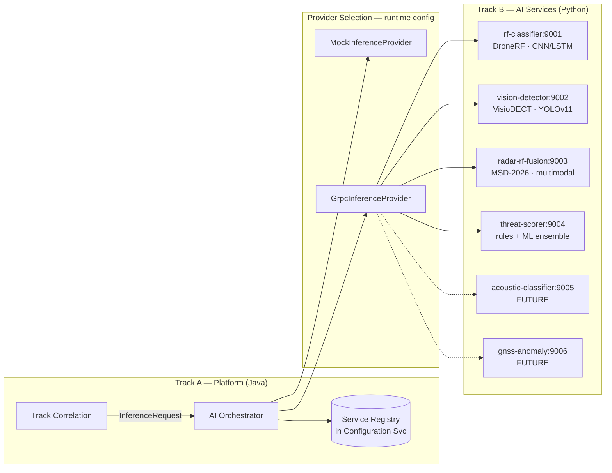

## 6.2 The AI Service Contract

```protobuf
syntax = "proto3";
package pk.nust.cuas.inference.v1;

import "google/protobuf/timestamp.proto";
import "detection.proto";

service InferenceService {
  rpc Infer        (InferenceRequest)        returns (InferenceResponse);
  rpc InferBatch   (BatchInferenceRequest)   returns (BatchInferenceResponse);
  rpc InferStream  (stream InferenceRequest) returns (stream InferenceResponse);
  rpc GetModelInfo (ModelInfoRequest)        returns (ModelInfo);
  rpc HealthCheck  (HealthRequest)           returns (HealthResponse);
}

message InferenceRequest {
  string   request_id     = 1;   // UUIDv7, echoed in the response
  string   track_id       = 2;
  string   correlation_id = 3;   // end-to-end trace, spans the whole pipeline
  google.protobuf.Timestamp requested_at = 4;

  repeated pk.nust.cuas.detection.v1.DetectionRecord detections = 10;

  InferenceOptions options = 20;
}

message InferenceOptions {
  string model_version   = 1;   // "" = service default; enables canary pinning
  uint32 timeout_ms      = 2;   // orchestrator-enforced budget
  float  min_confidence  = 3;   // suppress results below this
  bool   include_features = 4;  // return embeddings for the fusion stage
  bool   explain         = 5;   // return per-feature attribution
}

message InferenceResponse {
  string request_id  = 1;
  string track_id    = 2;
  InferenceStatus status = 3;

  repeated Prediction predictions = 10;
  ConfidenceReport    confidence  = 11;

  string model_id       = 20;   // "rf-classifier"
  string model_version  = 21;   // semver, e.g. "1.3.0"
  string model_sha      = 22;   // weights digest — reproducibility anchor
  uint32 inference_ms   = 23;   // service-measured compute time
  uint32 queue_wait_ms  = 24;   // time spent queued before compute
  ComputeDevice device  = 25;

  repeated FeatureAttribution attributions = 30;  // when explain=true
  bytes  embedding     = 31;                      // when include_features=true
  string error_message = 40;                      // populated when status != OK
}

enum InferenceStatus {
  STATUS_UNSPECIFIED     = 0;
  STATUS_OK              = 1;
  STATUS_LOW_CONFIDENCE  = 2;  // ran successfully, result below threshold
  STATUS_INSUFFICIENT_DATA = 3; // not enough input to infer
  STATUS_MODEL_ERROR     = 4;
  STATUS_TIMEOUT         = 5;
  STATUS_DEGRADED        = 6;  // fallback path used (e.g. CPU instead of GPU)
}

message Prediction {
  string label       = 1;   // "DJI_Mavic_3" | "bird" | "background" | "unknown"
  string label_class = 2;   // "DRONE" | "NON_DRONE" | "BACKGROUND"
  float  confidence  = 3;   // [0,1] calibrated
  uint32 rank        = 4;   // 1 = top prediction
  map<string, float> attributes = 10;  // range_m, bearing_deg, rcs_m2, …
}

message ConfidenceReport {
  float  score            = 1;  // [0,1] overall
  float  calibrated_score = 2;  // post temperature-scaling
  float  entropy          = 3;  // predictive uncertainty
  string method           = 4;  // "softmax" | "temperature_scaled" | "ensemble_variance"
  bool   is_reliable      = 5;  // service's own judgement of its output
}

message FeatureAttribution { string feature = 1; float contribution = 2; }
enum ComputeDevice { DEVICE_UNSPECIFIED = 0; DEVICE_CPU = 1; DEVICE_CUDA = 2; DEVICE_MOCK = 3; }

message ModelInfo {
  string model_id = 1; string model_version = 2; string model_sha = 3;
  string framework = 4;              // "pytorch-2.5" | "onnxruntime-1.20"
  string trained_on = 5;             // "DroneRF v1.0"
  repeated string labels = 6;
  map<string, float> eval_metrics = 7;  // accuracy, precision, recall, f1
  google.protobuf.Timestamp trained_at = 8;
  uint32 p95_latency_ms = 9;
  bool   requires_gpu = 10;
}

// Request/response types for the non-Infer RPCs. Added during M1 implementation so the
// specified service compiles; each carries the minimal shape its RPC dictates.
message BatchInferenceRequest  { repeated InferenceRequest  requests  = 1; }
message BatchInferenceResponse { repeated InferenceResponse responses = 1; }

message ModelInfoRequest {          // selects the model GetModelInfo describes
  string model_id = 1;
  string model_version = 2;         // "" = currently-served version
}

message HealthRequest { string model_id = 1; }  // mirrors /health/ready per §6.1

message HealthResponse {
  enum ServingStatus { SERVING_STATUS_UNSPECIFIED = 0; SERVING = 1; NOT_SERVING = 2; }
  ServingStatus status = 1;
  string detail = 2;
}
```

> **Implementation note (M1).** As originally written, §6.2's `InferenceService` referenced
> `BatchInferenceRequest`, `BatchInferenceResponse`, `ModelInfoRequest`, `HealthRequest`, and
> `HealthResponse` in its RPC signatures without defining their bodies, so the proto would not
> compile. The five definitions above were added with the minimal shape each RPC dictates; no
> existing message was changed. The authoritative source is
> [`contracts/proto/inference.proto`](../contracts/proto/inference.proto).

**Contract rules — non-negotiable, enforced by a conformance test suite:**
1. `model_version` and `model_sha` are **always** populated, including by the mock provider (`0.0.0-mock`).
2. Confidence is calibrated and in `[0,1]`. Raw softmax output without calibration is a contract violation.
3. A service **never** returns an empty response. Absence of detection is `label: "background"` with a confidence, not silence.
4. Timeout is enforced by the orchestrator. A service exceeding its budget is cancelled and the result discarded.
5. No AI service writes to any database or Kafka topic. Ever. It is a pure function of its input.

## 6.3 AI Service Specifications

### 6.3.1 `rf-classifier` — RF Signal Classification

| Attribute | Value |
|---|---|
| **Dataset** | DroneRF (proposal §7.3) — 6 classes: off, on, hovering, flying, video-recording, background |
| **Input** | `RfMeasurement`: PSD features (float32[1024]), centre frequency, bandwidth, SNR; optional I/Q reference |
| **Preprocessing** | STFT spectrogram (256×256), per-sample normalisation, class-balanced sampling |
| **Model** | CNN feature extractor (4 conv blocks) → BiLSTM(128) → FC → softmax(6) |
| **Output** | `Prediction[]` over 6 mode classes; `label_class` ∈ {DRONE, BACKGROUND} |
| **Confidence** | Temperature-scaled softmax, calibrated on the validation split |
| **Latency budget** | p95 ≤ 60 ms |
| **Compute** | CPU-viable (4 vCPU, 4 GB); GPU optional, ~3× speedup |
| **Model size** | ~18 MB (ONNX, INT8-quantised) |
| **Scaling** | 3 replicas, round-robin |

### 6.3.2 `vision-detector` — EO/IR Verification

| Attribute | Value |
|---|---|
| **Dataset** | VisioDECT (proposal §7.2) — 20,924 images, 6 drone models, sunny/cloudy/evening |
| **Input** | Frame reference (object-store URI) or inline JPEG ≤ 2 MB; ROI hint from radar bearing |
| **Preprocessing** | Letterbox 640×640, normalise, optional ROI crop from radar cue |
| **Model** | YOLOv11-s fine-tuned from COCO pretrained weights (proposal §10 — fine-tune, not cold-start) |
| **Output** | `Prediction[]` with bbox in `attributes` (x, y, w, h), model label, confidence |
| **Confidence** | Detection confidence × class probability; NMS IoU 0.45 |
| **Latency budget** | p95 ≤ 250 ms (**the pipeline's dominant term**) |
| **Compute** | **GPU strongly preferred** (6 GB VRAM). CPU fallback ~900 ms — acceptable for demo, flagged `STATUS_DEGRADED` |
| **Model size** | ~38 MB (ONNX FP16) |
| **Scaling** | 1 GPU replica in prototype; batch size 4, 20 ms max batch wait |

### 6.3.3 `radar-rf-fusion` — Multi-Sensor Fusion

| Attribute | Value |
|---|---|
| **Dataset** | Multi-Sensor Drone Dataset 2026 (proposal §7.1) — time-synchronised FMCW + CW radar + RF, with distance labels |
| **Input** | Paired `RadarMeasurement` + `RfMeasurement` within a ±50 ms synchronisation window, plus optional vision embedding |
| **Preprocessing** | Range-Doppler map → 128×128 tensor; RF PSD → 1024-vector; temporal alignment against `sensor_time` + `clock_drift_ms` |
| **Model** | Two-branch encoder (radar CNN ‖ RF CNN) → cross-attention fusion → dual head: classification + distance regression |
| **Output** | Fused class prediction, distance estimate (m), per-modality contribution weights, **agreement score** |
| **Confidence** | Ensemble variance across branches; the `agreement` attribute is what the dashboard renders as "3/3 agree" (§2.5.6) |
| **Latency budget** | p95 ≤ 120 ms |
| **Compute** | GPU preferred (4 GB); CPU viable at ~350 ms |
| **Model size** | ~52 MB |
| **Why it matters** | This service produces the number that validates the project's headline claim: fusion reduces false positives versus any single modality (proposal §11, §14). |

### 6.3.4 `threat-scorer` — Composite Threat Assessment

| Attribute | Value |
|---|---|
| **Input** | Fused classification, kinematics, trajectory history, CPA to protected assets, sensor-agreement score, active policy version |
| **Model** | Weighted rules engine (deterministic, explainable) + gradient-boosted residual correction. **Rules dominate by design** — a defence-adjacent threat score must be explainable to an operator and defensible to a reviewer. |
| **Output** | Composite score `[0,1]`, threat level (LOW/MEDIUM/HIGH/CRITICAL), per-factor breakdown (rendered in §2.4.2), recommendation string |
| **Confidence** | Propagated from inputs; explicitly reports when a factor is missing rather than substituting a default |
| **Latency budget** | p95 ≤ 40 ms |
| **Compute** | CPU only (2 vCPU, 2 GB) |
| **Constraint** | **Recommendations are advisory strings only.** The output vocabulary is closed: `MONITOR`, `TRACK_AND_MONITOR`, `REQUEST_VISUAL_ID`, `ESCALATE_TO_SUPERVISOR`, `RECOMMEND_OPERATOR_REVIEW`. There is no output value that encodes an engagement action. |

### 6.3.5 Future Services (contract-ready, not built in the 16 weeks)

| Service | Dataset | Latency | Compute | Notes |
|---|---|---|---|---|
| `acoustic-classifier` | RGB+Thermal+Audio (proposal §7.4) | ≤ 80 ms | CPU | YAMNet transfer learning; short-range confirmation |
| `gnss-anomaly` | Synthetic + public GNSS | ≤ 50 ms | CPU | LSTM spoofing detection; also the foundation for the §16 future-work track |
| `trajectory-predictor` | Derived from track history | ≤ 100 ms | CPU | Transformer sequence model, replaces the Kalman extrapolation |

Each registers with the orchestrator through a Configuration Service entry. **No Track A code changes.**

## 6.4 Mock Inference Providers — How Track A Ships Before Track B

This is the mechanism that decouples the two tracks, and it is the single most important implementation decision in the plan.

```java
public interface InferenceProvider {
    InferenceResponse infer(InferenceRequest request);
    ModelInfo modelInfo();
    boolean isHealthy();
}

@Component
@ConditionalOnProperty(name = "ai.provider.mode", havingValue = "mock")
public class MockInferenceProvider implements InferenceProvider {

    private final ScenarioEngine scenarios;   // deterministic, seeded
    private final LatencySimulator latency;   // samples the real budget distribution

    @Override
    public InferenceResponse infer(InferenceRequest req) {
        latency.simulate(modelId);            // e.g. lognormal(μ=45ms, p95=60ms)

        if (chaos.shouldFail())                // configurable failure injection
            return error(STATUS_MODEL_ERROR, "simulated model failure");

        Scenario s = scenarios.resolve(req.getTrackId());
        return InferenceResponse.newBuilder()
            .setRequestId(req.getRequestId())
            .setTrackId(req.getTrackId())
            .setStatus(STATUS_OK)
            .addAllPredictions(s.predictionsFor(req.getDetectionsList()))
            .setConfidence(s.calibratedConfidence())
            .setModelId(modelId)
            .setModelVersion("0.0.0-mock")     // never mistakable for a real model
            .setModelSha("mock")
            .setDevice(DEVICE_MOCK)
            .setInferenceMs(latency.lastMs())
            .build();
    }
}
```

**Mock provider requirements — it is a first-class deliverable, not a stub:**

| Requirement | Implementation |
|---|---|
| Schema-identical output | Same generated Protobuf classes as the real service — the contract is compile-enforced |
| Realistic latency | Samples a lognormal distribution matched to each service's documented p95 budget |
| Deterministic scenarios | Seeded by `trackId`; the same track always yields the same prediction, so tests and demos are reproducible |
| Scenario library | `single-intrusion`, `swarm-5`, `bird-false-positive`, `sensor-dropout`, `low-confidence-ambiguous`, `contradictory-modalities` |
| Failure injection | Configurable rates for timeout, model error, and low confidence — exercises every UI degraded state before a real model can produce one |
| Never silently promoted | `model_version: "0.0.0-mock"` and `device: DEVICE_MOCK` render an explicit **MOCK INFERENCE** badge in the dashboard. An operator, a reviewer, and a demo audience can always tell mocked results from real ones. |

**Provider switching is per-service and runtime-configurable:**

```yaml
ai:
  services:
    rf-classifier:    { mode: grpc, endpoint: rf-classifier:9001,    timeout-ms: 100 }
    vision-detector:  { mode: mock, timeout-ms: 400 }   # model not trained yet
    radar-rf-fusion:  { mode: mock, timeout-ms: 200 }
    threat-scorer:    { mode: grpc, endpoint: threat-scorer:9004,   timeout-ms: 80 }
```

**Consequence:** Track B integrates one service at a time. Each integration is a config change plus a container image tag. If a newly integrated model regresses, reverting is a one-line config rollback with no redeploy — which is exactly what you want two weeks before a demo.

## 6.5 Integration Sequence

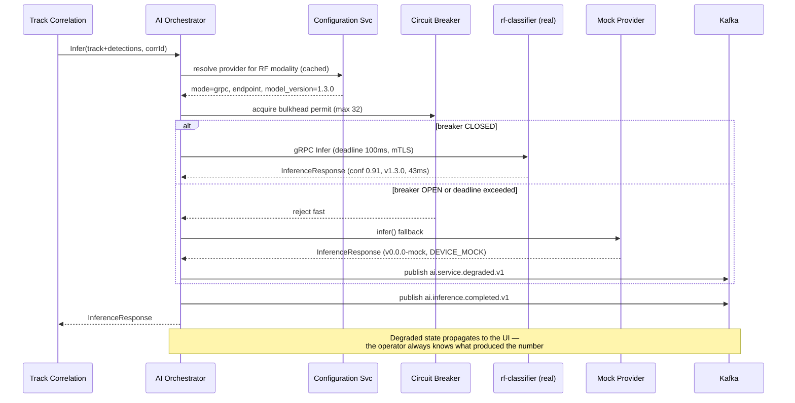

## 6.6 Model Versioning & Registry

| Concern | Approach |
|---|---|
| Version scheme | Semantic: `MAJOR.MINOR.PATCH`. MAJOR = label-set or output-schema change; MINOR = retrained weights, same labels; PATCH = calibration or threshold adjustment |
| Registry | **MLflow Model Registry** — stages `Staging` → `Production` → `Archived` |
| Weight storage | MinIO (S3-compatible), content-addressed by SHA-256 |
| Reproducibility anchor | `model_sha` on every inference response links a specific result back to exact weights, training config, and dataset split |
| Promotion gate | A model reaches `Production` only if it beats the incumbent on held-out F1 **and** meets its latency budget on the target device |
| Rollback | Configuration change: `model_version: "1.2.0"`. No redeploy, no code change. |
| Canary | Orchestrator splits traffic by `trackId` hash: e.g. 90% v1.2.0 / 10% v1.3.0. Both results logged; only the primary reaches the operator. |

## 6.7 AI Service Container Template

```
ai-services/rf-classifier/
├── src/rf_classifier/
│   ├── main.py                 # FastAPI (HTTP health/metrics) + grpc.aio server
│   ├── grpc_server.py          # implements InferenceService
│   ├── inference/{engine.py,onnx_runtime.py,batching.py}
│   ├── preprocessing/{spectrogram.py,normalize.py,psd.py}
│   ├── models/{architecture.py,loader.py,calibration.py}
│   ├── monitoring/{metrics.py,drift.py}
│   └── config.py
├── training/                   # NOT shipped in the runtime image
│   ├── train.py  evaluate.py  export_onnx.py
│   ├── data/{dataset.py,augmentation.py,splits.py}
│   └── configs/{baseline.yaml,tuned.yaml}
├── models/                     # weights fetched from MLflow at build time
├── tests/{test_contract.py,test_inference.py,test_preprocessing.py}
├── proto/                      # symlink to shared contracts — single source of truth
├── Dockerfile                  # multi-stage; runtime image excludes training deps
├── requirements.txt
└── README.md
```

`tests/test_contract.py` is the **shared conformance suite** — the identical test file runs against every AI service and against the mock provider. A service that passes it is integrable by definition. This is what lets Track B integrate without negotiation.

---

# 7. Security Architecture

## 7.1 Security Zone Model

```mermaid
flowchart TB
    subgraph Z0["Zone 0 — Untrusted"]
        OP[Operator Workstation]
        MOB[Mobile — Alerts Only]
    end
    subgraph Z1["Zone 1 — DMZ / Edge"]
        LB[TLS 1.3 Reverse Proxy]
        GW[API Gateway<br/>JWT · Rate Limit · WAF]
    end
    subgraph Z2["Zone 2 — Application"]
        AUTH[Authentication]
        RBAC[User & RBAC]
        ALR[Alert] 
        RPT[Reporting]
        CFG[Configuration]
        NOT[Notification]
    end
    subgraph Z3["Zone 3 — Processing"]
        ING[Sensor Ingestion]
        TRK[Track Correlation]
        ORC[AI Orchestrator]
        THR[Threat Assessment]
    end
    subgraph Z4["Zone 4 — AI Compute"]
        AI1[rf-classifier]
        AI2[vision-detector]
        AI3[radar-rf-fusion]
        AI4[threat-scorer]
    end
    subgraph Z5["Zone 5 — Data"]
        PG[(PostgreSQL<br/>TDE at rest)]
        ES[(Elasticsearch)]
        K[(Kafka<br/>SASL_SSL)]
        RD[(Redis · TLS · AUTH)]
        S3[(MinIO · SSE)]
    end
    subgraph Z6["Zone 6 — Governance"]
        AUD[Audit Service]
        VAULT[Secrets Manager]
        SIEM[SIEM Forwarder]
    end
    subgraph ZS["Sensor Zone — External"]
        SEN[Sensor Adapters<br/>client cert required]
    end

    OP -->|HTTPS/WSS TLS1.3| LB --> GW
    MOB -->|HTTPS| LB
    SEN -->|mTLS| GW
    GW -->|mTLS| AUTH & RBAC & ALR & RPT & CFG & ING
    Z2 <-->|mTLS| Z3
    ORC -->|mTLS| Z4
    Z2 & Z3 --> Z5
    Z2 & Z3 & Z4 -.audit events.-> AUD
    AUD --> SIEM
    VAULT -.short-lived creds.-> Z2 & Z3 & Z4

    style Z4 fill:#2a1f3d
    style Z6 fill:#1f2d3d
```

**Zone traversal rules:**

| From | To | Allowed | Control |
|---|---|---|---|
| Z0 | Z1 | ✅ | TLS 1.3, HSTS, CSP, rate limit |
| Z0 | Z2+ | ❌ | Network policy denies; no direct route exists |
| Z1 | Z2 | ✅ | mTLS + JWT forwarding |
| Z2 | Z3 | ✅ | mTLS + service-identity authorisation |
| Z3 | Z4 | ✅ | mTLS, orchestrator only — no other service may reach an AI container |
| Z4 | Z5 | ❌ | **AI services have no database credentials at all.** Pure functions. |
| Z4 | Internet | ❌ | Egress denied. Prevents model-weight exfiltration and unvetted dependency fetches at runtime. |
| Any | Z6 (Audit) | Write-only | Append via Kafka; no service can read or modify the audit log |
| Sensor Zone | Z1 | ✅ | Client-certificate authentication, per-sensor identity, IP allowlist |

## 7.2 Transport Security

| Path | Protocol | Authentication |
|---|---|---|
| Browser → Gateway | TLS 1.3 (TLS 1.2 min fallback) | JWT bearer, `Secure`+`HttpOnly`+`SameSite=Strict` refresh cookie |
| WebSocket | WSS, TLS 1.3 | JWT on upgrade; re-validated on token refresh; connection closed on revocation |
| Sensor Adapter → Gateway | **mTLS** | X.509 client certificate; CN maps to a registered `sensorId` |
| Service ↔ Service | **mTLS** | SPIFFE-style workload identity; certificate SANs pin the calling service |
| Orchestrator → AI Service | **mTLS** | Only the orchestrator's certificate is authorised on AI services |
| Service → PostgreSQL | TLS | Per-service credentials from the secrets manager, rotated |
| Service → Kafka | SASL_SSL (SCRAM-SHA-512) | Per-service principal; topic-level ACLs |
| Service → Redis | TLS + AUTH | Per-service password |

Cipher policy: TLS 1.3 AEAD suites only (`TLS_AES_256_GCM_SHA384`, `TLS_CHACHA20_POLY1305_SHA256`). No CBC, no RSA key exchange, no renegotiation.

Certificate management: internal CA (step-ca in development, HashiCorp Vault PKI in production). Service certificates carry a **24-hour TTL** with automatic rotation — a compromised certificate has a bounded blast radius measured in hours, not years.

## 7.3 Authentication & Token Design

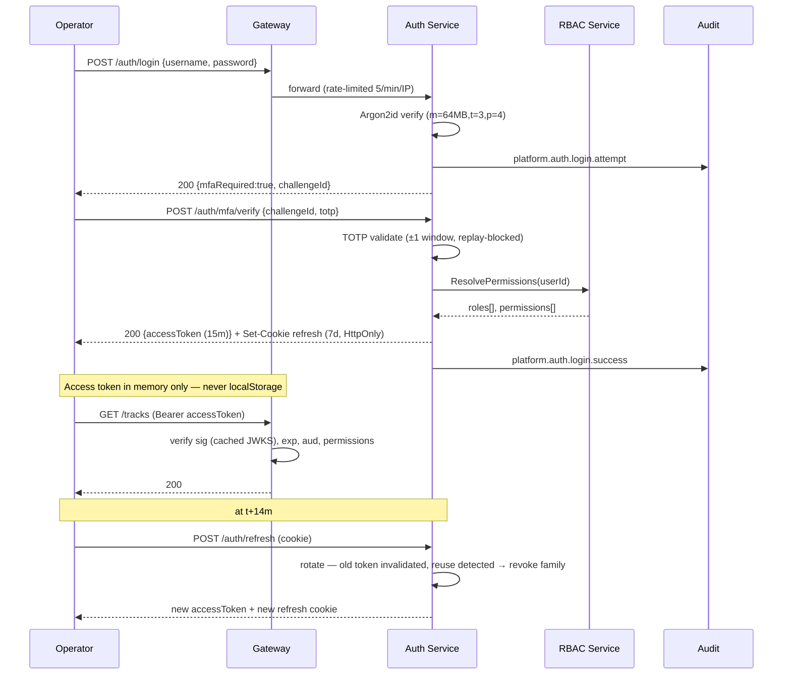

**Access token claims:**

```json
{
  "iss": "https://cuas.nust.edu.pk/auth",
  "sub": "usr_01J8X4K2M9P3Q7R5T1V6W8Y0Z2",
  "aud": ["cuas-api"],
  "exp": 1784563200, "iat": 1784562300, "jti": "tok_01J8X4K3N2R5S8",
  "sid": "ses_01J8X4K2P5R8",
  "roles": ["OPERATOR"],
  "perms": ["track:read","alert:read","alert:acknowledge","incident:create","incident:read"],
  "amr": ["pwd","otp"],
  "clearance": "UNCLASSIFIED"
}
```

| Property | Decision | Rationale |
|---|---|---|
| Signing | RS256, 2048-bit, keys rotated quarterly, JWKS published | Gateway validates without calling Auth on every request |
| Access token TTL | 15 minutes | Bounds the window for a stolen token |
| Refresh token TTL | 7 days, **rotating** | Rotation with reuse detection converts theft into a detectable event |
| Reuse detection | Presenting a rotated refresh token revokes the entire token family and raises a security alert | Standard OAuth 2.1 BCP; catches replay |
| Storage | Access token in JS memory only; refresh in `HttpOnly` cookie | Eliminates the XSS token-exfiltration path |
| Revocation | Redis denylist keyed by `jti`, TTL = remaining lifetime | Immediate logout-all and admin revocation |

## 7.4 RBAC Matrix

Six roles. Permissions are additive; no role inherits another implicitly, because implicit inheritance is where privilege-escalation defects hide.

| Permission | VIEWER | OPERATOR | ANALYST | ENGINEER | AUDITOR | ADMIN |
|---|:--:|:--:|:--:|:--:|:--:|:--:|
| `track:read` | ✅ | ✅ | ✅ | ✅ | ✅ | ✅ |
| `track:classify` | — | ✅ | ✅ | — | — | ✅ |
| `map:read` | ✅ | ✅ | ✅ | ✅ | ✅ | ✅ |
| `alert:read` | ✅ | ✅ | ✅ | ✅ | ✅ | ✅ |
| `alert:acknowledge` | — | ✅ | ✅ | — | — | ✅ |
| `alert:resolve` | — | ✅ | ✅ | — | — | ✅ |
| `incident:create` | — | ✅ | ✅ | — | — | ✅ |
| `incident:read` | — | ✅ | ✅ | ✅ | ✅ | ✅ |
| `incident:update` | — | ✅ | ✅ | — | — | ✅ |
| `incident:close` | — | — | ✅ | — | — | ✅ |
| `evidence:export` | — | — | ✅ | — | ✅ | ✅ |
| `sensor:read` | ✅ | ✅ | ✅ | ✅ | ✅ | ✅ |
| `sensor:acknowledge_fault` | — | — | — | ✅ | — | ✅ |
| `sensor:standby` | — | — | — | ✅ | — | ✅ |
| `sensor:configure` | — | — | — | ✅ | — | ✅ |
| `report:read` | — | ✅ | ✅ | ✅ | ✅ | ✅ |
| `report:generate` | — | — | ✅ | ✅ | ✅ | ✅ |
| `audit:read` | — | — | — | — | ✅ | ✅ |
| `audit:verify` | — | — | — | — | ✅ | ✅ |
| `audit:export` | — | — | — | — | ✅ | — |
| `policy:read` | — | ✅ | ✅ | ✅ | ✅ | ✅ |
| `policy:write` | — | — | — | — | — | ✅ |
| `ai:configure` | — | — | — | ✅ | — | ✅ |
| `user:read` | — | — | — | — | ✅ | ✅ |
| `user:write` | — | — | — | — | — | ✅ |
| `role:write` | — | — | — | — | — | ✅ |
| `config:write` | — | — | — | ⚠️ scoped | — | ✅ |

**Separation-of-duty constraints, enforced in the RBAC service, not the UI:**
- `ADMIN` **cannot** hold `audit:export`. The administrator who can alter permissions must not be able to produce the authoritative signed record of having done so.
- No user may grant themselves a permission they do not hold. Self-escalation is rejected at the API with `403 SELF_ESCALATION_DENIED`.
- Role changes require a justification string and are written to the audit log before the change commits.
- Permissions are enforced at three layers: gateway pre-check (fast rejection), service-level `@PreAuthorize` (authoritative), and database row-level security where a row carries an owner.

## 7.5 Audit Logging & Tamper Evidence

Every audit record is chained to its predecessor:

```
record_hash = SHA256(
    prev_hash ‖ audit_id ‖ timestamp ‖ actor_id ‖ action ‖
    resource_type ‖ resource_id ‖ outcome ‖ canonical_json(details)
)
```

```sql
CREATE TABLE audit_log (
    seq             BIGSERIAL PRIMARY KEY,
    audit_id        UUID        NOT NULL UNIQUE,
    occurred_at     TIMESTAMPTZ NOT NULL,
    recorded_at     TIMESTAMPTZ NOT NULL DEFAULT now(),
    actor_id        TEXT        NOT NULL,
    actor_type      TEXT        NOT NULL,   -- USER | SERVICE | SYSTEM
    actor_ip        INET,
    session_id      TEXT,
    action          TEXT        NOT NULL,   -- ALERT_ACKNOWLEDGED, POLICY_UPDATED, …
    resource_type   TEXT        NOT NULL,
    resource_id     TEXT,
    outcome         TEXT        NOT NULL,   -- SUCCESS | FAILURE | DENIED
    details         JSONB       NOT NULL DEFAULT '{}',
    correlation_id  TEXT,
    prev_hash       BYTEA       NOT NULL,
    record_hash     BYTEA       NOT NULL
);

-- Immutability enforced at the database, not the application
REVOKE UPDATE, DELETE, TRUNCATE ON audit_log FROM cuas_app;
CREATE RULE audit_no_update AS ON UPDATE TO audit_log DO INSTEAD NOTHING;
CREATE RULE audit_no_delete AS ON DELETE TO audit_log DO INSTEAD NOTHING;

CREATE INDEX idx_audit_actor_time  ON audit_log (actor_id, occurred_at DESC);
CREATE INDEX idx_audit_resource    ON audit_log (resource_type, resource_id, occurred_at DESC);
CREATE INDEX idx_audit_correlation ON audit_log (correlation_id);
```

**Checkpointing.** Every 10,000 records (and every 24 hours) a checkpoint row stores the chain head hash, signed with the platform's Ed25519 private key held in the secrets manager. Verification of an arbitrary range therefore requires re-hashing only the segment since the preceding checkpoint, not the entire log.

**Mandatory audit events:** every authentication attempt; every permission change; every alert acknowledgement, assignment, and resolution; every incident state transition; every policy and configuration change (with before/after diff); every AI model version change; every evidence export; every audit query; every chain verification result.

**Failure mode:** if the audit service cannot write, security-relevant operations **fail closed**. An operator action that cannot be recorded is an action that does not happen. This is deliberate and must be stated explicitly in the report — it is the behaviour a defence reviewer will ask about.

## 7.6 SIEM Integration

| Aspect | Implementation |
|---|---|
| Format | CEF over syslog (RFC 5424) with TLS transport |
| Transport | Filebeat sidecar → SIEM collector; Kafka topic `platform.audit.v1` as the durable buffer |
| Events forwarded | All `outcome=FAILURE` and `outcome=DENIED`; all privilege changes; all authentication anomalies; all `audit.chain.broken.v1`; all `ai.service.degraded.v1` |
| Correlation | `correlation_id` propagated end-to-end enables reconstruction of a full request chain in the SIEM |
| Detection rules shipped | Brute-force (≥5 failures/5 min/account); impossible-travel; privilege escalation attempt; off-hours admin access; audit chain break; anomalous export volume |

## 7.7 Secrets Management

| Secret | Store | Rotation |
|---|---|---|
| Database credentials | Vault dynamic secrets | 24 h, automatic |
| JWT signing keys | Vault transit | Quarterly, with overlap window |
| Service mTLS certificates | Vault PKI | 24 h, automatic |
| Kafka SASL credentials | Vault KV v2 | 90 days |
| Audit signing key (Ed25519) | Vault transit, **non-exportable** | Annual, old public keys retained for verification |
| Sensor client certificates | Internal CA | 1 year, per-sensor identity |

Hard rules: no secret in source control, in a container image, or in an environment variable in production; development uses a `.env.example` template with obviously-fake values and a `gitleaks` pre-commit hook; CI scans every commit with `gitleaks` and `trufflehog`, and a hit fails the build.

## 7.8 API Rate Limiting

Token-bucket in Redis, keyed by the most specific applicable identity.

| Scope | Limit | Burst | On exceed |
|---|---|---|---|
| `POST /auth/login` per IP | 5 / min | 5 | 429 + exponential backoff header |
| `POST /auth/login` per account | 10 / hour | 3 | 429 + lockout at 5 consecutive failures |
| Authenticated API per user | 300 / min | 50 | 429 + `Retry-After` |
| `POST /ingest/detections` per sensor | 5,000 / min | 1,000 | 429; adapter buffers and retries |
| WebSocket connections per user | 5 concurrent | — | Oldest connection closed |
| `POST /reports/generate` per user | 10 / hour | 2 | 429 |
| `POST /audit/export` per user | 5 / hour | 1 | 429 + security event raised |

Every 429 carries `X-RateLimit-Limit`, `X-RateLimit-Remaining`, `X-RateLimit-Reset`, and `Retry-After`. Rate-limit rejections on security-relevant endpoints are audited.

## 7.9 Data Retention & Classification

| Data class | Retention | Storage | Deletion |
|---|---|---|---|
| Raw sensor detections | 7 days | Kafka + PostgreSQL partitions | Automated partition drop |
| Normalised detections | 30 days | PostgreSQL, monthly partitions | Automated |
| Track states | 90 days | PostgreSQL, time-partitioned | Automated |
| Track summaries | 2 years | Elasticsearch (ILM: hot 30 d → warm 180 d → cold) | ILM policy |
| Alerts | 2 years | PostgreSQL + Elasticsearch | Policy-driven |
| Incidents | **7 years** | PostgreSQL + object store | Manual, dual-authorisation |
| Audit log | **7 years minimum** | PostgreSQL append-only + Elasticsearch | **Never automated.** Deletion requires an out-of-band procedure. |
| Evidence artefacts (frames, I/Q, RD maps) | Incident lifetime + 7 years | MinIO, versioned, SSE-encrypted | Tied to parent incident |
| Model artefacts | Indefinite | MLflow + MinIO | Never — reproducibility requirement |
| Session data | 7 days after expiry | Redis TTL | Automatic |

Encryption: TLS 1.3 in transit everywhere; PostgreSQL TDE and MinIO SSE-S3 at rest; per-tenant key derivation reserved for a multi-tenant future.

---

# 8. DevOps & MLOps

## 8.1 Environment Strategy

| Environment | Purpose | Infrastructure | Data | Deploy trigger |
|---|---|---|---|---|
| `local` | Developer workstation | Docker Compose, single node | Synthetic + scenario replay | Manual |
| `ci` | Automated test | Ephemeral Testcontainers | Fixtures | Every push |
| `dev` | Shared integration | Docker Compose on a lab host | Dataset replay | Auto on merge to `develop` |
| `staging` | Pre-demo validation | Docker Compose / K8s | Full dataset replay | Manual promotion from `dev` |
| `prod` (demo) | Evaluation and demonstration | K8s (future) or Compose | Curated demo scenarios | Tagged release, manual approval |

## 8.2 Docker Compose — Development Foundation

```yaml
# docker-compose.yml — development topology (excerpt)
x-service-defaults: &defaults
  restart: unless-stopped
  networks: [cuas-internal]
  logging: { driver: json-file, options: { max-size: "10m", max-file: "3" } }

services:
  # ── Infrastructure ────────────────────────────────────────────────
  postgres:
    <<: *defaults
    image: postgres:17-alpine
    environment: { POSTGRES_USER: cuas, POSTGRES_PASSWORD: ${PG_PASSWORD} }
    volumes:
      - pgdata:/var/lib/postgresql/data
      - ./infra/postgres/init-databases.sh:/docker-entrypoint-initdb.d/init.sh:ro
    healthcheck: { test: ["CMD-SHELL","pg_isready -U cuas"], interval: 10s, retries: 5 }

  kafka:
    <<: *defaults
    image: confluentinc/cp-kafka:7.8.0
    environment:
      KAFKA_PROCESS_ROLES: broker,controller          # KRaft — no ZooKeeper
      KAFKA_NODE_ID: 1
      KAFKA_CONTROLLER_QUORUM_VOTERS: 1@kafka:9093
      KAFKA_LISTENERS: PLAINTEXT://kafka:9092,CONTROLLER://kafka:9093
      KAFKA_OFFSETS_TOPIC_REPLICATION_FACTOR: 1
      KAFKA_TRANSACTION_STATE_LOG_REPLICATION_FACTOR: 1
      KAFKA_AUTO_CREATE_TOPICS_ENABLE: "false"        # topics are declared, not accidental
    volumes: [kafkadata:/var/lib/kafka/data]

  kafka-init:
    image: confluentinc/cp-kafka:7.8.0
    depends_on: { kafka: { condition: service_healthy } }
    entrypoint: ["/bin/bash","/scripts/create-topics.sh"]   # §5.2 catalogue, declarative
    volumes: [./infra/kafka:/scripts:ro]

  schema-registry:
    <<: *defaults
    image: confluentinc/cp-schema-registry:7.8.0
    environment:
      SCHEMA_REGISTRY_KAFKASTORE_BOOTSTRAP_SERVERS: kafka:9092
      SCHEMA_REGISTRY_SCHEMA_COMPATIBILITY_LEVEL: BACKWARD

  elasticsearch:
    <<: *defaults
    image: docker.elastic.co/elasticsearch/elasticsearch:8.17.0
    environment: [discovery.type=single-node, xpack.security.enabled=true, "ES_JAVA_OPTS=-Xms1g -Xmx1g"]
    volumes: [esdata:/usr/share/elasticsearch/data]

  kibana:      { <<: *defaults, image: docker.elastic.co/kibana/kibana:8.17.0, ports: ["5601:5601"] }
  redis:       { <<: *defaults, image: redis:7.4-alpine, command: ["redis-server","--requirepass","${REDIS_PASSWORD}","--appendonly","yes"] }
  minio:       { <<: *defaults, image: minio/minio:latest, command: server /data --console-address ":9090" }

  # ── Platform services (Track A) ───────────────────────────────────
  api-gateway:        { <<: *defaults, build: ./services/api-gateway,        ports: ["8080:8080"] }
  auth-service:       { <<: *defaults, build: ./services/auth-service }
  user-service:       { <<: *defaults, build: ./services/user-service }
  ingestion-service:  { <<: *defaults, build: ./services/sensor-ingestion }
  track-service:      { <<: *defaults, build: ./services/track-correlation }
  orchestrator:
    <<: *defaults
    build: ./services/ai-orchestrator
    environment:
      AI_PROVIDER_MODE: ${AI_PROVIDER_MODE:-mock}     # ── the two-track switch
      AI_RF_ENDPOINT: rf-classifier:9001
      AI_VISION_ENDPOINT: vision-detector:9002
  threat-service:     { <<: *defaults, build: ./services/threat-assessment }
  alert-service:      { <<: *defaults, build: ./services/alert-service }
  notification-service:{ <<: *defaults, build: ./services/notification-service }
  reporting-service:  { <<: *defaults, build: ./services/reporting-service }
  audit-service:      { <<: *defaults, build: ./services/audit-service }
  config-service:     { <<: *defaults, build: ./services/config-service }

  # ── Frontend ──────────────────────────────────────────────────────
  web: { <<: *defaults, build: ./apps/web, ports: ["3000:80"] }

  # ── Simulation ────────────────────────────────────────────────────
  sensor-simulator:
    <<: *defaults
    build: ./tools/sensor-simulator
    environment: { SCENARIO: ${SCENARIO:-single-intrusion}, REPLAY_SPEED: "1.0" }

networks: { cuas-internal: { driver: bridge } }
volumes:  { pgdata: , kafkadata: , esdata: , miniodata: }
```

Profile-based composition keeps developer machines usable:

```bash
docker compose --profile infra up -d                    # infrastructure only
docker compose --profile platform up -d                 # + Track A services
docker compose --profile ai up -d                       # + real AI services
AI_PROVIDER_MODE=mock docker compose --profile platform up -d   # full system, no models
```

**A single `docker compose up` must bring the entire system to a working state with mocked inference.** This is a Week-4 acceptance criterion, not an aspiration — it is what allows three engineers to work independently without a shared dev server.

## 8.3 Kubernetes — Future Path

Not required for the prototype. Designed for, so the migration is mechanical rather than a rewrite.

```
infra/k8s/
├── base/
│   ├── namespaces/{cuas-platform,cuas-ai,cuas-data}.yaml
│   ├── services/<per-service>/{deployment,service,configmap,hpa,pdb}.yaml
│   ├── network-policies/          # §7.1 zone enforcement, as code
│   └── rbac/
└── overlays/{dev,staging,prod}/   # Kustomize
```

| Concern | Approach |
|---|---|
| Stateful services | Kafka, PostgreSQL, Elasticsearch as StatefulSets, or managed services |
| Track Correlation | StatefulSet — sector ownership requires stable identity (§4.1.5) |
| AI services | Deployment + `nvidia.com/gpu` resource requests; node affinity to GPU nodes |
| Autoscaling | HPA on CPU for stateless services; **KEDA on Kafka consumer lag** for pipeline services — lag is the correct scaling signal, not CPU |
| Zone enforcement | NetworkPolicy per §7.1; default-deny, explicit allow |
| Service mesh | Linkerd for automatic mTLS if certificate management proves burdensome |
| Secrets | External Secrets Operator → Vault |

## 8.4 CI/CD Pipeline

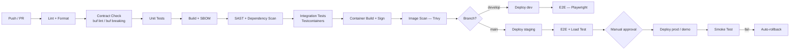

### 8.4.1 GitHub Actions — Backend Service

```yaml
name: service-ci
on:
  pull_request: { paths: ['services/**','libs/**','contracts/**'] }
  push:         { branches: [main, develop] }

env:
  REGISTRY: ghcr.io
  JAVA_VERSION: '21'

jobs:
  detect-changes:
    runs-on: ubuntu-latest
    outputs: { services: ${{ steps.filter.outputs.changes }} }
    steps:
      - uses: actions/checkout@v4
      - uses: dorny/paths-filter@v3
        id: filter
        with:
          filters: |
            api-gateway:        services/api-gateway/**
            auth-service:       services/auth-service/**
            track-correlation:  services/track-correlation/**
            ai-orchestrator:    services/ai-orchestrator/**

  contract-check:
    runs-on: ubuntu-latest
    steps:
      - uses: actions/checkout@v4
        with: { fetch-depth: 0 }
      - uses: bufbuild/buf-setup-action@v1
      - run: buf lint contracts/
      - name: Fail on breaking schema change
        run: buf breaking contracts/ --against '.git#branch=main'

  build-test:
    needs: [detect-changes, contract-check]
    if: needs.detect-changes.outputs.services != '[]'
    strategy:
      fail-fast: false
      matrix: { service: ${{ fromJSON(needs.detect-changes.outputs.services) }} }
    runs-on: ubuntu-latest
    steps:
      - uses: actions/checkout@v4
      - uses: actions/setup-java@v4
        with: { java-version: '21', distribution: temurin, cache: maven }
      - run: mvn -B -pl services/${{ matrix.service }} -am verify
      - name: Coverage gate (80% line, changed code)
        run: mvn -B jacoco:check -pl services/${{ matrix.service }}
      - uses: actions/upload-artifact@v4
        with: { name: test-results-${{ matrix.service }}, path: '**/surefire-reports' }

  security-scan:
    needs: build-test
    runs-on: ubuntu-latest
    steps:
      - uses: actions/checkout@v4
      - uses: gitleaks/gitleaks-action@v2
      - name: OWASP dependency check
        run: mvn -B org.owasp:dependency-check-maven:check -DfailBuildOnCVSS=7
      - uses: github/codeql-action/analyze@v3

  containerize:
    needs: [build-test, security-scan]
    if: github.event_name == 'push'
    permissions: { contents: read, packages: write, id-token: write }
    strategy: { matrix: { service: ${{ fromJSON(needs.detect-changes.outputs.services) }} } }
    runs-on: ubuntu-latest
    steps:
      - uses: actions/checkout@v4
      - uses: docker/setup-buildx-action@v3
      - uses: docker/login-action@v3
        with: { registry: ghcr.io, username: ${{ github.actor }}, password: ${{ secrets.GITHUB_TOKEN }} }
      - uses: docker/build-push-action@v6
        id: build
        with:
          context: services/${{ matrix.service }}
          push: true
          tags: |
            ghcr.io/${{ github.repository }}/${{ matrix.service }}:${{ github.sha }}
            ghcr.io/${{ github.repository }}/${{ matrix.service }}:${{ github.ref_name }}
          cache-from: type=gha
          cache-to: type=gha,mode=max
          provenance: true
          sbom: true
      - uses: aquasecurity/trivy-action@0.28.0
        with:
          image-ref: ghcr.io/${{ github.repository }}/${{ matrix.service }}:${{ github.sha }}
          exit-code: '1'
          severity: 'CRITICAL,HIGH'
      - uses: sigstore/cosign-installer@v3
      - run: cosign sign --yes ghcr.io/${{ github.repository }}/${{ matrix.service }}@${{ steps.build.outputs.digest }}

  integration-test:
    needs: containerize
    runs-on: ubuntu-latest
    steps:
      - uses: actions/checkout@v4
      - run: docker compose -f docker-compose.ci.yml up -d --wait
      - run: mvn -B verify -Pintegration-tests
      - if: failure()
        run: docker compose -f docker-compose.ci.yml logs
```

### 8.4.2 GitHub Actions — AI Service

```yaml
name: ai-service-ci
on:
  pull_request: { paths: ['ai-services/**','contracts/**'] }

jobs:
  contract-conformance:
    # The gate that guarantees Track B integrates with Track A without negotiation
    runs-on: ubuntu-latest
    strategy: { matrix: { service: [rf-classifier, vision-detector, radar-rf-fusion, threat-scorer] } }
    steps:
      - uses: actions/checkout@v4
      - uses: actions/setup-python@v5
        with: { python-version: '3.12' }
      - run: pip install -r ai-services/${{ matrix.service }}/requirements.txt
      - run: python -m grpc_tools.protoc -I contracts --python_out=. --grpc_python_out=. contracts/*.proto
      - name: Shared conformance suite — identical for every AI service and the mock
        run: pytest tests/contract/ --service=${{ matrix.service }} -v
      - name: Latency budget check
        run: pytest tests/performance/ --service=${{ matrix.service }} --assert-p95-budget

  model-validation:
    if: contains(github.event.pull_request.labels.*.name, 'model-update')
    runs-on: [self-hosted, gpu]
    steps:
      - uses: actions/checkout@v4
      - run: python training/evaluate.py --model-version ${{ github.event.inputs.version }} --split test
      - name: Gate — must beat incumbent on held-out F1
        run: python scripts/compare_to_production.py --min-f1-delta 0.0 --fail-on-regression
      - run: python scripts/register_model.py --stage Staging
```

## 8.5 MLOps

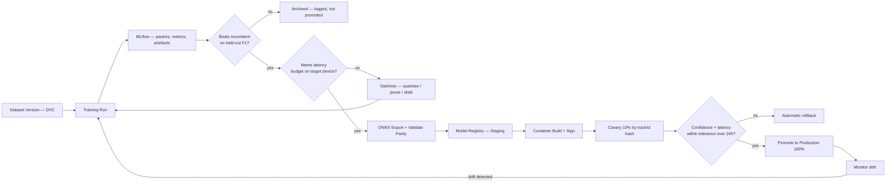

| Concern | Tool | Configuration |
|---|---|---|
| Experiment tracking | MLflow | Every run logs hyperparameters, metrics, confusion matrix, dataset version, git SHA, environment |
| Dataset versioning | DVC + MinIO | Dataset splits are content-hashed; the test split is committed once and never regenerated (proposal §10) |
| Model registry | MLflow Registry | Staging → Production → Archived, with promotion gates |
| Artefact store | MinIO | Content-addressed by SHA-256 |
| Serving format | ONNX Runtime | PyTorch → ONNX, with numerical parity validated to 1e-4 before promotion |
| Drift detection | Custom + Evidently | Input distribution (PSI) and confidence-distribution shift, evaluated hourly |
| Reproducibility | Seeded splits + pinned deps + container digests | Any published number regenerable from `model_sha` alone |

**Canary deployment for AI models:**

```yaml
ai:
  services:
    rf-classifier:
      mode: grpc
      canary:
        enabled: true
        primary:   { version: "1.2.0", weight: 90 }
        candidate: { version: "1.3.0", weight: 10 }
        routing: hash(track_id)           # deterministic — a track never flips mid-flight
        comparison:
          log_both: true                  # both results recorded; only primary reaches the operator
          auto_promote_after: 24h
          auto_rollback_if:
            error_rate_delta_gt: 0.02
            p95_latency_delta_ms_gt: 50
            mean_confidence_delta_lt: -0.05
```

Routing by `hash(track_id)` matters: a single track must never be scored by two model versions during its lifetime, or the threat score becomes non-reproducible and the audit trail incoherent.

## 8.6 Infrastructure as Code & Observability

| Layer | Tool | Scope |
|---|---|---|
| Container orchestration | Docker Compose (dev), Kustomize (K8s future) | All services |
| Kafka topics | Declarative YAML → `create-topics.sh` | §5.2 catalogue; topic auto-creation disabled |
| Database schema | Flyway, per service | Versioned migrations, forward-only |
| Elasticsearch | Index templates + ILM policies as JSON | Retention per §7.9 |
| Dashboards | Grafana JSON, version-controlled | Provisioned at startup, not hand-built |
| Alert rules | Prometheus rules as YAML | Version-controlled |
| Secrets | Vault policies as HCL | Version-controlled; values never are |

Observability stack: **Prometheus** (metrics, via Micrometer/`prometheus-client`), **Grafana** (dashboards), **Loki** (structured JSON logs, correlation-ID indexed), **Tempo + OpenTelemetry** (distributed tracing, propagated end-to-end from sensor adapter to browser).

Four dashboards ship with the system: *Pipeline Health* (throughput, lag, latency per stage), *AI Service Performance* (inference latency, confidence distribution, error rate, mock-vs-real ratio), *Security* (auth failures, rate limits, denied requests, audit chain status), *Operator Experience* (WS connections, client-side render latency, alert acknowledge time).
