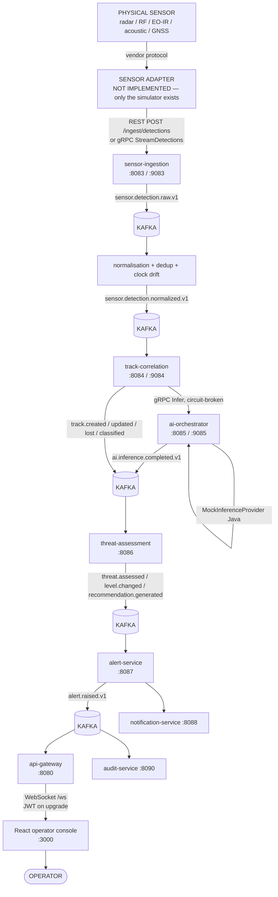
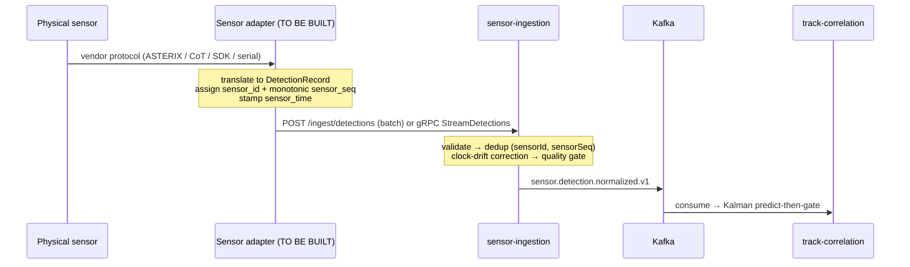
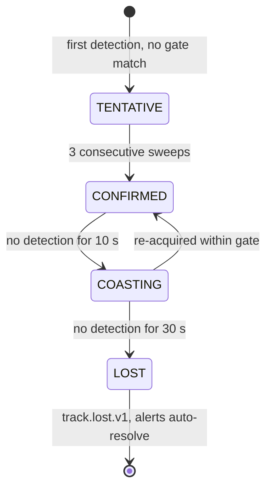
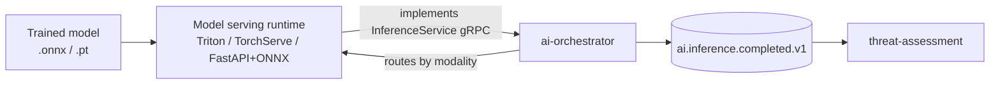
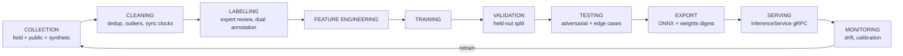
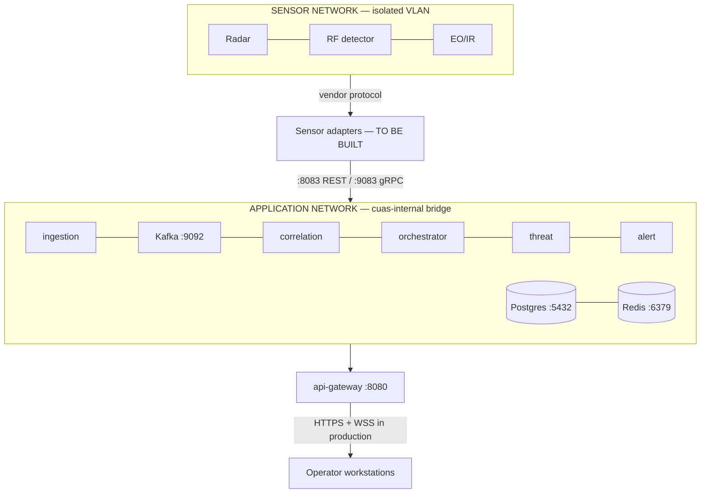

# Technical Audit Report — AI-Enabled Secure C2 Platform for Counter-UAS Operations

**Audit date:** 14 August 2026
**Repository state audited:** `563fb57` (`main`)
**Method:** direct inspection of source, contracts, configuration, database schemas, Kafka topic
catalogue, test artefacts and live runtime evidence from the running stack. Where a claim rests on a
measurement, the measurement is cited. Where a number is an engineering estimate, it says so.

---

## PART 1 — EXECUTIVE SUMMARY

### What the platform is

A command-and-control layer that sits between counter-UAS **detection** hardware and a human
operator. It ingests heterogeneous sensor detections (RF, radar, EO/IR, acoustic, GNSS), normalises
them into one canonical record, correlates them into tracks, invokes AI inference per sensor
modality, scores each track for threat, raises alerts, and presents an operator with a decision — in
real time, over a WebSocket, in a browser.

### The problem it solves

Counter-UAS sites accumulate sensors from different vendors with incompatible protocols and no shared
picture. Each produces its own alarms, so operators face several partial views and a high false-alarm
rate. This platform converts *n* vendor feeds into one correlated, scored, auditable airspace picture,
and makes the fusion claim testable: multi-sensor evidence should reduce false positives relative to
any single modality.

### The scope limit, which is architectural rather than aspirational

The platform is **advisory only**. RF jamming, GNSS spoofing and cyber takeover are outside the
software boundary. Every recommendation terminates at an operator authorisation gate.

This is enforced by the build, not by documentation: `Recommendation` (`contracts/proto/threat.proto`)
holds exactly five values — `MONITOR`, `TRACK_AND_MONITOR`, `REQUEST_VISUAL_ID`,
`ESCALATE_TO_SUPERVISOR`, `RECOMMEND_OPERATOR_REVIEW` — and `EngagementAction`
(`contracts/proto/alert.proto`) holds exactly `ENGAGEMENT_ACTION_NONE` plus `UNSPECIFIED`. A test
fails the build if a value is added.

### What it currently does, verified

The full chain runs end to end on one host with real containers:

- 13 backend services + 10 PostgreSQL databases + Kafka (48 topics) + Redis + MinIO
- 3 simulated sensors reporting continuously, ~46 tracks/min, ~48 alerts/min *(measured 14 Aug)*
- An authenticated React operator console receiving live tracks and alerts over the gateway's own
  WebSocket, with **no mocked transport**

### Implementation status

| Milestone | Status |
|---|---|
| M0–M10 (contracts → services → operator console) | Complete |
| M11 (runtime integration, assembled platform run) | Complete |
| M12.A (CI/CD, coverage, healthchecks, backup/restore) | Complete |
| M12 remaining (mTLS, secrets, load, DR, deploy) | **Not started** |

### What is still missing before real-world deployment

1. **No transport security between services** — every inter-service gRPC hop is plaintext
2. **No secrets backend** — credentials come from `.env`
3. **No load or stress evidence** — the §1.x track ceilings are unmeasured
4. **No real sensor adapter** — only the development simulator exists
5. **No trained model integrated** — inference is served by a Java mock provider
6. **Nothing deploys** — CI builds, scans and signs images; no deployment stage exists

### Architecture maturity statement

> ## **LOCAL DEMONSTRATION READY**
>
> Not pilot ready. Not production ready.
>
> The platform is a **verified, reproducible local system**: the architecture is real, the pipeline
> is real, the tests are real, and the end-to-end journey has been driven by a browser against
> running containers. What separates it from a pilot is a real sensor adapter and transport security;
> what separates it from production additionally is a secrets backend, load evidence, and a
> deployment path.

A pilot becomes credible after Phase 2 and Phase 5 of Part 18. Production requires all eight phases.

---

## PART 2 — COMPLETE SYSTEM ARCHITECTURE

### End-to-end flow



### The one synchronous hop

Every pipeline link is asynchronous over Kafka **except** `track-correlation → ai-orchestrator`,
which is a synchronous gRPC `Infer` call, deadlined at `PT0.5S` and circuit-broken
(`backend/track-correlation/src/main/resources/application.yml`). This is deliberate: classification
must influence the track before it is scored. Adding a second synchronous link would put an AI
service on the pipeline's critical path.

### Service responsibility matrix

| Service | Port (HTTP/gRPC) | Purpose | Consumes | Produces | Database | Status |
|---|---|---|---|---|---|---|
| **api-gateway** | 8080 | Single ingress: authN, rate limit, routing, WebSocket fan-out | `track.*`, `alert.raised`, `sensor.health` | `platform.gateway.access/ratelimit` | — (Redis) | ✅ Verified |
| **auth-service** | 8081 | Issues/rotates JWTs, MFA, refresh cookie | — | `platform.audit` | `authdb` | ✅ Verified |
| **user-service** | 8082/9082 | Identity, roles, §7.4 permission resolution (gRPC) | — | `platform.user.deactivated` | `userdb` | ✅ Verified |
| **sensor-ingestion** | 8083/9083 | Detection intake, normalisation, dedup, clock drift, sensor health | `sensor.detection.raw` | `sensor.detection.normalized`, `sensor.health`, `sensor.ingestion.error` | `sensordb` | ✅ Verified |
| **track-correlation** | 8084/9084 | Kalman predict-then-gate association, track lifecycle | `sensor.detection.normalized`, `ai.inference.completed` | `track.created/updated/lost/merged/classified` | `trackdb` | ✅ Verified |
| **ai-orchestrator** | 8085/9085 | Modality routing, timeout/breaker/bulkhead, cache, canary | — | `ai.inference.requested/completed/failed`, `ai.service.degraded` | — (Redis) | ✅ Boundary verified; **mock provider only** |
| **threat-assessment** | 8086 | 5-factor weighted scoring, level transitions, recommendations | `track.*`, `ai.inference.completed` | `threat.assessed/level.changed/recommendation.generated` | `threatdb` | ✅ Verified (one open defect) |
| **alert-service** | 8087 | Alert raise/dedup/escalate/resolve, incidents, decision chain | `threat.level.changed`, `track.lost`, `sensor.health` | `alert.*`, `incident.*` | `alertdb` | ✅ Verified |
| **notification-service** | 8088 | Channel fan-out, retry, delivery receipts | `alert.*`, `incident.*` | `notification.sent/failed` | `notifydb` | ⚠️ Implemented, not exercised live |
| **reporting-service** | 8089 | Templated async reports (PDF/JSON/CSV) | domain events → projection | `report.*` | `reportdb` | ⚠️ Implemented, not exercised live |
| **audit-service** | 8090 | Tamper-evident hash chain, verification | `platform.audit` | — | `auditdb` | ✅ Verified (chain intact, 109 records) |
| **config-service** | 8091/9091 | Namespaced runtime config, versioned, `WatchConfig` stream | — | `platform.config.*` | `configdb` | ⚠️ Routed; no namespace seeded |
| **sensor-simulator** | — | Development sensor adapter | — | drives the real intake | — | ✅ Verified (dev only) |

### Failure behaviour, per service

| Service | On failure |
|---|---|
| ai-orchestrator unreachable | track-correlation's breaker opens; tracks stay **unclassified**; scoring loses the 0.40 model-confidence factor. Pipeline continues (§6.5) |
| Kafka unavailable | Intake returns **503 `ingestion-unavailable`**; nothing is silently dropped |
| audit unavailable | Security-relevant mutations **fail closed** (§7.5) |
| Redis unavailable | Gateway fails closed (rate limits + revocation); inference cache degrades to a miss |
| Gateway restart | Live view empties; consumer resumes from `latest`; repopulates from new events (§3.5 D-1) |
| Poison message | Quarantined to the topic's `.dlq` without blocking the stream (§5.6) |

---

## PART 3 — SENSOR INTEGRATION

**This is the most consequential gap between the current system and a real deployment.**

### What exists today

`sensor-simulator` is the **only** adapter, and `backend/sensor-simulator/src/main/resources/application.yml`
describes it as "a development sensor adapter". **No real sensor has ever been connected.**

### Ingestion surfaces the platform actually supports

Verified from `backend/sensor-ingestion/src/main/java/pk/nust/cuas/ingestion/api/`:

| Transport | Endpoint | Status |
|---|---|---|
| **REST** | `POST /ingest/detections` (batch JSON) | ✅ Implemented, verified |
| **REST (replay)** | `POST /ingest/replay` (`application/x-ndjson`) | ✅ Implemented; **dev-only**, off by default (`INGESTION_REPLAY_ENABLED`) |
| **gRPC** | `DetectionIngestService.StreamDetections` (client-streaming) | ✅ Implemented, verified |
| **Kafka-native** | producer writes `sensor.detection.raw.v1` directly | ⚙️ Architecturally possible — the topic exists and normalisation consumes it — but **no adapter, auth or validation path exists**. Would bypass intake dedup and quality gating. **Not recommended.** |
| **MQTT** | — | ❌ **Not supported.** No broker, no client, no code |
| **TCP/UDP** | — | ❌ **Not supported.** No listener exists |
| **Vendor protocols** (ASTERIX, CoT, proprietary) | — | ❌ **Not supported.** Would require a new adapter |

### The integration architecture for a real sensor



### A–M walkthrough, using radar as the worked example

| Step | What happens | What must be built |
|---|---|---|
| **A. Physical sensor** | Vendor radar emits plots/tracks | — (procurement) |
| **B. Network connection** | Ethernet to the edge server | Sensor VLAN, static addressing |
| **C. Sensor protocol** | Typically **ASTERIX CAT-240/CAT-48**, or a vendor SDK | Protocol decoder |
| **D. Sensor adapter** | Translate vendor frames → `DetectionRecord` | **New service.** Must assign `sensor_id` and a **monotonic `sensor_seq`** |
| **E. Normalisation** | Dedup, clock drift, quality | ✅ Exists in sensor-ingestion |
| **F. Authentication** | Adapter → intake | ⚠️ **Gap.** `/ingest/**` is a documented gateway exception (§4.1.1). Needs mTLS or a service credential before any untrusted network |
| **G. Message format** | `DetectionRecord` protobuf | ✅ Contract exists (Part 4) |
| **H. Kafka publication** | `sensor.detection.raw` → `normalized` | ✅ Exists |
| **I. Track correlation** | Kalman predict-then-gate | ✅ Exists |
| **J. AI inference** | Routed by `modality` = `MODALITY_RADAR` | ✅ Routing exists; **model does not** |
| **K. Threat assessment** | 5-factor weighted score | ✅ Exists |
| **L. Alert generation** | Raise at ≥ MEDIUM | ✅ Exists |
| **M. Operator display** | Live over WebSocket | ✅ Exists |

**Steps E through M are built. Steps A through D are not, and F is a security gap.**

### Modalities the contract admits

`SensorModality` (`contracts/proto/detection.proto`) is a closed enum: `RF`, `RADAR`, `EO_IR`,
`ACOUSTIC`, `GNSS`, `EXTERNAL`. Typed measurement payloads exist for each (`RfMeasurement`,
`RadarMeasurement`, `OpticalMeasurement`, `AcousticMeasurement`, `GnssMeasurement`).

**ADS-B is not a modality.** It would map to `MODALITY_EXTERNAL` with metadata, or require a contract
amendment. Do not claim ADS-B support.

### Effort estimate per adapter *(engineering estimate, not measured)*

| Adapter | Complexity | Estimate |
|---|---|---|
| RF detector (vendor REST/SDK) | Low–medium | 1–2 weeks |
| Radar (ASTERIX) | Medium–high | 3–5 weeks |
| EO/IR (video + detector) | High — needs a vision model | 6–10 weeks |
| Acoustic | Medium | 2–4 weeks |
| ADS-B receiver (`EXTERNAL`) | Low | 1 week + contract decision |

---

## PART 4 — SENSOR DATA MODEL

Source: `contracts/proto/detection.proto`.

### `DetectionRecord`

| Field | Type | Required | Notes |
|---|---|---|---|
| `detection_id` | string | **Yes** | UUIDv7 — time-sortable |
| `sensor_id` | string | **Yes** | Dedup key part 1 |
| `modality` | `SensorModality` | **Yes** | Drives AI routing |
| `sensor_time` | Timestamp | **Yes** | Sensor clock as reported |
| `ingest_time` | Timestamp | Set by platform | Authoritative ordering |
| `clock_drift_ms` | int64 | Set by platform | Measured correction |
| `sensor_seq` | uint64 | **Yes** | **Per-sensor monotonic — dedup key part 2** |
| `position` | `GeoPosition` | Practically yes | lat, lon, `altitude_m` (AMSL), accuracies, `is_estimated` |
| `kinematics` | `Kinematics` | Optional | range, azimuth, elevation, radial velocity, speed, heading |
| `measurements` | `Measurements` | Optional | `oneof` per modality |
| `quality` | float | Optional | [0,1] sensor-reported confidence |
| `metadata` | map | Optional | Vendor extras |
| `schema_version` | string | Recommended | e.g. `"1.0.0"` |
| `correlation_id` | string | Recommended | End-to-end trace |

> **The single most important integration constraint:** `sensor_seq` must be **monotonic per sensor**.
> The intake deduplicates on `(sensor_id, sensor_seq)` with a 10-minute Redis window
> (`ingestion.dedup.ttl: PT10M`) so at-least-once redelivery is safe. An adapter that restarts its
> sequence at 1 will have its entire stream silently discarded at normalisation — detections reported
> as *accepted*, no tracks, and nothing logged above DEBUG. **This exact defect was hit and fixed in
> the simulator during M11.**

### Track identity

`track_id` is assigned by track-correlation, never by the sensor. Detections carry `detection_id`;
tracks carry `track_id`; alerts carry both `alert_id` and the originating `track_id`.

---

## PART 5 — TRACK CORRELATION

Source: `DetectionCorrelationService.java`, `AssociationPolicy.java`, `KalmanFilter.java`,
`TrackTimeoutApplier.java`, `application.yml`.

### The algorithm, stated precisely

**Kalman-predicted, gated, nearest-neighbour, single-hypothesis association.**

1. Candidate tracks in the detection's sector are fetched (lost tracks excluded — a temporal bound)
2. Each candidate is **predicted forward** to the detection's timestamp by its Kalman filter
3. A candidate qualifies if its *predicted* position is within `gate-m: 150` metres
4. Among qualifying candidates, the **nearest wins**
5. No match ⇒ a new track is created
6. The track's filter is updated from the Kalman estimate, not the raw detection

**This is not JPDA, MHT, or a multi-hypothesis tracker.** It is single-hypothesis nearest-neighbour.
It cannot resolve ambiguous crossing targets, and that limitation should be stated plainly.

### Lifecycle

| Parameter | Value | Effect |
|---|---|---|
| `required-consecutive-sweeps` | 3 | Sweeps before TENTATIVE → CONFIRMED |
| `gate-m` | 150 m | Association distance gate |
| `coast-timeout` | `PT10S` | CONFIRMED → COASTING |
| `lost-timeout` | `PT30S` | → LOST, emits `track.lost.v1`, removed from live view |
| `check-interval` | `PT5S` | Timeout sweep cadence |



### Multi-sensor fusion — what actually exists

Detections from **different sensors** associate to the same track when they fall within the same
spatial gate. That is genuine multi-sensor correlation. The **`SENSOR_AGREEMENT`** factor (weight
0.05) in threat scoring rewards agreement across modalities.

**What does not exist:** covariance-weighted fusion, track-to-track fusion, or a fusion model that
combines modality evidence probabilistically. The `radar-rf-fusion` registry entry routes to the
**mock provider** — there is no fusion model behind it.

---

## PART 6 — AI / MACHINE LEARNING INTEGRATION

### What exists today

| Component | Status |
|---|---|
| `InferenceService` gRPC contract | ✅ Complete — `Infer`, `InferBatch`, `InferStream`, `GetModelInfo`, `HealthCheck` |
| ai-orchestrator (routing, breaker, bulkhead, cache, canary) | ✅ Implemented and verified |
| `InferenceProvider` port | ✅ Implemented |
| **Java `MockInferenceProvider`** | ✅ The only working provider |
| Python services under `ai-services/` | 🔴 **Empty scaffolds** — `src/**` contains only `__init__.py` |
| `mock-inference-provider/` | 🔴 `.gitkeep` files only |
| §6.7 conformance suites | 🔴 `@pytest.mark.skip` over unimplemented bodies |
| Trained models (RF, Vision, Acoustic) | 🔴 External Kaggle notebooks, **not integrated** |

**Live evidence:** `GET /api/v1/ai/services` returns 4 registrations, all `"mode":"MOCK"`,
`"healthy":true`, with timeouts 80–400 ms. The console's **AI Services** screen displays this and
states plainly that inference is mock.

### Model agnosticism, enforced

`ModelAgnosticismTest` fails the build if any §6.3 service or framework name appears anywhere in
ai-orchestrator source, comments included. **Routing is by modality — a fact about the sensor — never
by service identity.** Adding a model is a configuration entry, not a code change (§6.1).

### The inference contract

**Request:** `request_id`, `track_id`, `correlation_id`, `requested_at`, `repeated DetectionRecord`,
and `InferenceOptions` (`model_version` for canary pinning, `timeout_ms`, `min_confidence`,
`include_features`, `explain`).

**Response:** `predictions`, `ConfidenceReport`, **`model_id` / `model_version` / `model_sha`**,
`inference_ms`, `queue_wait_ms`, `ComputeDevice`, optional `FeatureAttribution` and `embedding`.

> `model_sha` is the reproducibility anchor: every prediction is traceable to a weights digest.

### Production integration path



**Supported by the current architecture today** — a service is added by registering it under
`ai.services` with `mode: grpc` and an `endpoint`. **No orchestrator code changes.** The service must
implement `InferenceService` and honour the five §6.2 contract rules.

| Runtime | Compatible? | Notes |
|---|---|---|
| Python + gRPC (FastAPI is HTTP; needs a gRPC server) | ✅ | Simplest path; the `ai-services/` scaffolds anticipate it |
| **NVIDIA Triton** | ⚠️ | Speaks its own gRPC API — needs a thin `InferenceService` shim |
| **TorchServe** | ⚠️ | Same — HTTP/gRPC shim required |
| **ONNX Runtime** (embedded in a Python/Java service) | ✅ | Recommended for CPU inference |
| **TensorRT** | ⚠️ | Via Triton; GPU node required |

### Contract rules a model service must honour (§6.2)

1. `model_version` and `model_sha` always populated
2. Confidence calibrated, within [0,1]
3. Never an empty response — absence is `background` with a confidence, not silence
4. Honour the orchestrator-supplied `timeout_ms`
5. **No database credentials and no network egress** — pure functions (§7.1)

### Versioning, canary, rollback

`InferenceOptions.model_version` pins a version; the registry carries `canaryVersion` and
`canaryPercentage`. **Rollback is a configuration change**, not a redeploy.

### Latency budgets (§6.3, enforced per call)

| Service | p95 budget |
|---|---|
| rf-classifier | 100 ms |
| radar-rf-fusion | 200 ms |
| vision-detector | 400 ms |
| threat-scorer | 80 ms |

The orchestrator enforces these; exceeding one opens the breaker. **Note:** the mock provider fits its
latency distribution *to* these budgets deliberately, so p95 ≈ timeout by construction — under a
burst the breaker opens and tracks stay unclassified. That is §6.5 degradation working, not a fault.

### CPU vs GPU

| Model | Recommendation |
|---|---|
| RF classifier | CPU sufficient *(estimate)* |
| Radar/RF fusion | CPU sufficient *(estimate)* |
| **Vision (EO/IR)** | **GPU required** for real-time video *(estimate)* |
| Acoustic | CPU sufficient *(estimate)* |

*No inference benchmark exists in this repository. All four rows are engineering estimates.*

---

## PART 7 — HOW TO TRAIN THE AI MODEL

**Nothing in this section is implemented.** `training/` directories exist as scaffolds; there is no
dataset, no pipeline, no MLOps automation in the repository.

### Data required

| Modality | Data | Labels |
|---|---|---|
| RF | I/Q captures, spectrograms of control links (OcuSync, Lightbridge, WiFi/analogue FPV) | Protocol, make/model, drone vs background |
| Radar | Plot-level RCS, micro-Doppler | Drone vs bird vs clutter — **the hard discrimination** |
| EO/IR | Annotated imagery, day/night/weather | Bounding boxes + class |
| Acoustic | Rotor signatures with distance/SNR variation | Drone vs ambient |
| Trajectory | Correlated track histories | Benign vs approach vs loiter |

### Pipeline



### Critical dataset requirements

- **Negative classes matter most.** Birds, aircraft, weather clutter and RF interference drive the
  false-positive rate the project's headline claim is about
- **Class imbalance is severe** — real intrusions are rare
- **Calibration, not just accuracy** — the platform *weights confidence at 0.40*. An overconfident
  model directly inflates threat scores
- **Environmental diversity** — a model trained on clear-day data will fail at night and in rain

### Current status: this is entirely research work

Three trained models exist as **external Kaggle notebooks**. They are not production services, not
integrated, and CLAUDE.md records that integrating them is an architecture amendment.

---

## PART 8 — DEPLOYMENT OPTIONS

| # | Target | Supported today? | Notes |
|---|---|---|---|
| 1 | **Developer laptop** | ✅ **Verified** | The only proven target. `docker compose`, 20 containers |
| 2 | **Local lab server** | ✅ Should work | Same compose, more headroom |
| 3 | **On-premise data centre** | ⚠️ Needs hardening | Requires mTLS + secrets |
| 4 | **Edge server near sensors** | ⚠️ Architecturally suited | Kafka buffers upstream loss; needs adapters |
| 5 | **Security operations centre** | ⚠️ | Needs HA + DR |
| 6 | **Kubernetes** | 🔴 **Manifests are scaffolds** | `infrastructure/kubernetes/` exists; unverified |
| 7 | **Cloud** | ⚠️ Possible, but consider | Sensor data is latency-sensitive and often classified; air-gapped edge is the better fit |

### Verified deployment (target 1)

```bash
COMPOSE_PARALLEL_LIMIT=2 docker compose --profile infra --profile platform up -d
```

**Host constraint found during audit:** Docker Desktop's Linux engine died **five times** on the
development host (7.4 GB engine) — under concurrent image builds *and* under sustained pipeline load.
`COMPOSE_PARALLEL_LIMIT=2` is mandatory, and Elasticsearch + Kibana (~1.5 GB, on no demo path) should
be stopped.

---

## PART 9 — HARDWARE REQUIREMENTS

> ⚠️ **All figures below except the DEMO column are engineering estimates.** The repository contains
> **no load test, no benchmark, and no soak evidence**. Sizing for a real deployment requires the
> load testing in Phase 6.

| Resource | DEMO *(measured)* | SMALL PILOT *(est.)* | MEDIUM *(est.)* | LARGE *(est.)* |
|---|---|---|---|---|
| Sensors | 3 simulated | 3–8 real | 10–30 | 50+ |
| Concurrent tracks | ~20 | ~100 | ~1,000 | 10,000 (§1.x target) |
| CPU cores | 12 (shared) | 16 | 32–48 | 64+ per node |
| RAM | **7.4 GB — at its limit** | 32 GB | 64–128 GB | 256 GB+ |
| GPU | none | none (CPU models) | 1× T4/A10 | 2+ A10/L40S |
| GPU VRAM | — | — | 16 GB | 24–48 GB |
| SSD | ~50 GB | 500 GB NVMe | 2 TB NVMe | 10 TB+ NVMe |
| Network | localhost | 1 GbE | 10 GbE | 10–25 GbE |
| Kafka | 1 broker, RF=1 | 1 broker, RF=1 | **3 brokers, RF=3** | 5 brokers, RF=3 |
| PostgreSQL | 1 node, `max_connections=200` | 1 + backup | Primary + replica | HA cluster |
| Redis | 1 node | 1 node | Sentinel | Cluster |
| Elasticsearch | 1 node (stoppable) | 1 node | 3 nodes | 5+ nodes |

**Measured facts from the audit:**
- 11 services × HikariCP pool 6 = 66 connections against `max_connections=200` (was default 100,
  which the platform **saturated** — `pg_dump` and superuser `psql` were both refused)
- Demo load ~135 detections/min produced ~46 tracks/min and ~48 alerts/min
- ~430 detections/min made sign-in take 11.5 s on the demo host

---

## PART 10 — NETWORK ARCHITECTURE



### Ports (from `docker-compose.yml`)

| Port | Service | Exposure in production |
|---|---|---|
| 3000 | Operator console | Behind TLS |
| **8080** | **api-gateway — the only operator ingress** | **TLS** |
| 8081–8091 | Services (HTTP) | **Internal only** |
| 9082–9091 | Services (gRPC) | **Internal only — mTLS required** |
| 8083 / 9083 | Sensor intake | **Sensor VLAN only** |
| 5432 / 6379 / 29092 | Postgres / Redis / Kafka | **Internal only** |
| 9200 / 5601 / 9000 | Elasticsearch / Kibana / MinIO | Internal |

> **Audit finding:** the development compose publishes **every** service port to the host. That is
> correct for development and **must not** be carried to production — only 8080 (and the console)
> should be reachable.

### Security posture of the network today

| Control | Status |
|---|---|
| TLS at the edge | 🔴 Not configured (plain HTTP locally) |
| **mTLS between services** | 🔴 **Not provisioned — SR-2** |
| Network segmentation | ⚠️ One bridge network; no sensor/app separation |
| Firewall rules | 🔴 Not defined |
| VPN | 🔴 Not addressed |
| Air-gap | ⚠️ Architecturally supported (self-hosted tiles anticipated); **not tested** |

---

## PART 11 — SECURITY ARCHITECTURE

Source: `docs/SECURITY-REVIEW.md` plus direct inspection.

### Implemented and enforced server-side

| Control | Evidence |
|---|---|
| JWT authentication | RS256, JWKS at `/auth/jwks`, cached; gateway never calls auth per request |
| **RBAC** | Closed §7.4 matrix: 6 roles, 28 permissions. `@PreAuthorize` per endpoint; gateway pre-check may only **refuse**, never grant |
| WebSocket authN | JWT validated on upgrade, incl. revocation; per-channel authorisation; 5 connections/user |
| Rate limiting | `LOGIN_PER_ACCOUNT` 10/h burst 3; `LOGIN_PER_IP` 5/min; audit export 5/h. **Observed working (429)** |
| **Audit hash chain** | Tamper-evident; **verified `intact: true`, 109 records, after a real restore** |
| Fail-closed audit | Security mutations fail if unauditable (§7.5) |
| Password hashing | Argon2id |
| Self-escalation | Blocked server-side (403), surfaced in UI |
| Secret scanning | gitleaks in CI over full history **+ pre-commit hook** |
| SAST / deps / images | CodeQL, OWASP dependency-check, Trivy, cosign signing |
| Bootstrap admin | No default password; refuses to start without one; never overwrites |

### Open gaps — the system is **NOT production secure**

| # | Gap | Severity |
|---|---|---|
| **SR-2** | **mTLS + 24 h rotation not provisioned. Every inter-service gRPC hop is plaintext** | **Medium — blocks production** |
| — | **No secrets backend.** Credentials in `.env` | **Medium — blocks production** |
| SR-3 | Owner-scoping in application code, not Postgres RLS | Low |
| SR-4 | Elasticsearch ILM not active | Low |
| SR-6 | No Track B service exists to conformance-test | Low (by design) |
| SR-8 | Unsupported HTTP verb renders **500**, not 405 | Low |
| — | Sensor intake `/ingest/**` is unauthenticated by design | **Medium once a real sensor network exists** |
| — | Kafka has no SASL/TLS; Postgres/Redis passwords only | Medium |

> The **core** of §7 — authentication, authorisation, audit, rate limiting — is genuinely implemented
> and server-enforced. What is missing is **transport security and secrets management**.

---

## PART 12 — DATABASE ARCHITECTURE

**Database-per-service is absolute.** No service reads another's tables; cross-service data flows by
API or event only.

| Database | Owner | Holds |
|---|---|---|
| `authdb` | auth-service | Credentials, sessions, refresh tokens, MFA |
| `userdb` | user-service | Users, roles, permissions, role_permissions |
| `sensordb` | sensor-ingestion | `sensors`, `sensor_health`, `ingestion_stats` |
| `trackdb` | track-correlation | `tracks` (track_id, sector_id, status, lat/lon, altitude_m, speed_ms, heading_deg), history |
| `threatdb` | threat-assessment | `threat_scores`, policies, versions |
| `alertdb` | alert-service | `alerts`, incidents, notes, evidence, decision chain |
| `notifydb` | notification-service | Preferences, delivery attempts (personal data stays here) |
| `reportdb` | reporting-service | Event projection, report jobs |
| `auditdb` | audit-service | **Hash-chained audit records** |
| `configdb` | config-service | Namespaced config + version history |

Schema managed by **Flyway**; Hibernate validates and never alters. Domain models and JPA entities are
**separate types**, mapped explicitly.

### Redis / Elasticsearch / MinIO

- **Redis** — dedup window (10 min TTL), rate-limit buckets, JWT revocation denylist, inference cache,
  alert escalation set + leader lease. **Load-bearing for alert-service and the gateway**
- **Elasticsearch** — provisioned; the reporting mirror is **deferred**. Safe to stop
- **MinIO** — report artefacts and evidence bundles, sha256-stamped

### Backup / restore — verified

```bash
bash scripts/backup.sh                             # 10 dumps + MinIO
bash scripts/restore.sh backups/<ts> configdb      # per-database restore
```

**Both actually run.** Verified: 10 databases dumped with real content; a single-database restore
(`configdb`) completed with the service healthy afterwards; and the **audit chain verified
`intact: true` over 109 records** after the restore — the one failure nothing else would report.

**DR beyond this does not exist.** Single-node Postgres, single-broker Kafka, no replica, no failover test.

---

## PART 13 — KAFKA ARCHITECTURE

**48 topics** (37 primary + 11 DLQ), declared in `infrastructure/kafka/create-topics.sh`.

### Event-flow table

| Topic | Partitions | Retention | Producer | Consumer |
|---|---|---|---|---|
| `sensor.detection.raw.v1` | 12 | 24 h | sensor-ingestion (intake) | sensor-ingestion (normaliser) |
| `sensor.detection.normalized.v1` | 12 | 7 d | sensor-ingestion | track-correlation |
| `sensor.health.v1` | 3 | 7 d | sensor-ingestion | gateway, alert-service |
| `track.created/updated/lost.v1` | 6 | 30 d / 7 d / 30 d | track-correlation | threat-assessment, gateway |
| `track.classified.v1` | 6 | 30 d | track-correlation | threat-assessment |
| `track.state.snapshot.v1` | 6 | ∞ **compact** | **none — no producer (D-1)** | — |
| `ai.inference.requested/completed/failed.v1` | 6/6/3 | 24 h / 7 d / 30 d | ai-orchestrator | track-correlation, threat-assessment |
| `threat.assessed.v1` | 6 | 30 d | threat-assessment | alert-service |
| `threat.level.changed.v1` | 6 | **90 d** | threat-assessment | alert-service |
| `alert.raised.v1` | 3 | **90 d** | alert-service | gateway, notification, audit |
| `incident.*.v1` | 3 | **∞** | alert-service | audit, reporting |
| `platform.audit.v1` | 3 | **∞** | all services | audit-service |
| `platform.config.*.v1` | 1 | ∞ **compact** | config-service | all services |
| `*.dlq` (11) | 3 | 30 d | error handlers | manual triage |

### Delivery semantics

Per-hop transactional Kafka-to-Kafka plus **idempotent consumers at the edges**. ARCHITECTURE.md
§5.6 is explicit that true end-to-end exactly-once is **not attempted and should not be claimed** —
the honest description is *effectively-once within each transactional boundary*.

### Deduplication

At the intake, on `(sensor_id, sensor_seq)`, Redis-backed, 10-minute window. This is what makes
at-least-once redelivery safe — and what silently discards an adapter with non-monotonic sequences.

### Replay

`track.state.snapshot.v1` is compacted and **has no producer**; the gateway's `SNAPSHOT` is built from
its own in-memory view (decision **D-1**). A gateway restart therefore starts with an empty picture
and repopulates from `latest`.

---

## PART 14 — FRONTEND / OPERATOR CONSOLE

React 19 + TypeScript (strict, no `any`) + Vite + Tailwind 4 + MapLibre. **Separate npm project — not
in the Maven reactor.**

### Connection model

- **REST** — `src/api/client.ts`: auth header, refresh-on-401, correlation id
- **WebSocket** — one `/ws` connection, JWT on the upgrade URL, backoff+jitter reconnect,
  heartbeat timeout, seq-gap → resnapshot, two gaps → degraded
- **Four state domains, four tools** (§3.4): TanStack Query (server), external stores (streaming),
  Zustand (UI), React Hook Form (forms)
- **Streaming data never passes through React state per message** — external store, rAF-coalesced.
  This is the single most important frontend performance rule, and it is respected

### Screen status

| Screen | Status | Data source |
|---|---|---|
| Login / MFA | ✅ Live | auth-service |
| Dashboard | ✅ Live | WebSocket |
| Live Map | ✅ Live tracks | WebSocket, imperative MapLibre at 10 Hz |
| Track Console | ✅ Live | WebSocket + `/tracks` |
| **Sensor Health** | ✅ Live *(added 14 Aug)* | `sensors` WS channel |
| **Threat Timeline** | ✅ Live *(added 14 Aug)* | `/alerts` + live raised feed |
| Alert Center | ✅ Live | WS + `/alerts` |
| Incidents | ✅ Routed | alert-service |
| Reports | ✅ Routed | reporting-service |
| Configuration | ⚠️ Routed; **`threat-policy` returns 404** — no namespace seeded | config-service |
| **AI Services** | ✅ Live *(added 14 Aug)* | `/ai/services` |
| User Management | ✅ Live | user-service |
| Audit | ✅ Live | audit-service |

### Deferred, shown as disabled-with-reason rather than faked

Protected zones, sensor geometry, predicted trajectories, self-hosted map tiles.

### Not built

**Time scrubbing and 1×/2×/8× playback** on the Threat Timeline. No endpoint accepts a `from`/`to`
window or reconstructs the airspace at a past instant. The screen names the missing contract in its
own footer rather than presenting a dead control.

---

## PART 15 — END-TO-END LIVE DATA FLOW

### Concrete verified example

```
sensor-simulator (sim-rf-0, sim-radar-1, sim-eo-ir-2)
  → POST /ingest/detections            [18 detections / 8 s, 0 rejected]
  → sensor.detection.raw.v1
  → normalisation (dedup, clock drift)
  → sensor.detection.normalized.v1
  → track-correlation: Kalman predict-then-gate
  → track.created.v1 / track.updated.v1        [~46 created/min]
  → gRPC Infer → ai-orchestrator → MockInferenceProvider
  → ai.inference.completed.v1
  → threat-assessment: 5-factor weighted score
  → threat.level.changed.v1
  → alert-service: raise at ≥ MEDIUM
  → alert.raised.v1                             [~48 raised/min]
  → api-gateway fan-out
  → WebSocket → browser
```

### Envelopes captured in the browser (M11 acceptance)

```
CONNECTED {"sessionId":"1626cd9a-a814-da16-4cd5-fe78c033f79e"}
SNAPSHOT  tracks  seq 1  {"tracks":[]}          ← gateway starts EMPTY
DELTA     tracks  seq 2  trackId 019ff95a-76d4-7c3a-a03e-d720a6b4bbe8
DELTA     tracks  seq 3 … 14
ALERT     reference ALT-4243, THREAT_LEVEL_MEDIUM,
          trackId matching the track at DELTA seq 3
```

**Why the empty first `SNAPSHOT` matters:** the gateway is restarted before the run, so its in-memory
view is empty and its consumer sits at `latest`. Every track the browser then received demonstrably
arrived from *that run's* replay — nothing can be explained by leftover data.

### Alert ↔ track correspondence, verified in the databases

| Evidence | Value |
|---|---|
| Alert (alertdb) | `ALT-5945` · MEDIUM · trackId `019ffcaa-d80d-7b87-a023-0366e7ed4790` |
| Track (trackdb) | same id · **status CONFIRMED** · 86.5 m/s · 106 m |

### Proven vs inferred

| Proven | Inferred / not proven |
|---|---|
| Full chain simulator → browser | Behaviour with a **real** sensor |
| Alert trackIds are real tracks | Behaviour above ~135 detections/min |
| WebSocket carries real backend envelopes | Accuracy of any classification (mock provider) |
| Sensors stay ONLINE continuously | Multi-node / HA behaviour |
| 556 simulator cycles (~74 min) with 0 warnings | Long-duration soak beyond ~74 min |

---

## PART 16 — CURRENT TESTING AND VERIFICATION

| Layer | Count | What it proves |
|---|---|---|
| **Backend** | **947 tests, 0 failures**, 17 modules | Domain logic, layering, API contracts, integration via Testcontainers |
| **Frontend** | **78 tests / 28 files** | Components, stores, permission gating, boundary guards |
| **Coverage gate** | Floor **0.40**, enforced in CI | Measured: 40.7% (alert-service) → 90.2% (api-gateway), median ~76%; `contracts` excluded as generated |
| **Playwright (mocked edge)** | 1 spec | SPA end-to-end without a backend |
| **Playwright (live)** | 2 specs | **Real backend, no `page.route`, no `routeWebSocket`** |
| **Infra acceptance** | `verify-infra.sh` | 10 DBs, 48 topics, Redis, MinIO, ES |
| **Platform acceptance** | `verify-platform.sh` | Black-box through the gateway only |
| **Live journey** | `verify-journey.sh` | Browser → gateway → services → Kafka → browser |
| **Healthchecks** | 16 healthy | Spring readiness groups, greps for `UP` |
| **Backup/restore** | Executed | 10 dumps + per-DB restore + audit chain intact |
| **Security gates** | gitleaks, pre-commit, OWASP, CodeQL, Trivy, cosign | Secrets, CVEs, SAST, image CVEs, signing |

### What these tests do **not** prove

- ❌ Behaviour under production load — **no load test exists**
- ❌ Behaviour with real sensor data
- ❌ Any AI accuracy claim — the provider is a mock
- ❌ Multi-node, HA or failover behaviour
- ❌ Security under attack — no penetration test
- ❌ Long-duration stability beyond ~74 minutes

---

## PART 17 — KNOWN DEFECTS AND LIMITATIONS

| # | Finding | Severity | Current state | Impact | Work required | Priority |
|---|---|---|---|---|---|---|
| 1 | **No mTLS between services (SR-2)** | **High** | Not provisioned | All inter-service gRPC plaintext | cert-manager/SPIFFE in K8s overlay | **P0 for production** |
| 2 | **No secrets backend** | **High** | `.env` | Credentials on disk | Vault or cloud secrets manager | **P0 for production** |
| 3 | **No real sensor adapter** | **High** | Simulator only | Cannot ingest real data | Per-vendor adapter (Part 3) | **P0 for pilot** |
| 4 | **No trained model integrated** | **High** | Mock provider | No real classification | Model + serving runtime (Part 6) | **P0 for pilot** |
| 5 | **No load/stress evidence** | **High** | Not attempted | Sizing is guesswork | k6/Gatling harness + soak | **P1** |
| 6 | `threat-assessment` duplicate-key race | Medium | **Open** | `threat_scores_pkey` violation on concurrent `track.updated`; self-heals via consumer retry | Change insert to upsert | **P1** |
| 7 | Sensor intake unauthenticated | Medium | By design (§4.1.1 exception) | Anyone on the sensor VLAN can inject | mTLS or service credential | **P1 for pilot** |
| 8 | Kafka without SASL/TLS | Medium | Plaintext | Broker traffic readable | Enable SASL_SSL | P1 |
| 9 | Docker engine instability | Medium | Host constraint | Died 5× under build/load | More RAM; avoid concurrent builds | P1 (host) |
| 10 | Single-hypothesis correlation | Medium | By design | Cannot resolve crossing targets | JPDA/MHT if required | P2 |
| 11 | SR-8: unsupported verb → 500 not 405 | Low | Open | Misleading status | Map exception in `BaseExceptionHandler` | P2 |
| 12 | SR-3 Postgres RLS | Low | App-level only | Defence-in-depth gap | RLS policies | P2 |
| 13 | SR-4 Elasticsearch ILM | Low | Inactive | Unbounded index growth | Wire ILM | P2 |
| 14 | K8s manifests are scaffolds | Medium | Unverified | No orchestrated deploy | Author + test manifests | P1 for production |
| 15 | Timeline scrub/playback absent | Low | No contract | Reduced after-action capability | Time-window query API | P2 |
| 16 | `config/threat-policy` 404 | Low | No namespace seeded | Empty Configuration screen | Seed a policy namespace | P2 |
| 17 | `sensor-simulator` image stale | Low | Host-JAR path used | Container runs pre-fix code | Rebuild when engine is stable | P2 |
| 18 | No deployment stage in CI | Medium | Builds/scans/signs only | Manual deployment | Deploy + rollback jobs | P1 for production |

---

## PART 18 — PATH FROM CURRENT SYSTEM TO REAL DEPLOYMENT

### PHASE 1 — Local demonstration ✅ **COMPLETE**
Objective: prove the assembled architecture. **Acceptance met:** browser-driven intrusion → alert
against real containers.

### PHASE 2 — Real sensor adapter
- **Objective:** ingest one real sensor end to end
- **Tasks:** choose sensor; implement protocol decoder; map to `DetectionRecord`; **guarantee
  monotonic `sensor_seq`**; handle reconnection; field-test clock drift
- **Dependencies:** physical sensor, vendor documentation, site access
- **Hardware:** edge server (16 GB), sensor VLAN
- **Acceptance:** real detections produce real tracks in the console for ≥ 24 h without gaps

### PHASE 3 — Real AI model
- **Objective:** replace the mock provider for at least one modality
- **Tasks:** dataset collection and labelling (Part 7); train; export ONNX; implement
  `InferenceService`; **implement the §6.7 conformance suite**; register with `mode: grpc`; canary
- **Dependencies:** Phase 2 (real data), GPU for training
- **Acceptance:** conformance suite passes; p95 within budget; **calibration measured, not assumed**

### PHASE 4 — Edge deployment
- **Objective:** run at a sensor site
- **Tasks:** author and test K8s manifests; sizing; offline map tiles; store-and-forward for WAN loss
- **Acceptance:** survives a 1-hour network partition without data loss

### PHASE 5 — Security hardening
- **Objective:** close SR-2 and secrets
- **Tasks:** cert-manager/SPIFFE, 24 h rotation; secrets backend; Kafka SASL/TLS; TLS at edge;
  authenticate `/ingest/**`; network segmentation; Postgres RLS; **penetration test**
- **Acceptance:** no plaintext inter-service traffic; no secret on disk; pen-test findings closed

### PHASE 6 — Load testing
- **Objective:** replace estimates with measurements
- **Tasks:** load harness; ramp to §1.x ceilings; **10k-track soak**; profile against §3.7 budgets;
  tune breakers; exercise observability under load
- **Acceptance:** sustained target track count with p95 within budget; documented sizing

### PHASE 7 — Pilot
- **Objective:** one real site, supervised
- **Tasks:** multi-sensor install; operator training; runbooks; on-call; **false-positive baseline**
- **Acceptance:** 30 days with measured FP rate and operator acceptance

### PHASE 8 — Production
- **Objective:** operational service
- **Tasks:** HA (3 Kafka brokers, Postgres replica, Redis Sentinel); DR with tested failover; deploy +
  rollback automation; 24/7 monitoring; incident process
- **Acceptance:** DR exercise passed; SLOs defined and met

---

## PART 19 — FINAL RESOURCE REQUIREMENTS

| Category | DEMO *(today)* | PILOT | PRODUCTION |
|---|---|---|---|
| **Hardware** | 1 laptop, 8 GB+ (7.4 GB is marginal) | 1 edge server 32 GB + 1 ops workstation | 3+ nodes 64–256 GB, HA |
| **Software** | Docker Desktop, JDK 21, Node 22, buf | + Kubernetes, cert-manager, secrets backend | + monitoring, log aggregation, backup automation |
| **Network** | localhost | Sensor VLAN + 1 GbE + TLS | Segmented, 10 GbE, firewalled, VPN/air-gap |
| **Sensors** | 3 simulated | 1–8 real + adapters | 10–50 + redundancy |
| **AI/GPU** | none (mock) | CPU inference; GPU for training | GPU node for vision |
| **Storage** | ~50 GB | 500 GB NVMe + offsite backup | 2–10 TB NVMe + DR site |
| **People** | 1 developer | 2 engineers + 1 domain expert + operator | Team + 24/7 on-call |
| **Security** | Dev-only | mTLS, secrets, pen test | + continuous scanning, IR plan, compliance |
| **Monitoring** | IaC exists, not exercised | Dashboards + alert rules tuned | SLOs, paging, capacity planning |
| **Backup** | ✅ Verified scripts | + automated schedule + offsite | + DR site + tested failover |
| **Operations** | `DEMO-RUNBOOK.md` | + on-call rota | + change management, post-incident review |

---

## PART 20 — SUPERVISOR-FRIENDLY CONCLUSION

**What have we built?**
A complete, working command-and-control platform for counter-UAS operations: 13 backend
microservices, an event-driven Kafka pipeline, an AI inference boundary, and a professional operator
console. It runs today on one machine and has been demonstrated end to end.

**How does it work?**
Sensors send detections to an ingestion service. Detections are normalised, deduplicated and
published to Kafka. A correlation service uses a Kalman filter to associate detections into tracks.
Each track is classified by an AI service chosen by *sensor modality*. A threat service scores the
track on five weighted factors. Crossing a threshold raises an alert. Everything reaches the operator
live over a WebSocket.

**How would a real sensor connect?**
Through a **sensor adapter** — the one component we have not built. It translates the vendor's
protocol into our `DetectionRecord` format and posts it over REST or gRPC. Everything downstream
already works. The critical constraint: the adapter must supply a **monotonically increasing sequence
number per sensor**, or the intake will correctly treat its data as duplicates and silently discard it.

**How would a real AI model connect?**
By implementing our `InferenceService` gRPC contract and registering it in configuration with
`mode: grpc`. **No orchestrator code changes** — the routing is by modality and a test forbids naming
any model in the orchestrator. Today a mock provider serves that interface, which is why the console
labels every classification as mock.

**Where can it be deployed?**
Today: a developer laptop or lab server, via Docker Compose — verified. Intended: an edge server at a
sensor site, or an on-premise operations centre. Kubernetes manifests exist but are scaffolds.

**What hardware is required?**
Demo: one machine, 8 GB+ (our 7.4 GB engine was at its limit and crashed repeatedly). Pilot: a 32 GB
edge server. Production: multiple 64–256 GB nodes with a GPU for vision. **Beyond the demo these are
engineering estimates — we have not load-tested.**

**What remains before real-world deployment?**
Five things: a **real sensor adapter**, a **real trained model**, **mTLS**, a **secrets backend**, and
**load testing**.

**What has actually been proven?**
That the architecture works end to end with real infrastructure: 947 backend tests and 78 frontend
tests passing; 16 containers healthy; a browser signing in against the real auth service and
receiving real tracks and a real alert over a real WebSocket, with the alert's track id confirmed in
the database; backup and restore executed with the audit hash chain verified intact afterwards.

**What has not been proven is equally important:** no real sensor, no real model, no load evidence, no
security testing. The platform is **locally verified, not production ready**, and should be presented
that way.

---

## APPENDIX A — SOURCE DOCUMENTS INSPECTED

`docs/ARCHITECTURE.md` (§2, §3, §4.1, §5, §6, §7, §8) · `docs/ROADMAP.md` · `docs/DEVELOPMENT.md` ·
`docs/SECURITY-REVIEW.md` · `docs/HANDOFF.md` · `docs/OPERATIONS.md` · `docs/DEMO-RUNBOOK.md` ·
`CLAUDE.md` · `README.md`

## APPENDIX B — REPOSITORY COMPONENTS INSPECTED

- **Contracts:** `detection.proto`, `inference.proto`, `threat.proto`, `alert.proto`, `ingestion.proto`
  (+ 7 more)
- **Services:** ingestion API (REST + gRPC), `DetectionCorrelationService`, `AssociationPolicy`,
  `KalmanFilter`, `ThreatPolicy`, `LevelThresholds`, `AlertController`, `TrackController`,
  `ThreatController`, `AuditController`, ai-orchestrator registry + `application-dev.yml`
- **Infrastructure:** `docker-compose.yml`, `infrastructure/kafka/create-topics.sh`,
  `infrastructure/postgres/init-databases.sh`
- **Frontend:** `App.tsx`, `navigation.ts`, `config.ts`, `protocol.ts`, `SensorStore.ts`, feature dirs
- **Scripts:** `verify-infra.sh`, `verify-platform.sh`, `verify-journey.sh`, `backup.sh`, `restore.sh`
- **CI:** four `.github/workflows/*.yml`, `.pre-commit-config.yaml`
- **Test artefacts:** surefire XML (947 tests), Vitest output (78 tests), JaCoCo reports

## APPENDIX C — VERIFIED CLAIMS

1. 947 backend tests, 0 failures, 17 modules — surefire XML
2. 78 frontend tests / 28 files; typecheck, lint (0 errors), build clean
3. 16 containers healthy — `docker compose ps`
4. Live browser journey passes with no mocks — `verify-journey.sh`
5. Empty initial `SNAPSHOT` then real `DELTA` tracks — captured envelopes
6. Alert `ALT-5945` → track `019ffcaa-…` **CONFIRMED** in `trackdb`
7. 3 sensors ONLINE sustained across six 30-second samples
8. ~46 tracks/min, ~48 alerts/min sustained across three samples
9. Simulator: 556 cycles (~74 min), 0 warnings
10. Backup: 10 databases + MinIO; restore of `configdb`; **audit chain `intact: true`, 109 records**
11. Coverage floor 0.40 enforced; range 40.7%–90.2%
12. Rate limiting returns 429 with `Retry-After`
13. Cold-start login: 500 in 22.6 s, then 200 in 1.15 s
14. AI registry returns 4 services, all `mode: MOCK`
15. 48 Kafka topics created

## APPENDIX D — UNVERIFIED CLAIMS

1. Behaviour with any real sensor
2. Any AI accuracy or false-positive-reduction claim — **the project's headline claim is unmeasured**
3. Behaviour above ~135 detections/min
4. §1.x track ceilings (target 10,000)
5. Kubernetes deployment
6. Multi-node, HA, failover
7. Security under attack
8. Stability beyond ~74 minutes
9. Air-gapped operation
10. notification-service and reporting-service under real use

## APPENDIX E — ASSUMPTIONS / ENGINEERING ESTIMATES

All Part 9 sizing except the DEMO column · all Part 3 adapter effort estimates · all Part 6 CPU/GPU
recommendations · Part 8 deployment suitability · Part 19 pilot and production resources.

**None is backed by a benchmark in this repository.**

## APPENDIX F — DEFERRED WORK

mTLS + rotation (SR-2) · secrets backend · load/stress + 10k soak · observability under load ·
Postgres RLS (SR-3) · Elasticsearch ILM (SR-4) · failover/DR · deploy + rollback in CI · Track B
services and §6.7 conformance bodies (SR-6) · protected zones, sensor geometry, predicted
trajectories, self-hosted tiles · Threat Timeline scrub/playback (no contract) · `threat_scores`
upsert fix · SR-8 405 mapping

---

*Prepared by direct inspection of the repository at `563fb57`. Every measured value is cited; every
estimate is labelled. Where the repository does not support a claim, this report says so.*
